# Unidade 1 — Sistemas de Controle I

## 1. Introdução aos sistemas de controle

Principais partes do sistema de controle:

1. Planta: qualquer objeto físico a ser controlado.
2. Controle: o cérebro do sistema.
3. Atuador: executa a ação física da planta.
4. Sensor: mede a saída do sistema e envia a informação de volta.
5. Distúrbio: um sinal que afeta de modo adverso.

**Sistemas de malha aberta:** a saída não tem nenhum efeito sobre a ação de controle.

  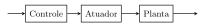

**Sistemas de malha fechada:** um sinal é realimentado da saída para a entrada e usado para modificar a entrada, de tal maneira que a saída seja mantida constante.

Erro = Entrada − Saída.

  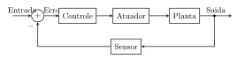

## 2. Modelagem no domínio da frequência

### Transformada de Laplace

$$
\boxed{\mathcal L\{f(t)\}=F(s)=\int_0^\infty f(t)e^{-st}\,dt}
$$

| $f(t)$ | $F(s)$ |
|---|---|
| $\delta(t)$ | $1$ |
| $u(t)$ | $1/s$ |
| $tu(t)$ | $1/s^2$ |
| $t^nu(t)$ | $n!/s^{n+1}$ |
| $e^{-at}u(t)$ | $1/(s+a)$ |
| $\sin(\omega t)u(t)$ | $\omega/(s^2+\omega^2)$ |
| $\cos(\omega t)u(t)$ | $s/(s^2+\omega^2)$ |

**Teoremas:**

| Teorema | Nome |
|---|---|
| $\mathcal L\{f(t)\}=\int_0^\infty f(t)e^{-st}dt$ | Definição |
| $\mathcal L\{Kf(t)\}=KF(s)$ | Linearidade |
| $\mathcal L\{f_1(t)+f_2(t)\}=F_1(s)+F_2(s)$ | Linearidade |
| $\mathcal L\{e^{-at}f(t)\}=F(s+a)$ | Deslocamento em frequência |
| $\mathcal L\{f(t-T)\}=e^{-sT}F(s)$ | Deslocamento no tempo |
| $\mathcal L\{f(at)\}=\frac1a F(s/a)$ | Escala |
| $\mathcal L\{df/dt\}=sF(s)-f(0^-)$ | Derivação |
| $\mathcal L\{d^2f/dt^2\}=s^2F(s)-sf(0^-)-f'(0^-)$ | Derivação |
| $\mathcal L\{d^nf/dt^n\}=s^nF(s)-\sum_{k=1}^n s^{n-k}f^{(k-1)}(0^-)$ | Derivação |
| $\mathcal L\{\int_0^t f(\tau)d\tau\}=F(s)/s$ | Integração |
| $f(\infty)=\lim_{s\to0}sF(s)$ | Valor final |
| $f(0^+)=\lim_{s\to\infty}sF(s)$ | Valor inicial |

### Transformada de Laplace inversa

$$
\mathcal L^{-1}\{F(s)\}=f(t)=\frac{1}{2\pi j}\int_{\sigma-j\infty}^{\sigma+j\infty}F(s)e^{st}ds
$$

### Transformada de Laplace inversa por frações parciais

Seja:

$$
F(s)=\frac{s^3+2s^2+6s+7}{s^2+s+5}=\frac{N(s)}{D(s)}
$$

- Se a ordem de $N(s)$ é menor que a de $D(s)$, a operação pode ser realizada.
- Se a ordem de $N(s)$ é maior que a de $D(s)$, realiza-se uma divisão sucessiva (polinômios) até a ordem ficar inferior.

Pela divisão: quociente + resto/divisor.

$$
\begin{aligned}
s^3+2s^2+6s+7-(s^3+s^2+5s)&=s^2+s+7\\
s^2+s+7-(s^2+s+5)&=2\\
F(s)&=s+1+\frac{2}{s^2+s+5}
\end{aligned}
$$

O grau de $N(s)$ agora é menor, logo aplica-se o método de frações parciais.

Existem três casos:

1. Raízes do denominador reais e distintas.
2. Raízes do denominador reais e repetidas.
3. Raízes do denominador complexas e distintas.

| Caso | $F(s)$ | $f(t)$ |
|---|---|---|
| 1 | $\frac{K}{s+a}$ | $Ke^{-at}$ |
| 2 | $\frac{K}{(s+a)^2}$ | $Kte^{-at}$ |
| 3 | $\frac{K}{s+\alpha-j\beta}+\frac{K^*}{s+\alpha+j\beta}$ | $2\lvert K\rvert e^{-\alpha t}\cos(\beta t+\theta)$ |

Sendo $K=a+jb$, $|K|=\sqrt{a^2+b^2}$ e $\theta=\arctan(-b/a)$ (sinal anotado no caderno; depende da convenção usada para $K$).

## 3. Modelagem de circuitos elétricos

| Componente | Tensão–corrente | Corrente–tensão | Tensão–carga | Impedância $Z(s)$ | Admitância $Y(s)$ |
|---|---|---|---|---|---|
| Capacitor | $v=\frac1C\int i\,dt$ | $i=C\frac{dv}{dt}$ | $v=q/C$ | $1/(Cs)$ | $Cs$ |
| Resistor | $v=Ri$ | $i=v/R$ | $v=R\frac{dq}{dt}$ | $R$ | $1/R$ |
| Indutor | $v=L\frac{di}{dt}$ | $i=\frac1L\int v\,dt$ | $v=L\frac{d^2q}{dt^2}$ | $Ls$ | $1/(Ls)$ |

  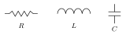

### Circuito simples

  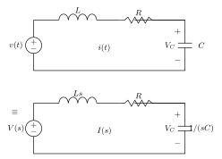

Aplica $\sum V(s)=0$ no domínio de Laplace:

$$
\begin{aligned}
-V(s)+LsI(s)+RI(s)+\frac{1}{sC}I(s)&=0\\
V(s)&=\left(Ls+R+\frac1{sC}\right)I(s)\\
\frac{I(s)}{V(s)}&=\frac1{Ls+R+\frac1{sC}}
\end{aligned}
\tag{1}
$$

Note que $i_C(t)=C\frac{dv_C(t)}{dt}$. Aplicando Laplace de ambos os lados, utilizamos também o teorema da derivação.

$$
\mathcal L\left\{\frac{df}{dt}\right\}=sF(s)-f(0^-)
$$

$C$ é constante; pelo teorema da linearidade podemos retirá-la de dentro da Laplace.

$$
\begin{aligned}
\mathcal L\{i_C(t)\}&=\mathcal L\left\{C\frac{dv_C(t)}{dt}\right\}\\
I(s)&=C\mathcal L\left\{\frac{dv_C(t)}{dt}\right\}\\
I(s)&=CsV_C(s)
\end{aligned}
\tag{2}
$$

Substituindo (2) em (1), com condições iniciais nulas:

$$
\begin{aligned}
\frac{sCV_C(s)}{V(s)}&=\frac1{Ls+R+\frac1{sC}}\\
\frac{V_C(s)}{V(s)}&=\frac1{s^2LC+sRC+1}\\
\boxed{\frac{V_C(s)}{V(s)}=\frac{1/(LC)}{s^2+\frac RL s+\frac1{LC}}}
\end{aligned}
$$

### Circuito complexo por análise de malha/nodal

  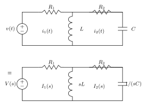

Análise de malha: determinar $I_2(s)/V(s)$.

**Malha 1:**

$$
\begin{aligned}
-V+R_1I_1+sL(I_1-I_2)&=0\\
-V+R_1I_1+sLI_1-sLI_2&=0\\
-V+(R_1+sL)I_1-sLI_2&=0
\end{aligned}
\tag{1}
$$

**Malha 2:**

$$
\begin{aligned}
sL(I_2-I_1)+R_2I_2+\frac1{sC}I_2&=0\\
-sLI_1+sLI_2+R_2I_2+\frac1{sC}I_2&=0\\
I_1&=\frac{I_2(sL+R_2+1/(sC))}{sL}\\
I_1&=I_2\left(\frac{s^2LC+sR_2C+1}{s^2LC}\right)
\end{aligned}
\tag{2}
$$

Substituindo (2) em (1):

$$
-V+(R_1+sL)I_2\left(\frac{s^2LC+sR_2C+1}{s^2LC}\right)-sLI_2=0
$$

$$
s^2LCV=I_2(s^2R_1LC+sR_1R_2C+R_1+s^3L^2C+s^2R_2LC+sL-s^3L^2C)
$$

$$
\boxed{\frac{I_2}{V}=\frac{s^2LC}{(R_1+R_2)s^2LC+(R_1R_2C+L)s+R_1}}
$$

## 4. Modelagem de sistemas mecânicos translacionais

| Componente | Força–velocidade | Força–deslocamento | Impedância $Z(s)=F(s)/X(s)$ |
|---|---|---|---|
| Mola | $f=K\int v\,dt$ | $f=Kx$ | $K$ |
| Amortecedor viscoso | $f=f_vv$ | $f=f_v\frac{dx}{dt}$ | $f_vs$ |
| Massa | $f=M\frac{dv}{dt}$ | $f=M\frac{d^2x}{dt^2}$ | $Ms^2$ |

### Sistema mecânico simples

Determine $X(s)/F(s)$.

  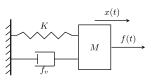

  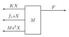

$$
\sum F=0\Rightarrow -(Ms^2+f_vs+K)X(s)+F(s)=0
$$

$$
\boxed{\frac{X(s)}{F(s)}=\frac1{Ms^2+f_vs+K}}
$$

### Sistema mecânico complexo

Determine $X_2(s)/F(s)$.

  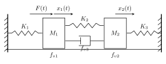

Forças em $M_1$ (deslocamentos $X_1$ e $X_2$):

  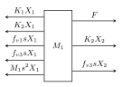

$$
-(K_1+K_2+f_{v1}s+f_{v3}s+M_1s^2)X_1+(K_2+f_{v3}s)X_2+F=0
$$

$$
(M_1s^2+(f_{v1}+f_{v3})s+K_1+K_2)X_1-(f_{v3}s+K_2)X_2=F(s)\tag{1}
$$

Forças em $M_2$:

  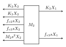

$$
-(M_2s^2+(f_{v2}+f_{v3})s+K_2+K_3)X_2+(f_{v3}s+K_2)X_1=0
$$

$$
-(f_{v3}s+K_2)X_1+(M_2s^2+(f_{v2}+f_{v3})s+K_2+K_3)X_2=0
$$

> Obs.: o sinal do primeiro termo aparece positivo na última linha do caderno; foi mantido negativo aqui conforme a equação imediatamente anterior.

## 5. Modelagem de sistemas mecânicos rotacionais

| Componente | Torque–velocidade angular | Torque–deslocamento angular | Impedância $Z(s)=T(s)/\Theta(s)$ |
|---|---|---|---|
| Mola | $T=K\int\omega\,dt$ | $T=K\theta$ | $K$ |
| Amortecedor viscoso | $T=D\omega$ | $T=D\frac{d\theta}{dt}$ | $Ds$ |
| Inércia | $T=J\frac{d\omega}{dt}$ | $T=J\frac{d^2\theta}{dt^2}$ | $Js^2$ |

Determine as equações:

  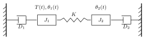

Torques em $J_1$:

  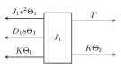

$$
\begin{aligned}
\sum T&=0\\
T-(J_1s^2+D_1s+K)\Theta_1+K\Theta_2&=0\\
(J_1s^2+D_1s+K)\Theta_1-K\Theta_2&=T
\end{aligned}
\tag{1}
$$

Torques em $J_2$:

  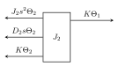

$$
-K\Theta_1+(J_2s^2+D_2s+K)\Theta_2=0\tag{2}
$$

## 6. Modelagem de sistemas mecânicos rotacionais com engrenagens

  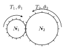

**Ângulo:** $l_1=l_2$.

$$
r_1\theta_1=r_2\theta_2\Rightarrow \frac{\theta_1}{\theta_2}=\frac{r_2}{r_1}=\frac{N_2}{N_1}
$$

**Torque:**

$$
T_1\theta_1=T_2\theta_2\Rightarrow\boxed{\frac{T_2}{T_1}=\frac{N_2}{N_1}}
$$

**Impedância:**

$$
\boxed{\frac{Z_D}{Z_O}=\left(\frac{N_D}{N_O}\right)^2}
$$

$D$: destino; $O$: origem.

### Trem de engrenagens

  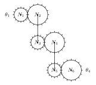

$$
\boxed{\frac{\theta_4}{\theta_1}=\frac{N_1N_3N_5}{N_2N_4N_6}}
$$

**Exemplo:** determine $\Theta_2(s)/T(s)$.

  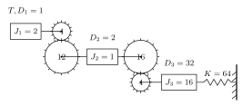

$$
\begin{aligned}
J_{eq}&=J_1\left(\frac{N_2}{N_1}\right)^2+J_2+J_3\left(\frac{N_3}{N_4}\right)^2\\
&=2\left(\frac{12}{4}\right)^2+1+16\left(\frac4{16}\right)^2=20\\
D_{eq}&=D_1\left(\frac{N_2}{N_1}\right)^2+D_2+D_3\left(\frac{N_3}{N_4}\right)^2\\
&=1\left(\frac{12}{4}\right)^2+2+32\left(\frac4{16}\right)^2=13\\
K_{eq}&=64\left(\frac4{16}\right)^2=4
\end{aligned}
$$

$$
T_{eq}:\quad\frac{T_2}{T_1}=\frac{N_2}{N_1}\Rightarrow T_2=\frac{12}{4}T(s)=3T(s)
$$

  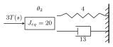

$$
3T(s)-(20s^2+13s+4)\Theta_2=0
$$

$$
\boxed{\frac{\Theta_2}{T(s)}=\frac3{20s^2+13s+4}}
$$

## 7. Modelagem de sistemas eletromecânicos

  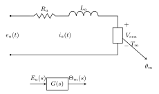

- $R_a$: resistência da armadura.
- $L_a$: indutância da armadura.
- $i_a(t)$: corrente da armadura.
- $e_a(t)$: tensão da armadura.
- $v_{cea}(t)$: força contraeletromotriz.
- $T_m(t)$: torque do motor.
- $\theta_m(t)$: deslocamento angular do eixo do motor.

$$
v_{cea}(t)=K_{cea}\frac{d\theta_m(t)}{dt}\Rightarrow V_{cea}(s)=K_{cea}s\Theta_m(s)\tag{1}
$$

$K_{cea}$: constante FCEM.

  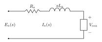

**LKT:**

$$
\begin{aligned}
-E_a+(R_a+sL_a)I_a+V_{cea}&=0\\
(sL_a+R_a)I_a+V_{cea}&=E_a
\end{aligned}
\tag{2}
$$

O torque desenvolvido pelo motor é proporcional à corrente da armadura.

$$
T_m(s)=K_TI_a(s)\Rightarrow I_a(s)=\frac1{K_T}T_m(s)\tag{3}
$$

Substituindo (1) e (3) em (2):

$$
(sL_a+R_a)\frac1{K_T}T_m+K_{cea}s\Theta_m=E_a\tag{4}
$$

Carregamento mecânico equivalente típico em um motor:

  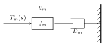

$J_m$: inércia da armadura. $D_m$: amortecimento viscoso da armadura.

$$
T_m-(J_ms^2+D_ms)\Theta_m=0\Rightarrow T_m(s)=(J_ms^2+D_ms)\Theta_m(s)\tag{5}
$$

Substituindo (5) em (4):

$$
(sL_a+R_a)\frac1{K_T}(J_ms^2+D_ms)\Theta_m+K_{cea}s\Theta_m=E_a
$$

Obs.: considerando a indutância da armadura muito pequena em relação à resistência, sua influência pode ser desprezada: $sL_a+R_a\approx R_a$.

$$
\left[\frac{R_a}{K_T}(J_ms+D_m)+K_{cea}\right]s\Theta_m=E_a
$$

$$
\begin{aligned}
\frac{\Theta_m}{E_a}&=\frac1{\left[\frac{R_a}{K_T}(J_ms+D_m)+K_{cea}\right]s}\\
&=\frac{K_T/R_a}{s\left[J_ms+D_m+\frac{K_{cea}K_T}{R_a}\right]}\\
\boxed{\frac{\Theta_m}{E_a}=\frac{\frac{K_T}{R_a}\frac1{J_m}}{s\left[s+\frac1{J_m}\left(D_m+\frac{K_TK_{cea}}{R_a}\right)\right]}}
\end{aligned}
$$

### Constantes mecânicas

  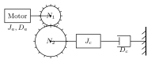

$$
\boxed{J_m=J_a+J_c\left(\frac{N_1}{N_2}\right)^2}\qquad
\boxed{D_m=D_a+D_c\left(\frac{N_1}{N_2}\right)^2}
$$

### Constantes elétricas

  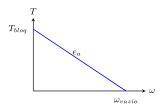

$$
\boxed{K_{cea}=\frac{e_a}{\omega_{vazio}}}\qquad\boxed{\frac{K_T}{R_a}=\frac{T_{bloq}}{e_a}}
$$
