# Unidade 2 — Sistemas de Controle I

## Linearização

Fórmula geral:

$$
\boxed{y-y_0=\left.\frac{df}{dx}\right|_{x=x_0}(x-x_0)}
$$

**Exemplo:**

 a) Linearize a função $y=\sqrt{x}$ em $x_0=4$.

 b) Encontre o erro relativo e absoluto em $x=4{,}001$.

**a)**

$$
\begin{aligned}
y_0&=\sqrt{x_0}=\sqrt4=2\\
\left.\frac{df}{dx}\right|_{x=4}&=\frac1{2\sqrt4}=\frac14\\
y-2&=\frac14(x-4)\\
y&=\frac x4-1+2\\
\boxed{y=0{,}25x+1}
\end{aligned}
$$

**b)**

$$
\begin{aligned}
y_N&=\sqrt{4{,}001}\approx2{,}00024\quad\text{(não linear)}\\
y_L&=0{,}25\cdot4{,}001+1=2{,}00025\\
E_{abs}&=|y_L-y_N|\approx0\\
E_{rel}&=\frac{|y_L-y_N|}{y_N}
\end{aligned}
$$

**SISO:**

  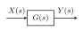

$$
y-y_0=\left.\frac{df}{dx}\right|_{x=x_0}(x-x_0)
$$

**MISO ou MIMO:**

  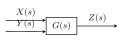

$$
z-z_0=\left.\frac{\partial f}{\partial x}\right|_0(x-x_0)+\left.\frac{\partial f}{\partial y}\right|_0(y-y_0)
$$

> Obs.: o desenho é MISO; as derivadas parciais foram identificadas conforme a variável de cada termo (os índices aparecem trocados no caderno).

## Resposta no domínio do tempo

Polos e zeros:

$$
FT=\frac{s+2}{s+3}
$$

- Zeros: fazem o numerador tender a zero.
- Polos: fazem a função tender a infinito (denominador tende a zero).

> Obs.: está anotado $F=\text{Polos}/\text{Zeros}$; na forma fatorada da FT os zeros estão no numerador e os polos no denominador.

### Sistemas de primeira ordem

$$
\begin{aligned}
C(s)&=R(s)G(s)=\frac1s\frac{a}{s+a}=\frac{a}{s(s+a)}\\
&=\frac As+\frac B{s+a},\qquad A=1,\ B=-1\\
c(t)&=1-e^{-at}
\end{aligned}
$$

Em $t=1/a$:

$$
c(t)=1-e^{-1}=0{,}632
$$

  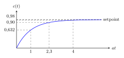

- Constante de tempo: $\boxed{\tau=1/a}$ → 63% do valor final.
- Tempo de subida (rise time): $\boxed{T_r=2{,}2/a}$ → de 10% a 90% do valor final (o início está anotado como 2% no caderno).
- Tempo de acomodação (settling time): $\boxed{T_s=4/a}$ → até 98% do valor final.

### Sistemas de segunda ordem

Em ordem de rapidez anotada:

- Não amortecido ($\zeta=0$): dois polos puramente imaginários.
- Subamortecido ($0<\zeta<1$): dois polos complexos e distintos.
- Criticamente amortecido ($\zeta=1$): dois polos reais e iguais.
- Superamortecido ($\zeta>1$): dois polos reais e distintos.

Função de transferência geral de segunda ordem:

$$
\boxed{G(s)=\frac{\omega_n^2}{s^2+2\zeta\omega_ns+\omega_n^2}}
$$

$\omega_n$: frequência natural; $\zeta$: coeficiente de amortecimento.

**Exemplo:** determine $\omega_n$ e $\zeta$.

**a)**

$$
G(s)=\frac{12}{s^2+8s+12}
$$

$$
\omega_n^2=12\Rightarrow\omega_n=\sqrt{12},\qquad 2\zeta\omega_n=8\Rightarrow\zeta=\frac8{2\sqrt{12}}\approx1{,}15
$$

**b)**

$$
G(s)=\frac{16}{s^2+8s+16}
$$

$$
\omega_n=\sqrt{16}=4,\qquad\zeta=\frac8{2\cdot4}=1
$$

#### Tempo de pico

$$
\boxed{T_p=\frac{\pi}{\omega_n\sqrt{1-\zeta^2}}}
$$

Relacionado com a parte imaginária.

#### Ultrapassagem percentual

$$
\boxed{\%UP=\frac{c_{max}-c_{final}}{c_{final}}\cdot100}
$$

$$
\boxed{\%UP=e^{-\frac{\zeta\pi}{\sqrt{1-\zeta^2}}}\cdot100}
$$

Isolando o zeta:

$$
\boxed{\zeta=\frac{-\ln(\%UP/100)}{\sqrt{\pi^2+\ln^2(\%UP/100)}}}
$$

#### Tempo de acomodação

$$
\boxed{T_s=\frac4{\zeta\omega_n}}
$$

Relaciona-se com a parte real.

#### Tempo de subida

$$
\boxed{T_r=\frac{\pi-\beta}{\omega_n\sqrt{1-\zeta^2}}}
$$

  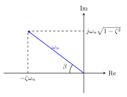

$$
\beta=\arctan\left(\frac{\omega_n\sqrt{1-\zeta^2}}{-\zeta\omega_n}\right)
$$

> Obs.: o desenho mede $\beta$ a partir do eixo real negativo; para esse ângulo agudo, usa-se $\zeta\omega_n$ positivo no denominador.

## Teorema do valor final para sistemas de 1ª e 2ª ordem

  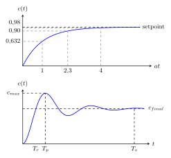

Valor final = setpoint.

$$
\boxed{f(\infty)=\lim_{s\to0}sF(s)}
$$

### Resposta do sistema com polos adicionais

$$
\frac1{(s^2+2s+5)(s+20)}
$$

$(s+20)$ é desprezado porque esse polo está muito distante. Por via de regra é adotada uma distância de cinco constantes de tempo.

$$
p_{1,2}=-1\pm j2
$$

  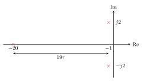

$19\tau>5\tau$: logo podemos desprezar o polo (notação do caderno).

## Diagrama de bloco

  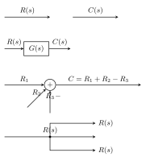

**Série:** multiplica as FTs.

$$
\frac CR=G_1G_2
$$

  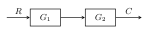

**Paralelo:** soma/subtrai as FTs.

$$
\frac CR=G_1+G_2
$$

  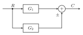

**Realimentação:**

$$
\frac CR=\frac G{1\pm GH}
$$

  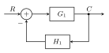

### Transformações de diagramas de blocos

1. Combinação de blocos em cascata: $Y=(P_1P_2)X$.

  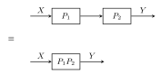

2. Combinação de blocos em paralelo ou eliminação de uma malha direta: $Y=P_1X\pm P_2X$.

  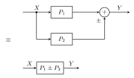

3. Remoção de um bloco de um percurso direto: $Y=P_1X\pm P_2X$.

  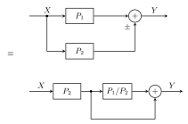

4. Eliminação de uma malha de realimentação: $Y=P_1(X\pm P_2Y)$.

  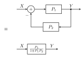

5. Remoção de um bloco de uma malha de realimentação: $Y=P_1(X\pm P_2Y)$.

  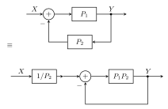

6a. Reorganizando os pontos de soma: $Z=W\pm X\pm Y$.

  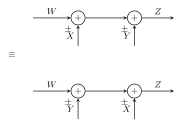

6b. Reorganizando os pontos de soma: $Z=W\pm X\pm Y$.

  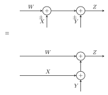

7. Movendo um ponto de soma à frente de um bloco: $Z=PX\pm Y$.

  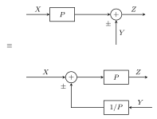

8. Movendo um ponto de soma para além de um bloco: $Z=P(X\pm Y)$.

  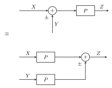

9. Movendo um ponto de tomada à frente de um bloco: $Y=PX$.

  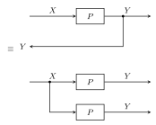

10. Movendo um ponto de tomada para além de um bloco: $Y=PX$.

  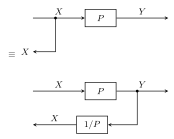

11. Movendo um ponto de tomada à frente de um ponto de soma: $Z=X\pm Y$.

  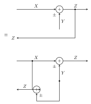

12. Movendo um ponto de tomada para além de um ponto de soma: $Z=X\pm Y$.

  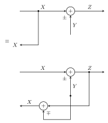

## Diagrama de fluxo

  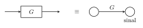

Fórmula geral (Mason):

$$
\boxed{\frac{C(s)}{R(s)}=\frac{\sum_k T_k\Delta_k}{\Delta}}
$$

- $T_k$: ganho do caminho direto $k$.
- $\Delta_k$: determinante considerando os laços que não tocam o caminho direto $k$.
- $k$: índice dos caminhos diretos.

$$
\Delta=1-\sum G_L+\sum G_{L\,2\times2}-\sum G_{L\,3\times3}+\cdots
$$

Ganhos dos laços; produtos dos ganhos dos laços que não se tocam dois a dois, três a três etc.

## Estabilidade

### Critério de Routh-Hurwitz

Polinômio do exemplo:

$$
a_4s^4+a_3s^3+a_2s^2+a_1s+a_0
$$

  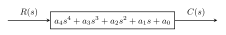

| Potência | 1ª coluna | 2ª coluna | 3ª coluna |
|---|---|---|---|
| $s^4$ | $a_4$ | $a_2$ | $a_0$ |
| $s^3$ | $a_3$ | $a_1$ | $0$ |
| $s^2$ | $b_3$ | $b_2=a_0$ | $b_1=0$ |
| $s^1$ | $c_3$ | $c_2=0$ | $c_1=0$ |
| $s^0$ | $d_3$ | $d_2=0$ | $d_1=0$ |

$$
\begin{aligned}
b_3&=-\frac{\begin{vmatrix}a_4&a_2\\a_3&a_1\end{vmatrix}}{a_3},&b_2&=-\frac{\begin{vmatrix}a_4&a_0\\a_3&0\end{vmatrix}}{a_3}=a_0\\
b_1&=-\frac{\begin{vmatrix}a_4&0\\a_3&0\end{vmatrix}}{a_3}=0\\
c_3&=-\frac{\begin{vmatrix}a_3&a_1\\b_3&b_2\end{vmatrix}}{b_3},&c_2&=-\frac{\begin{vmatrix}a_3&0\\b_3&0\end{vmatrix}}{b_3}=0\\
d_3&=-\frac{\begin{vmatrix}b_3&b_2\\c_3&c_2\end{vmatrix}}{c_3}
\end{aligned}
$$

Analisamos as mudanças de sinal na primeira coluna: $a_4,\ a_3,\ b_3,\ c_3,\ d_3$. Se houver mudanças, existem polos no SPD (semiplano direito).

### Caso especial: linha de zeros

$$
P(s)=20s^5+8s^4+5s^3+6s^2+1
$$

| Potência | 1ª coluna | 2ª coluna | 3ª coluna |
|---|---:|---:|---:|
| $s^5$ | 20 | 5 | 0 |
| $s^4$ | 8 | 6 | 1 |
| $s^3$ | -10 | $-5/2$ | 0 |
| $s^2$ | 4 | 1 | 0 |
| $s^1$ | 0 | 0 | 0 |
| $s^0$ | | | |

$$
\begin{aligned}
b_3&=-\frac{\begin{vmatrix}20&5\\8&6\end{vmatrix}}8=-10,&b_2&=-\frac{\begin{vmatrix}20&0\\8&1\end{vmatrix}}8=-5/2\\
c_3&=-\frac{\begin{vmatrix}8&6\\-10&-5/2\end{vmatrix}}{-10}=4,&c_2&=1\\
d_3&=-\frac{\begin{vmatrix}-10&-5/2\\4&1\end{vmatrix}}4=0
\end{aligned}
$$

1º Pega a linha acima (par): $P_{aux}(s)=4s^2+1=0$.

2º Deriva ela; esse valor é a nova linha de zeros:

$$
\frac{dP_{aux}(s)}{ds}=8s
$$

| Potência | 1ª coluna | 2ª coluna | 3ª coluna |
|---|---:|---:|---:|
| $s^5$ | 20 | 5 | 0 |
| $s^4$ | 8 | 6 | 1 |
| $s^3$ | -10 | $-5/2$ | 0 |
| $s^2$ | 4 | 1 | 0 |
| $s^1$ | 8 | 0 | 0 |
| $s^0$ | 1 | 0 | 0 |

Duas mudanças de sinal: $8\rightarrow-10$ e $-10\rightarrow4$.

Polinômio geral: 2 SPD, 1 SPE (semiplano esquerdo), 2 no eixo $j\omega$.

**Exemplo:**

  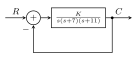

Malha fechada:

$$
G(s)=\frac K{s^3+18s^2+77s+K}
$$

| Potência | 1ª coluna | 2ª coluna |
|---|---|---|
| $s^3$ | 1 | 77 |
| $s^2$ | 18 | $K$ |
| $s^1$ | $(1386-K)/18$ | 0 |
| $s^0$ | $K$ | 0 |

**Estável:**

$$
\frac{1386-K}{18}>0\Rightarrow K<1386
$$

**Instável:**

$$
\frac{1386-K}{18}<0\Rightarrow K>1386
$$

**Marginalmente estável (limiar da estabilidade):**

$$
\frac{1386-K}{18}=0\Rightarrow K=1386
$$

> Obs.: considerando $K>0$, a faixa estável completa é $0<K<1386$.
