# Unidade 3 — Sistemas de Controle I

## Erros em regime permanente

Erro ($R-S$) = entrada − saída.

  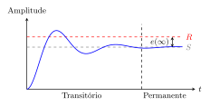

- Transitório: $T_s$, $T_p$ e $\%UP$.
- Permanente: $e(\infty)$.
- Erro tende a infinito: instável; erro tende a zero: estável (anotação; estabilidade não exige erro nulo).

### Erros para sistemas com realimentação unitária

**Erro em regime permanente em função de $T(s)$:**

  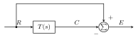

$$
\begin{aligned}
E&=R-C\\
\frac CR&=T\Rightarrow C=TR\\
E&=R-TR=R(1-T)\\
\boxed{e(\infty)=\lim_{s\to0}sR(1-T)}
\end{aligned}
$$

**Erro em regime permanente em função de $G(s)$:**

  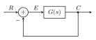

$$
E=R-C\tag{1}
$$

$$
\frac CE=G\tag{2}
$$

$$
\begin{aligned}
E&=R-EG\\
E(1+G)&=R\\
E&=\frac R{1+G}\\
\boxed{e(\infty)=\lim_{s\to0}s\frac R{1+G}}
\end{aligned}
$$

**Exemplo:** para o sistema a seguir, calcule (entrada em degrau unitário):

  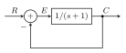

 a) Erro em regime permanente para o sistema de controle aberto ($G(s)$).

 b) Erro em regime permanente para o sistema de controle simplificado ($T(s)$).

**a)**

$$
e(\infty)=\lim_{s\to0}s\frac{1/s}{1+\frac{10}{s+5}}=\frac1{1+10/5}=\frac13
$$

**b)**

$$
T=\frac G{1+GH}=\frac{10/(s+5)}{1+10/(s+5)}=\frac{10}{s+15}
$$

$$
e(\infty)=\lim_{s\to0}s\frac1s\left(1-\frac{10}{s+15}\right)=1-\frac{10}{15}=\frac5{15}=\frac13
$$

> Obs.: o diagrama do caderno traz $1/(s+1)$; a resolução utiliza $10/(s+5)$. Para a função desenhada, o erro ao degrau seria $1/2$.

#### Entrada em degrau ($1/s$)

$$
\boxed{e_{degrau}(\infty)=\lim_{s\to0}\frac{s(1/s)}{1+G}=\frac1{1+K_p}},\quad K_p=\lim_{s\to0}G(s)
$$

$K_p$: constante de posição.

#### Entrada em rampa ($1/s^2$)

$$
\boxed{e_{rampa}(\infty)=\lim_{s\to0}\frac{s(1/s^2)}{1+G}=\frac1{K_v}},\quad K_v=\lim_{s\to0}sG(s)
$$

$K_v$: constante de velocidade.

#### Entrada em parábola ($1/s^3$)

$$
\boxed{e_{parabola}(\infty)=\lim_{s\to0}\frac{s(1/s^3)}{1+G}=\frac1{K_a}},\quad K_a=\lim_{s\to0}s^2G(s)
$$

$K_a$: constante de aceleração.

**Exemplo (slide 179):**

$$
G(s)=\frac{120(s+2)}{(s+3)(s+4)}
$$

- Degrau ($5/s$):

$$
e_D(\infty)=\frac5{1+\lim_{s\to0}G(s)}=\frac5{1+240/12}=\frac5{21}
$$

- Rampa ($5/s^2$):

$$
e_R(\infty)=\frac5{\lim_{s\to0}s\frac{120(s+2)}{(s+3)(s+4)}}=\frac50=\infty
$$

- Parábola ($5/s^3$):

$$
e_P(\infty)=\frac5{\lim_{s\to0}s^2\frac{120(s+2)}{(s+3)(s+4)}}=\frac50=\infty
$$

Acrescentando $s$ ou $s^2$ ao denominador:

| | Degrau | Rampa | Parábola |
|---|---|---|---|
| $s$ | 0 | $5/20$ | $\infty$ |
| $s^2$ | 0 | 0 | $5/20$ |

| Tipo | D | R | P |
|---|---|---|---|
| 0 | cte | $\infty$ | $\infty$ |
| 1 | 0 | cte | $\infty$ |
| 2 | 0 | 0 | cte |

**Exemplo (slide 187):**

$$
G(s)=\frac{1000(s-8)}{(s+7)(s+9)}
$$

$$
\begin{aligned}
K_p&=\lim_{s\to0}G(s)\approx-127,&e_D(\infty)&=\frac1{1-127}\approx-7{,}93\times10^{-3}\\
K_v&=\lim_{s\to0}sG(s)=0,&e_R(\infty)&=\frac10=\infty\\
K_a&=\lim_{s\to0}s^2G(s)=0,&e_P(\infty)&=\frac10=\infty
\end{aligned}
$$

> Obs.: valores formais anotados; o teorema do valor final requer estabilidade da malha fechada, que não ocorre neste exemplo.

**Exemplo (slide 190):**

  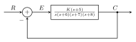

Tipo 1.

$$
\begin{aligned}
e_R(\infty)&=\frac1{\lim_{s\to0}sG(s)}\\
0{,}1&=\frac1{\lim_{s\to0}s\frac{K(s+5)}{s(s+6)(s+7)(s+8)}}\\
0{,}1&=\frac1{5K/(6\cdot7\cdot8)}\\
336&=0{,}5K\\
\boxed{K=672}
\end{aligned}
$$

### Distúrbio

  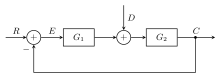

$C=C_R+C_D$.

Superposição:

**Para $R(s)$:**

  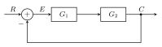

$$
\frac CR=\frac{G_1G_2}{1+G_1G_2}\Rightarrow C_R=\frac{G_1G_2}{1+G_1G_2}R
$$

**Para $D(s)$:**

  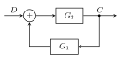

$$
\frac CD=\frac{G_2}{1+G_1G_2}\Rightarrow C_D=\frac{G_2}{1+G_1G_2}D
$$

$$
\begin{aligned}
E&=R-C=R-(C_R+C_D)\\
&=R-\frac{G_1G_2R+G_2D}{1+G_1G_2}\\
&=\frac{R-G_2D}{1+G_1G_2}
\end{aligned}
$$

$$
\boxed{e(\infty)=\lim_{s\to0}\frac{sR}{1+G_1G_2}-\lim_{s\to0}\frac{sG_2D}{1+G_1G_2}}
$$

### Realimentação não unitária

  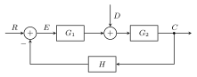

**Para $R(s)$:**

  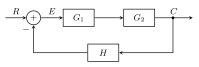

$$
\frac{C_R}R=\frac{G_1G_2}{1+G_1G_2H}\Rightarrow C_R=\frac{G_1G_2R}{1+G_1G_2H}
$$

**Para $D(s)$:**

  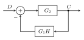

$$
\frac{C_D}D=\frac{G_2}{1+G_1G_2H}\Rightarrow C_D=\frac{G_2D}{1+G_1G_2H}
$$

$$
\begin{aligned}
E&=R-C=R-(C_R+C_D)\\
&=R-\frac{G_1G_2R+G_2D}{1+G_1G_2H}\\
&=\frac{R(1+G_1G_2H-G_1G_2)}{1+G_1G_2H}-\frac{G_2D}{1+G_1G_2H}
\end{aligned}
$$

$$
\boxed{e(\infty)=\lim_{s\to0}\frac{sR(1+G_1G_2H-G_1G_2)}{1+G_1G_2H}-\lim_{s\to0}\frac{sG_2D}{1+G_1G_2H}}
$$

  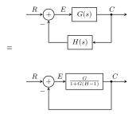

$$
G_e=\frac G{1+G(H-1)}
$$

**Questão do simulado:**

  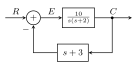

$$
\begin{aligned}
G_e&=\frac{10/[s(s+5)]}{1+\frac{10}{s(s+5)}(s+3-1)}\\
&=\frac{10}{s^2+5s+10s+20}=\frac{10}{s^2+15s+20}
\end{aligned}
$$

> Obs.: a resolução usa $s(s+5)$; o desenho parece trazer $s(s+2)$. O valor de regime permanente não muda nesse caso.

Tipo 0:

$$
K_p=\lim_{s\to0}G_e=\frac{10}{20}=0{,}5
$$

$$
e(\infty)=\frac1{1+0{,}5}=0{,}6667\Rightarrow\boxed{66{,}67\%}
$$

## Controle digital

### Modelador e amostrador

  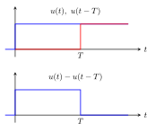

Modelando o segurador de ordem zero:

$$
\boxed{G_h(s)=\frac{1-e^{-Ts}}s}
$$

### Transformada Z

$$
z=e^{Ts},\qquad\boxed{F(z)=\sum_{k=0}^\infty f(kT)z^{-k}}
$$

### Função de transferência

**Exemplo:**

  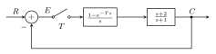

$$
\begin{aligned}
G'(s)&=1-e^{-Ts}\\
G'(z)&=1-z^{-1}=\frac{z-1}z\\
G''(s)&=\frac{s+2}{s(s+1)}=\frac As+\frac B{s+1}=\frac2s-\frac1{s+1}\\
A&=2,\ B=-1\\
G''(z)&=\frac{2z}{z-1}-\frac z{z-e^{-T}}
\end{aligned}
$$

$$
\begin{aligned}
G(z)&=G'(z)G''(z)\\
&=\frac{z-1}z\left(\frac{2z}{z-1}-\frac z{z-e^{-T}}\right)\\
&=2-\frac{z-1}{z-e^{-T}}
\end{aligned}
$$

Onde $T=0{,}5$:

$$
G(z)=2-\frac{z-1}{z-0{,}606}=\frac{2(z-0{,}606)-(z-1)}{z-0{,}606}\approx\boxed{\frac{z-0{,}213}{z-0{,}606}}
$$

**Questão 31 (IFPB 2013):** segurador de ordem zero em cascata com circuito RL série, $G(s)=\tau s/(1+\tau s)$, $\tau=L/R$. Para $R=1\,\Omega$, $L=1\,H$ e tempo de amostragem $T=1\,s$:

$$
\begin{aligned}
G''(s)&=\frac1s\frac{\tau s}{1+\tau s}=\frac1{s+1}\\
G''(z)&=\frac z{z-e^{-T}}\\
G(z)&=(1-z^{-1})\frac z{z-e^{-T}}=\boxed{\frac{z-1}{z-e^{-T}}}
\end{aligned}
$$

### Estabilidade

| $e^{\alpha t}$ | $\alpha$ | Módulo |
|---|---|---|
| | $\alpha>0$ | $\lvert z\rvert>1$ |
| | $\alpha<0$ | $\lvert z\rvert<1$ |
| | $\alpha=0$ | $\lvert z\rvert=1$ |

  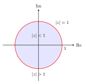

$$
T(z)=\frac{G(z)}{1+G(z)}
$$

$$
T(z)=\frac{\frac{z-0{,}213}{z-0{,}606}}{1+\frac{z-0{,}213}{z-0{,}606}}\approx\frac{z-0{,}212}{2z-0{,}818}
$$

$$
2z=0{,}818\Rightarrow z=\frac{0{,}818}2=0{,}409
$$

Estável.

**Exemplo (slide 19):**

$$
G'(z)=1-z^{-1}=\frac{z-1}z
$$

$$
G''(s)=\frac{27}{s^2(s+27)}=\frac A{s^2}+\frac Bs+\frac C{s+27}
$$

$$
\begin{aligned}
A&=\left.\frac{27}{s+27}\right|_{s=0}=1\\
C&=\left.\frac{27}{s^2}\right|_{s=-27}=\frac{27}{27^2}\approx0{,}037=\frac1{27}\\
B&=\left.\frac{d}{ds}\frac{27}{s+27}\right|_{s=0}=-\frac1{27}
\end{aligned}
$$

$\left(\frac uv\right)'=\frac{u'v-uv'}{v^2}$.

$$
G''(z)=\frac{Tz}{(z-1)^2}-\frac z{27(z-1)}+\frac z{27(z-e^{-27T})}
$$

$$
G(z)=G'(z)G''(z)=\boxed{\frac T{z-1}-\frac1{27}+\frac{z-1}{27(z-e^{-27T})}}
$$

Para $T=0{,}1$:

$$
G(z)=\frac{0{,}1}{z-1}-\frac1{27}+\frac{z-1}{27(z-0{,}067)}
$$

No caderno, desenvolvendo o denominador comum, consta:

$$
G(z)=\frac{z^2+27{,}067z-2{,}742}{27(z-1)(z-0{,}067)}
$$

Aplicando a realimentação (resultado anotado):

$$
T(z)=\frac{K(z^2+27{,}067z-2{,}742)}{(z-1)(27z-1{,}809)+K(z^2+27{,}067z-2{,}742)}
$$

> Obs.: há erro algébrico na simplificação anotada. Pela expressão em frações parciais, o numerador correto com o mesmo denominador é $1{,}767z+0{,}7521$ (usando $0{,}067$ arredondado).

### Critério de Jury

Seja:

$$
P(z)=5z^4+2z^3+3z^2+4z+1
$$

$a_0=5$, $a_m=1$, $m=4$ (notação do caderno: $a_0$ é o coeficiente de maior grau).

1. $|a_m|<a_0\Rightarrow|1|<5$.
2. $P(1)>0\Rightarrow15>0$.
3. $P(-1)>0$ para $m$ par; $P(-1)<0$ para $m$ ímpar. Aqui, $3>0$.
4. $|b_{m-1}|>|b_0|$, $|c_{m-2}|>|c_0|$, $\ldots$, até chegar a dois coeficientes de índices 2 e 0.

### Tabela de Jury

| Linha | | | | | |
|---|---|---|---|---|---|
| 1ª | 1 | 4 | 3 | 2 | 5 |
| 2ª | 5 | 2 | 3 | 4 | 1 |
| 3ª | $b_3$ | $b_2$ | $b_1$ | $b_0$ | |
| 4ª | $b_0$ | $b_1$ | $b_2$ | $b_3$ | |
| 5ª | $c_2$ | $c_1$ | $c_0$ | | |

$$
\begin{aligned}
b_3&=\begin{vmatrix}1&5\\5&1\end{vmatrix},&b_2&=\begin{vmatrix}1&2\\5&4\end{vmatrix},&b_1&=\begin{vmatrix}1&3\\5&3\end{vmatrix},&b_0&=\begin{vmatrix}1&4\\5&2\end{vmatrix}\\
c_2&=\begin{vmatrix}b_3&b_0\\b_0&b_3\end{vmatrix},&c_1&=\begin{vmatrix}b_3&b_1\\b_0&b_2\end{vmatrix},&c_0&=\begin{vmatrix}b_3&b_2\\b_0&b_1\end{vmatrix}
\end{aligned}
$$

**Exemplo (slide 24):**

$$
P(z)=z^4-1{,}2z^3+0{,}07z^2+0{,}3z-0{,}08
$$

$a_0=1$, $a_m=-0{,}08$, $m=4$.

1. $|-0{,}08|<1$.
2. $P(1)=1-1{,}2+0{,}07+0{,}3-0{,}08=0{,}09>0$.
3. $P(-1)=1+1{,}2+0{,}07-0{,}3-0{,}08=1{,}89>0$.
4. $|b_3|>|b_0|$, $|c_2|>|c_0|$.

| Linha | | | | | |
|---|---|---|---|---|---|
| 1ª | -0,08 | 0,3 | 0,07 | -1,2 | 1 |
| 2ª | 1 | -1,2 | 0,07 | 0,3 | -0,08 |
| 3ª | $b_3$ | $b_2$ | $b_1$ | $b_0$ | |
| 4ª | $b_0$ | $b_1$ | $b_2$ | $b_3$ | |
| 5ª | $c_2$ | $c_1$ | $c_0$ | | |

$$
\begin{aligned}
b_3&=\begin{vmatrix}-0{,}08&1\\1&-0{,}08\end{vmatrix}\approx-0{,}99\\
b_2&=\begin{vmatrix}-0{,}08&-1{,}2\\1&0{,}3\end{vmatrix}\approx1{,}17\\
b_1&=\begin{vmatrix}-0{,}08&0{,}07\\1&0{,}07\end{vmatrix}\approx-0{,}07\\
b_0&=\begin{vmatrix}-0{,}08&0{,}3\\1&-1{,}2\end{vmatrix}\approx-0{,}2\\
c_2&=\begin{vmatrix}-0{,}99&-0{,}2\\-0{,}2&-0{,}99\end{vmatrix}\approx0{,}94\\
c_0&=\begin{vmatrix}-0{,}99&1{,}17\\-0{,}2&-0{,}07\end{vmatrix}\approx0{,}3
\end{aligned}
$$

$|b_3|>|b_0|$ e $|c_2|>|c_0|$: sistema estável.

> Obs.: na primeira linha da tabela manuscrita do exemplo, o sinal de $-1{,}2$ está ausente; o polinômio e os determinantes confirmam o sinal negativo. Na última comparação foi escrito $b_2$ em vez de $b_3$; o teste é com $b_3$.

## Sistema de controle digital

### Erro em regime permanente

  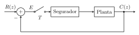

$$
E(z)=\frac R{1+G}
$$

Dado que $E=R-C$ e $C=GE$:

$$
\begin{aligned}
E&=R-GE\\
E+GE&=R\\
E(1+G)&=R\\
E&=\frac R{1+G}
\end{aligned}
$$

$$
e(\infty)=\lim_{z\to1}(1-z^{-1})E(z)=\lim_{z\to1}\left(\frac{z-1}z\right)\frac{R(z)}{1+G(z)}
$$

**Para degrau:** $R(z)=z/(z-1)$.

$$
e(\infty)=\lim_{z\to1}\frac{(z-1)/z\cdot z/(z-1)}{1+G(z)}=\frac1{1+\lim_{z\to1}G(z)}=\boxed{\frac1{1+K_p}}
$$

Onde $K_p=\lim_{z\to1}G(z)$.

**Para rampa:**

$$
\boxed{e(\infty)=\frac1{K_v}},\qquad K_v=\frac1T\lim_{z\to1}(z-1)G(z)
$$

**Para parábola:**

$$
\boxed{e(\infty)=\frac1{K_a}},\qquad K_a=\frac1{T^2}\lim_{z\to1}(z-1)^2G(z)
$$
