# Unidade 1 — Sistemas de Controle II

## Lugar geométrico das raízes (LGR)

### Definição

O lugar geométrico das raízes de um sistema é a representação em um gráfico das raízes da equação característica do sistema (os polos da FT de malha fechada) para algum parâmetro do sistema que é variado.

**Exemplo:** considere um sistema de controle representado pelo seguinte diagrama de blocos:

  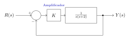

**1. Malha aberta:**

$$
G(s)=K\frac{N(s)}{D(s)}
$$

- $N(s)$: zeros.
- $D(s)$: polos.

**2. Malha fechada:**

$$
T(s)=\frac{G(s)}{1+G(s)H(s)}
$$

$$
D(s)+KN(s)=0,\qquad K\geq 0
$$

As raízes dependem de $K$ (de $0$ a $\infty$).

**Polos dominantes:**

$$
\boxed{s=-\zeta\omega_n\pm\omega_n\sqrt{1-\zeta^2}\,j}
$$

- $\omega_n$: frequência angular.
- $\zeta$: coeficiente de amortecimento.

### Resposta do sistema

*Esboço da resposta transitória e do regime permanente.*

  

- $T_s$ (%): tempo de acomodação.
- $M_p$ (%): máximo sobressinal.

**Solução do sistema:**

  

$$
T(s)=\frac{K}{s^2+2s+K}
$$

O sistema é de segunda ordem, sendo ele estável para os valores de $K$ positivos. A equação característica de um sistema de segunda ordem é dada por:

$$
\boxed{s^2+2\zeta\omega_n s+\omega_n^2=0}
$$

Supondo, por exemplo, um $\zeta=0{,}707$, e comparando as equações, temos:

$$
\omega_n^2=K
$$

$$
2\zeta\omega_n=2
$$

$$
\omega_n=\frac{2}{2\times0{,}707}\approx1{,}41\ \mathrm{rad/s}
$$

Logo:

$$
K=(1{,}41)^2\approx2
$$

### Efeito nas raízes

Equação característica:

$$
s^2+2s+K=0
$$

- $K\to0$:

$$
s^2+2s=0
$$
$$
s(s+2)=0
$$
$$
\boxed{s=0}\qquad\boxed{s=-2}
$$

- $K\to1$:

$$
s^2+2s+1=0
$$
$$
\boxed{s=-1}\quad\text{(dupla)}
$$

- $K\to2$:

$$
s^2+2s+2=0
$$
$$
s=-1\pm j
$$

**Observação:** raízes reais distintas ou iguais; raízes complexas conjugadas.

Representando no plano complexo $s$:

  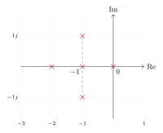

### Função de transferência em malha fechada

1. Para $0<K<1$: raízes reais e distintas (constantes de tempo diferentes).
2. Para $K=1$: raízes reais iguais (sistema criticamente amortecido).
3. Para $K>1$: raízes complexas (com constante de tempo de 1 s).

Considerando o seguinte sistema representado na forma de diagrama de blocos:

  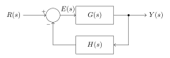

A função de transferência do sistema em malha fechada é dada por:

$$
E(s)=R(s)-H(s)Y(s)
$$
$$
Y(s)=E(s)G(s)
$$
$$
Y(s)=[R(s)-H(s)Y(s)]G(s)
$$
$$
Y(s)=R(s)G(s)-H(s)Y(s)G(s)
$$
$$
Y(s)+H(s)Y(s)G(s)=R(s)G(s)
$$
$$
Y(s)[1+H(s)G(s)]=R(s)G(s)
$$
$$
\boxed{\frac{Y(s)}{R(s)}=\frac{G(s)}{1+G(s)H(s)}}
$$

O denominador corresponde à equação característica. Escrevendo a equação característica na forma complexa, temos:

$$
G(s)H(s)=-1+0j
$$

### Condições de módulo e fase

**1. Condição de módulo:**

$$
|G(s)H(s)|=1
$$

**2. Condição de fase:**

$$
\angle G(s)H(s)=\pm\text{múltiplos de }180^\circ
$$

> Obs.: múltiplos ímpares de $180^\circ$.

Escrevendo a função de transferência de malha aberta na forma de polos e zeros, temos:

$$
G(s)H(s)=K\frac{N(s)}{D(s)}
$$

$$
G(s)H(s)=\frac{K(s-z_1)(s-z_2)\cdots(s-z_m)}{(s-p_1)(s-p_2)\cdots(s-p_n)}
$$

Reescrevendo a condição de módulo:

$$
|G(s)H(s)|=1
$$

$$
|G(s)H(s)|=\frac{|K||s-z_1||s-z_2|\cdots|s-z_m|}{|s-p_1||s-p_2|\cdots|s-p_n|}
$$

Para $K\geq0$:

$$
\frac{K|s-z_1||s-z_2|\cdots|s-z_m|}{|s-p_1||s-p_2|\cdots|s-p_n|}=1
$$

### Coeficiente de ganho K

O coeficiente de ganho $K$ é dado por:

$$
K=\frac{|s-z_1||s-z_2|\cdots|s-z_m|}{|s-p_1||s-p_2|\cdots|s-p_n|}
$$

> Obs.: conferir a expressão de $K$ — a razão está invertida em relação à condição de módulo.

Considerando a equação característica, temos:

$$
1+KG(s)H(s)=0
$$

O valor $s_1$ é um ponto no lugar geométrico das raízes. O lado direito da equação:

$$
K=-\frac{1}{G(s)H(s)}
$$

Calculando o lado direito para $s_1$, isso resulta em um número real positivo.

$$
G(s)H(s)=\frac{1}{s(s+2)}
$$

  

- Polos/zeros: 1 polo (ímpar) → número negativo.
- Polos/zeros: 2 polos (par) → número positivo. O zero é par.

  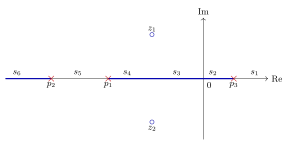

Pontos que pertencem ao LGR: $s_2,s_3,s_4,s_6$.

### Propriedades do LGR

#### 1. Número de ramos

Devemos marcar os polos e zeros de malha aberta do sistema: polo ($\times$), zero ($\circ$). O número de ramos é igual ao número $n$ de polos.

  

**Exemplo:** 2 ramos (quantidade de polos).

  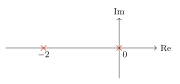

#### 2. Simetria

O lugar geométrico das raízes é simétrico em relação ao eixo real, uma vez que consideramos que os modelos do sistema usados são funções racionais, ou seja, razão entre dois polinômios com coeficientes reais.

#### 3. Pontos de início e término

Esta propriedade estabelece que o lugar geométrico das raízes se origina nos polos e termina nos zeros de malha aberta, respectivamente.

**Prova:** a equação característica do sistema em malha fechada é dada por:

$$
1+KG(s)H(s)=0
$$

$$
1+\frac{K(s-z_1)(s-z_2)\cdots(s-z_m)}{(s-p_1)(s-p_2)\cdots(s-p_n)}=0
$$

Reescrevendo a equação acima, temos:

$$
(s-p_1)(s-p_2)\cdots(s-p_n)+K(s-z_1)(s-z_2)\cdots(s-z_m)=0
$$

O ponto de partida corresponde a $K\to0$, logo:

$$
\boxed{(s-p_1)(s-p_2)\cdots(s-p_n)=0}
$$

Utilizando a condição de módulo, temos:

$$
|KG(s)H(s)|=1
$$

$$
\frac{K|s-z_1||s-z_2|\cdots|s-z_m|}{|s-p_1||s-p_2|\cdots|s-p_n|}=1
$$

$$
\frac{|s-z_1||s-z_2|\cdots|s-z_m|}{|s-p_1||s-p_2|\cdots|s-p_n|}=\frac{1}{K}\to0
$$

O ponto de término corresponde a $K\to\infty$, logo temos:

$$
\boxed{|s-z_1||s-z_2|\cdots|s-z_m|=0}
$$

#### 4. Assíntotas

Se a função de transferência de malha aberta $G(s)H(s)$ possui $n-m$ zeros no infinito, ou seja, $n-m\geq1$, o lugar geométrico das raízes tende a uma assíntota quando $K\to\infty$.

As assíntotas são determinadas pelos ângulos:

$$
\boxed{\alpha_i=\frac{2i+1}{n-m}\times180^\circ}
$$

$$
i=0,1,2,\ldots,|n-m|-1
$$

**Exemplo:** $n-m=2$.

$$
\alpha_0=\frac{2\times0+1}{2}\times180^\circ=90^\circ
$$
$$
\alpha_1=\frac{2\times1+1}{2}\times180^\circ=270^\circ
$$

  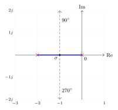

**Caso geral:**

$$
\alpha_0=\frac{1}{n-m}\times180^\circ
$$
$$
\alpha_1=\frac{3}{n-m}\times180^\circ
$$
$$
\alpha_2=\frac{5}{n-m}\times180^\circ
$$

As assíntotas cruzam o eixo real em:

$$
\boxed{\sigma=\frac{\sum\text{polos de }G(s)H(s)-\sum\text{zeros de }G(s)H(s)}{n-m}}
$$

- Polos: $0$ e $-2$ (na anotação inferior aparece 2).
- Zeros: não tem.
- $\alpha_0=90^\circ$, $\alpha_1=270^\circ$, $n-m=2$.

$$
\sigma=\frac{(0-2)-0}{2}=-1\quad\longrightarrow\quad K=1
$$

Se os polos/zeros são complexos conjugados, temos:

$$
\boxed{\sigma=\frac{\sum\operatorname{Re}(p_i)-\sum\operatorname{Re}(z_i)}{n-m}}
$$

- Polos: $-x\pm jy$.
- Zeros: $-c\pm jy$.

#### 5. Pontos de saída e de entrada

Pontos em que as raízes da equação característica deixam de ser reais para se tornarem complexas conjugadas (ponto de saída) ou, inversamente, pontos de entrada.

**Prova:** considere a equação característica do sistema:

$$
1+KG(s)H(s)=0
$$

Supondo que:

$$
G(s)H(s)=\frac{KN(s)}{D(s)},\qquad D(s)\neq0,\quad D(s)\geq N(s)
$$

> Obs.: o manuscrito alterna entre incluir $K$ em $G(s)H(s)$ e escrevê-lo separadamente.

Reescrevendo a equação característica:

$$
1+K\frac{N(s)}{D(s)}=0
$$
$$
D(s)+KN(s)=0
$$
$$
\boxed{K=-\frac{D(s)}{N(s)}}
$$

Os pontos de saída e de entrada sobre o eixo real podem ser calculados a partir das raízes de:

$$
\frac{dK}{ds}=0
$$

$$
-\left[\frac{D'(s)N(s)-D(s)N'(s)}{N(s)}\right]=0
$$

$$
D'(s)N(s)-D(s)N'(s)=0
$$

> Obs.: conferir o denominador da derivada — pela regra do quociente, deve ser $N(s)^2$.

**Exemplo:**

$$
G(s)=\frac{1}{s(s+2)},\qquad H(s)=1
$$
$$
N(s)=1,\qquad D(s)=s^2+2s
$$
$$
D(s)+KN(s)=0
$$
$$
s^2+2s+K=0
$$
$$
K=-(s^2+2s)
$$

Aplicando a condição $dK/ds=0$, temos:

$$
[-(s^2+2s)]'=0
$$
$$
2s+2=0
$$
$$
\boxed{s=-1}
$$

#### 6. Cruzamento com o eixo imaginário

Os pontos de cruzamento com o eixo imaginário são obtidos considerando $s=0\pm j\omega$.

$$
D(j\omega)+KN(j\omega)=0+j\omega
$$

> Obs.: na aplicação da equação característica, o lado direito é zero.

A parte real $D(j\omega)$ e a parte imaginária $KN(j\omega)$ dependem de $K$ e $\omega$ e devem ser nulas. Portanto, a solução destas equações determina os pontos de cruzamento com o eixo imaginário.

Outra forma de determinar os pontos de cruzamento com o eixo imaginário seria utilizando o critério de estabilidade de Routh-Hurwitz.

| Potência | Primeira coluna | Segunda coluna |
|---|---|---|
| $s^n$ | $a_0$ | $a_2$ |
| $s^{n-1}$ | $a_1$ | $a_3$ |
| $s^{n-2}$ | $b_1$ | $\cdots$ |
| $\vdots$ | $\vdots$ | $\vdots$ |
| $s^0$ | $g_1$ | |

Estabilidade: estável, instável ou marginalmente estável.

**Exemplo:** considere um sistema representado pela seguinte função de transferência:

$$
G(s)H(s)=\frac{K}{s(s+1)(s+2)}
$$

- Zeros: não tem.
- Polos: 3.
- Assíntotas: $n-m=3-0=3$.

$$
\alpha_0=\frac{180^\circ}{3}=60^\circ
$$
$$
\alpha_1=\frac{3\times180^\circ}{3}=180^\circ
$$
$$
\alpha_2=\frac{5\times180^\circ}{3}=300^\circ
$$

  

**Solução:**

Considere $s=j\omega$. Temos:

$$
D(s)+KN(s)=0
$$
$$
D(j\omega)+KN(j\omega)=0
$$
$$
D(s)=s^3+3s^2+2s
$$

$$
(j\omega)^3+3(j\omega)^2+2(j\omega)+K=0
$$
$$
j^3\omega^3+3j^2\omega^2+2j\omega+K=0
$$
$$
-j\omega^3-3\omega^2+2j\omega+K=0
$$

- Parte real: $K-3\omega^2$.
- Parte imaginária: $2\omega-\omega^3=0$.

$$
K-3\omega^2=0\qquad\text{e}\qquad2\omega-\omega^3=0
$$
$$
\omega(2-\omega^2)=0
$$

Raízes: $\omega=0$ e $\omega=\pm\sqrt2$.

Para apenas no eixo imaginário, o $\omega$ tem que ser $\omega=\pm\sqrt2$.

Pontos de cruzamento:

$$
s=\pm j\sqrt2
$$
$$
K-3(\sqrt2)^2=0
$$
$$
\boxed{K=6}
$$

**Utilizando o critério de Routh-Hurwitz:**

$$
s^3+3s^2+2s+K=0
$$

| Potência | Primeira coluna | Segunda coluna |
|---|---:|---:|
| $s^3$ | 1 | 2 |
| $s^2$ | 3 | $K$ |
| $s^1$ | $b_1$ | 0 |
| $s^0$ | $K$ | 0 |

$$
b_1=-(K-6)=-K+6
$$
$$
0=-K+6\quad\longrightarrow\quad\boxed{K=6}
$$

> Obs.: falta o divisor 3 em $b_1$; o valor de $K$ no cruzamento não muda.

Polinômio auxiliar:

$$
Q(s)=3s^2+K=3s^2+6
$$
$$
\boxed{s=\pm\sqrt2}
$$

> Obs.: os pontos são imaginários ($\pm j\sqrt2$).

#### 7. Ângulos de partida de um polo complexo e chegada de um zero complexo

Esta propriedade permite determinar a direção dos ramos na proximidade dos polos e zeros complexos conjugados.

**1. Ângulo de partida:**

$$
\boxed{\phi_{p_j}=\sum_{i=1}^{m}\phi_{z_i}-\sum_{i\neq j}^{n}\phi_{p_i}\pm\text{múltiplo ímpar de }180^\circ}
$$

**2. Ângulo de chegada:**

$$
\boxed{\theta_{z_j}=\sum_{i=1}^{n}\theta_{p_i}-\sum_{i\neq j}^{m}\theta_{z_i}\pm\text{múltiplo ímpar de }180^\circ}
$$

## Exemplo 1 — Sistema de terceira ordem sem zeros

Considere um sistema representado pela seguinte função de transferência:

$$
G(s)H(s)=\frac{K}{s(s+2)(s+3)}
$$

**1. Marcar os polos e zeros no plano complexo:**

- Zeros: não tem ($m=0$).
- Polos: $0,-2,-3$ ($n=3$).

  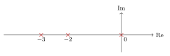

**a) Segmentos:**

| Segmento | Quantidade de polos e zeros à direita | Faz parte do LGR? |
|---|---:|---|
| $0$ a $+\infty$ | 0 | Não |
| $0$ a $-2$ | 1 | Sim |
| $-2$ a $-3$ | 2 | Não |
| $-3$ a $-\infty$ | 3 | Sim |

  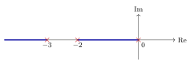

**2. Assíntotas:** $n-m=3-0=3$, com os seguintes ângulos:

$$
\alpha_0=\frac{180^\circ}{n-m}=\frac{180^\circ}{3}=60^\circ
$$
$$
\alpha_1=\frac{3\times180^\circ}{n-m}=\frac{3\times180^\circ}{3}=180^\circ
$$
$$
\alpha_2=\frac{5\times180^\circ}{n-m}=\frac{5\times180^\circ}{3}=300^\circ
$$

As assíntotas cruzam o eixo real em:

$$
\sigma=\frac{\sum\text{polos de }G(s)H(s)-\sum\text{zeros de }G(s)H(s)}{n-m}
$$
$$
\sigma=\frac{(0-2-3)-0}{3}
$$
$$
\boxed{\sigma=-1{,}6}
$$

  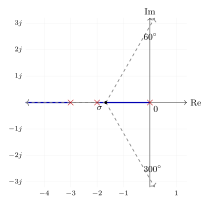

**3. Pontos de saída/entrada:**

$$
D(s)+KN(s)=0
$$
$$
N(s)=1,\qquad D(s)=s^3+5s^2+6s
$$
$$
s^3+5s^2+6s+K=0
$$
$$
K=-(s^3+5s^2+6s)
$$

Aplicando a condição $dK/ds=0$:

$$
-(3s^2+10s+6)=0
$$
$$
3s^2+10s+6=0
$$

Raízes:

$$
\boxed{s=-0{,}78},\qquad s=-2{,}54
$$

Só usa uma porque está dentro do LGR.

**4. Cruzamento com o eixo imaginário:**

$$
s^3+5s^2+6s+K=0
$$

1º método: $s=0+j\omega=j\omega$.

$$
(j\omega)^3+5(j\omega)^2+6j\omega+K=0
$$
$$
-j\omega^3-5\omega^2+6j\omega+K=0
$$

- Parte real: $K-5\omega^2$.
- Parte imaginária: $-\omega^3+6\omega$.

$$
-(\omega^3-6\omega)=0
$$
$$
\omega(\omega^2-6)=0
$$
$$
\omega=0\quad\text{e}\quad\omega=\pm\sqrt6
$$
$$
s=\pm j\sqrt6
$$

$$
K-5\omega^2=0
$$
$$
K=5(\sqrt6)^2
$$
$$
\boxed{K=30}
$$

Representando no plano $s$:

  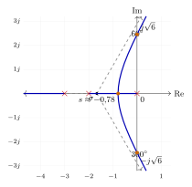

**Exercício para casa:** determinar $K$ para estável e instável.

**K para o sistema ser estável — 2º método: Routh-Hurwitz.**

| Potência | Primeira coluna | Segunda coluna |
|---|---:|---:|
| $s^3$ | 1 | 6 |
| $s^2$ | 5 | $K$ |
| $s^1$ | $b_1$ | 0 |
| $s^0$ | $K$ | |

$$
b_1=-\frac{K-30}{5}
$$

Para o sistema ser estável, $b_1>0$ (positivo), pois não pode ter mudança de sinal.

$$
-\left(\frac{K-30}{5}\right)>0
$$

Multiplicando por $-1$:

$$
\frac{K-30}{5}<0
$$
$$
K-30<0
$$
$$
K<30
$$

Faixa de $K$ para estabilidade:

$$
\boxed{0<K<30}
$$

**K para o sistema ser instável — 2º método: Routh-Hurwitz.**

| Potência | Primeira coluna | Segunda coluna |
|---|---:|---:|
| $s^3$ | 1 | 6 |
| $s^2$ | 5 | $K$ |
| $s^1$ | $b_1$ | 0 |
| $s^0$ | $K$ | |

$$
b_1=-\frac{K-30}{5}
$$

Para o sistema ser instável, $b_1<0$ (negativo), pois tem que ter mudança de sinal.

$$
-\left(\frac{K-30}{5}\right)<0
$$
$$
\frac{K-30}{5}>0
$$
$$
K-30>0
$$
$$
\boxed{K>30}
$$

**Gabarito:**

| Estabilidade | Valores de $K$ |
|---|---|
| Estável | $0<K<30$ |
| Instável | $K>30$ |
| Marginalmente estável | $K=30$ |

**K para o sistema ser marginalmente estável**

2º método: Routh-Hurwitz.

| Potência | Primeira coluna | Segunda coluna |
|---|---:|---:|
| $s^3$ | 1 | 6 |
| $s^2$ | 5 | $K$ |
| $s^1$ | $b_1$ | 0 |
| $s^0$ | $K$ | |

$$
b_1=-\frac{K-30}{5}
$$

Para operar marginalmente estável, $b_1=0$.

$$
0=-\frac{K-30}{5}
$$
$$
\boxed{K=30}
$$

Polinômio auxiliar:

$$
Q(s)=5s^2+30=0
$$
$$
s=\pm\sqrt{\frac{30}{5}}
$$
$$
\boxed{s=\pm\sqrt6}
$$

> Obs.: os pontos são imaginários ($\pm j\sqrt6$).

## Exemplo 2 — Adição de um zero em (s + 1)

Adicionando um zero em $(s+1)$, temos:

$$
G(s)H(s)=\frac{(s+1)K}{s(s+2)(s+3)}
$$

- Zero: $z=-1$.
- Polos: $p=0,-2,-3$.

**1. Marcar os polos e zeros no plano complexo $s$:**

  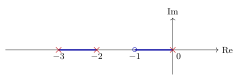

**a) Segmentos:**

- $0$ a $+\infty$, $-1$ a $-2$, $-3$ a $-\infty$: não fazem parte do LGR.
- $0$ a $-1$ e $-2$ a $-3$: fazem parte do LGR.

**2. Assíntotas:** $n-m=3-1=2$.

$$
\alpha_0=\frac{180^\circ}{2}=90^\circ
$$
$$
\alpha_1=\frac{3\times180^\circ}{2}=270^\circ
$$

As assíntotas cruzam o eixo real em:

$$
\sigma=\frac{\sum\text{polos}-\sum\text{zeros}}{n-m}
$$
$$
\sigma=\frac{-5-(-1)}{2}=-2
$$

  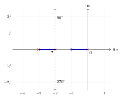

**3. Pontos de saída e entrada:** a equação característica do sistema é dada por:

$$
D(s)+KN(s)=0
$$
$$
D(s)=s(s+2)(s+3),\qquad N(s)=s+1
$$

$$
s^3+5s^2+6s+K(s+1)=0
$$
$$
K=-\left[\frac{s^3+5s^2+6s}{s+1}\right]
$$

Aplicando $dK/ds=0$, temos:

$$
\frac{dK}{ds}=-\left[\frac{(3s^2+10s+6)(s+1)-(s^3+5s^2+6s)(1)}{(s+1)^2}\right]=0
$$

$$
3s^3+3s^2+10s^2+10s+6s+6-s^3-5s^2-6s=0
$$
$$
2s^3+8s^2+10s+6=0
$$

Raízes (como anotadas):

$$
\boxed{s=-2{,}46},\qquad s=-0{,}76\pm0{,}79j
$$

O LGR é dado por:

  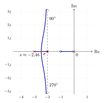

**Para casa: simular malha fechada.**

$$
G(s)H(s)=\frac{1}{s(s+2)(s+3)}
$$
$$
G(s)H(s)=\frac{s+1}{s(s+2)(s+3)}
$$
$$
R(s)=\frac{1}{s}\quad\text{e}\quad\frac{1}{s^2}
$$

## Exemplo 3 — Adição de dois zeros em (s − 2)²

$$
G(s)H(s)=\frac{K(s-2)^2}{s(s+2)(s+3)}
$$

**1. Polos e zeros:**

  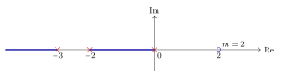

- $0$ a $+\infty$ e $-2$ a $-3$: não fazem parte do LGR.
- $0$ a $-2$ e $-3$ a $-\infty$: fazem parte do LGR.

**2. Assíntotas:** $n-m=1$.

$$
\alpha_0=\frac{180^\circ}{1}\quad\longrightarrow\quad\boxed{\alpha_0=180^\circ}
$$

**3. Pontos de saída/entrada:**

$$
s^3+5s^2+6s+K(s^2-4s+4)=0
$$
$$
K=-\left(\frac{s^3+5s^2+6s}{s^2-4s+4}\right)
$$
$$
-(s^4-8s^3-14s^2+40s+24)=0
$$

Raízes (conforme manuscrito):

$$
9{,}27,\quad2,\quad\boxed{-0{,}53},\quad-2{,}49
$$

  

**4. Cruzamento com o eixo imaginário**

$$
s^3+5s^2+6s+K(s^2-4s+4)=0
$$
$$
s^3+5s^2+6s+Ks^2-4Ks+4K=0
$$

Substituindo $s=j\omega$:

$$
(j\omega)^3+5(j\omega)^2+6j\omega+K(j\omega)^2-4K(j\omega)+4K=0
$$
$$
-j\omega^3-5\omega^2+6j\omega-K\omega^2-4Kj\omega+4K=0
$$

Parte real:

$$
-5\omega^2-K\omega^2+4K=0
$$

Parte imaginária:

$$
-\omega^3+6\omega-4K\omega=0
$$

**Exercício para casa:** encontrar $K$ e $\omega$.

$$
s^3+(K+5)s^2+(6-4K)s+4K=0
$$

| Potência | Primeira coluna | Segunda coluna |
|---|---|---|
| $s^3$ | 1 | $6-4K$ |
| $s^2$ | $K+5$ | $4K$ |
| $s^1$ | $c_1$ | |
| $s^0$ | $d_1$ | |

$$
c_1=\frac{(K+5)(6-4K)-(4K\times1)}{K+5}
$$
$$
d_1=4K
$$
$$
6K-4K^2+30-20K-4K=0
$$
$$
-4K^2-18K+30=0
$$
$$
\boxed{K=1{,}29},\qquad K=-5{,}79
$$

$$
Q(s)=(K+5)s^2+4K=6{,}29s^2+5{,}16
$$

Raízes: $s\approx\pm0{,}9j$.

## Exemplo 4 — Sistema com zeros complexos

Considere um sistema representado pela seguinte função de transferência e esboce o LGR:

$$
G(s)H(s)=\frac{K(s^2+6s+5)}{s(s+2)^2}
$$

- Zeros anotados: $z=-3\pm1{,}73j$ ($m=2$).
- Polos: $0,-2,-2$ ($n=3$).

> Obs.: conferir o enunciado — os zeros complexos e a resolução correspondem a $s^2+6s+12$, e não a $s^2+6s+5$.

**Solução:**

**1. Marcar polos e zeros:**

  

- $0$ a $+\infty$: não faz parte do LGR.
- $0$ a $-2$ e $-2$ a $+\infty$: faz parte do LGR (como escrito).

> Obs.: no gráfico, o segundo intervalo é $-2$ a $-\infty$.

**2. Assíntotas: $n-m=3-2=1$, somente uma assíntota em $180^\circ$.**

$$
\boxed{\alpha_0=180^\circ}
$$

**3. Pontos de saída/entrada:**

$$
D(s)+KN(s)=0
$$
$$
s^3+4s^2+4s+K(s^2+6s+12)=0
$$
$$
K=-\left[\frac{s^3+4s^2+4s}{s^2+6s+12}\right]
$$

Aplicando $dK/ds=0$.

$$
0=-\left[\frac{(3s^2+8s+4)(s^2+6s+12)-(s^3+4s^2+4s)(2s+6)}{(s^2+6s+12)^2}\right]
$$

$$
3s^4+18s^3+36s^2+8s^3+48s^2+96s+4s^2+24s+48-2s^4-8s^3-8s^2-6s^3-24s^2-24s=0
$$

$$
s^4+12s^3+56s^2+96s+48=0
$$

*LGR para o numerador utilizado na resolução ($s^2+6s+12$).*

  

**4. Ângulo de chegada sobre os zeros complexos:**

$$
\phi_{z_j}=\sum_{i=1}^n\theta_{p_i}-\sum_{i\neq j}^m\theta_{z_i}+180^\circ
$$

  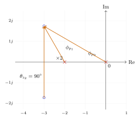

$$
\phi_{p_0}=180^\circ-\arctan\left(\frac{1{,}73}{3}\right)=150{,}03^\circ
$$
$$
\phi_{p_1}=180^\circ-\arctan\left(\frac{1{,}73}{1}\right)=120{,}03^\circ
$$
$$
\phi_{z_1}=(\phi_{p_0}+2\phi_{p_1})-\theta_{z_2}+180^\circ
$$
$$
=(150{,}03+120{,}03+120{,}03)-90+180
$$

$$
\phi_{z_1}=480{,}36^\circ
$$

> Obs.: o valor final anotado difere ligeiramente da soma anterior.

*Traçado para os zeros indicados na resolução; a direção de chegada é representada pelo ângulo equivalente módulo $360^\circ$.*

  

## Exemplo 5 — Sistema de quarta ordem

Esboce o gráfico do LGR para o sistema:

$$
G(s)H(s)=\frac{K}{s(s+3)(s^2+6s+64)}
$$

- Zeros: nenhum ($m=0$).
- Polos: $0,-3,-3\pm7{,}4j$ ($n=4$).

  

- $0$ a $+\infty$ e $-3$ a $+\infty$ não fazem parte do LGR (como anotado).
- $0$ a $-3$ faz parte do LGR.

> Obs.: o intervalo à esquerda de $-3$ não pertence ao LGR.

**2. Assíntotas:** $n-m=4$.

$$
\alpha_0=\frac{180^\circ}{4}=45^\circ
$$
$$
\alpha_1=\frac{3\times180^\circ}{4}=135^\circ
$$
$$
\alpha_2=\frac{5\times180^\circ}{4}=225^\circ
$$
$$
\alpha_3=\frac{7\times180^\circ}{4}=315^\circ
$$

As assíntotas cruzam o eixo real em:

$$
\sigma=\frac{(0-3-3-3)-0}{4}=-\frac94=-2{,}25
$$

  

**3. Ponto de saída/entrada:**

$$
D(s)+KN(s)=0
$$
$$
s^4+6s^3+64s^2+3s^3+18s^2+192s+K=0
$$
$$
s^4+9s^3+82s^2+192s+K=0
$$
$$
K=-[s^4+9s^3+82s^2+192s]
$$

$$
\frac{dK}{ds}=0\quad\longrightarrow\quad4s^3+27s^2+164s+192=0
$$

Raízes anotadas:

$$
\underline{-1{,}43},\qquad-2{,}65\pm5{,}13j
$$

## Exemplo 6 — Sistema com malha interna e externa

Considere o seguinte sistema:

  

$$
D(s)+KN(s)=0
$$

**Solução — Malha interna:**

$$
G_1(s)=\frac{s^2+1}{s(s+2)},\qquad H_1(s)=K_t s
$$
$$
T_1(s)=\frac{G_1(s)}{1+G_1(s)H_1(s)}
$$
$$
T_1(s)=\frac{\frac{s^2+1}{s(s+2)}}{1+\frac{K_t s(s^2+1)}{s(s+2)}}
$$
$$
T_1(s)=\frac{s^2+1}{s(s+2)+K_t s(s^2+1)}
$$

**Malha externa:**

$$
G_2(s)=\frac{K(s^2+1)}{s(s+2)+K_t s(s^2+1)},\qquad H_2(s)=1
$$
$$
T_2(s)=\frac{G_2(s)}{1+G_2(s)H_2(s)}
$$
$$
T_2(s)=\frac{K(s^2+1)}{s(s+2)+K_t s(s^2+1)+K(s^2+1)}
$$

Equação característica:

$$
s(s+2)+K_t s(s^2+1)+K(s^2+1)=0
$$

Considerando $K_t=1$, temos:

$$
s(s+2)+s(s^2+1)+K(s^2+1)=0
$$
$$
s^3+s^2+3s+K(s^2+1)=0
$$
$$
G(s)=\frac{K(s^2+1)}{s^3+s^2+3s}
$$

- Zeros: $\pm j$, $m=2$.
- Polos: $0,-0{,}5\pm1{,}65j$, $n=3$.

**1. Segmentos:** o intervalo de $-\infty$ a $0$ faz parte do LGR; de $0$ a $+\infty$ não faz parte.

  

**2. Assíntotas:** $n-m=1$.

$$
\alpha_0=\frac{180^\circ}{1}=180^\circ
$$

**3. Pontos de saída/entrada:** a equação característica é dada por:

$$
s^3+s^2+3s+K(s^2+1)=0
$$
$$
K=-\left(\frac{s^3+s^2+3s}{s^2+1}\right)
$$

Aplicando $dK/ds=0$:

$$
\frac{(3s^2+2s+3)(s^2+1)-(s^3+s^2+3s)(2s)}{(s^2+1)^2}=0
$$
$$
s^4+2s+3=0
$$

Raízes anotadas (leitura aproximada da foto):

$$
0{,}95\pm1{,}19j,\qquad-0{,}95\pm0{,}61j
$$

**4. Ângulos de partida/chegada dos polos/zeros complexos:**

  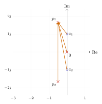

$$
\phi_{p_2}=90^\circ
$$
$$
\phi_{p_0}=180^\circ-\tan^{-1}\left(\frac{1{,}65}{0{,}5}\right)=106{,}86^\circ
$$
$$
\theta_{z_1}=180^\circ-\tan^{-1}\left(\frac{0{,}65}{0{,}5}\right)=127{,}57^\circ
$$
$$
\theta_{z_2}=180^\circ-\tan^{-1}\left(\frac{2{,}65}{0{,}5}\right)=100{,}68^\circ
$$
$$
\phi_{p_1}=(\theta_{z_1}+\theta_{z_2})-(\phi_{p_0}+\phi_{p_2})+180^\circ
$$
$$
\phi_{p_1}=\sum_i^m\theta_{z_i}-\sum_{i\neq j}^n\phi_{p_i}\pm180^\circ
$$
$$
\phi_{p_1}=(127{,}57+100{,}68)-(106{,}86+90)+180
$$
$$
\phi_{p_1}=211{,}4^\circ,\qquad\phi_{p_2}=-211{,}4^\circ
$$

> Obs.: alguns índices e algarismos do quadro têm leitura incerta.

### Exercícios para casa

  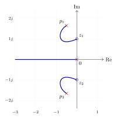

$$
\theta_{p_0}=90^\circ,\qquad\theta_{z_2}=90^\circ
$$

Exercício para casa: determinar os ângulos indicados no quadro e esboçar o lugar geométrico das raízes (índices de leitura incerta).

Exercício para casa:

- $K_t=0$ ($K\geq0$).
- $K=1$ ($K_t\geq0$).
- $K=0$ ($K_t\geq0$).

> Obs.: parte de um cálculo no quadro está cortada.
