# Unidade 1 — Sistemas de Controle II

## Lugar geométrico das raízes (LGR)

### Definição

O lugar geométrico das raízes (LGR) representa, no plano complexo, as raízes da equação característica de malha fechada à medida que um parâmetro varia. Nesta unidade, considera-se realimentação negativa e ganho real $K\geq0$. Salvo indicação contrária, a função de malha é racional, própria, com coeficientes reais e sem fatores comuns entre numerador e denominador. Cancelamentos devem ser analisados separadamente quanto à estabilidade interna.

**Exemplo:** considere um sistema de controle representado pelo seguinte diagrama de blocos:

  

**1. Malha aberta:**

$$
L(s)=G(s)H(s)=K\frac{N(s)}{D(s)}
$$

- $N(s)$: polinômio cujas raízes são os zeros de malha aberta.
- $D(s)$: polinômio cujas raízes são os polos de malha aberta.
- $L(s)$ inclui o ganho $K$; define-se também $L_0(s)=N(s)/D(s)$, sem o ganho variável. No diagrama acima, $H(s)=1$.

**2. Malha fechada:**

$$
T(s)=\frac{G(s)}{1+G(s)H(s)}
$$

$$
D(s)+KN(s)=0,\qquad K\geq 0
$$

As raízes dependem de $K$ (de $0$ a $\infty$). Para $K=0$, os polos de malha aberta são os pontos iniciais do LGR, ainda que a FT entrada–saída possa se tornar identicamente nula.

**Polos de um sistema de segunda ordem subamortecido ($0<\zeta<1$):**

$$
\boxed{s=-\zeta\omega_n\pm\omega_n\sqrt{1-\zeta^2}\,j}
$$

- $\omega_n$: frequência natural não amortecida (rad/s).
- $\zeta$: razão de amortecimento (adimensional).

Em sistemas de ordem superior, essas expressões podem descrever um par dominante, desde que os demais modos e zeros não alterem significativamente a resposta.

### Resposta do sistema

*Esboço ilustrativo da resposta a um degrau unitário; não corresponde necessariamente ao ganho calculado no exemplo seguinte.*

  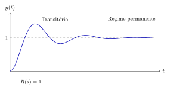

- $T_s$: tempo de acomodação (em segundos), especificando a faixa de tolerância, por exemplo, 2% ou 5% do valor final.
- $M_p$ (%): máximo sobressinal relativo ao valor final (para resposta ao degrau de amplitude positiva e valor final positivo).

Para o modelo canônico de segunda ordem subamortecido sem zeros, $M_p=100e^{-\pi\zeta/\sqrt{1-\zeta^2}}\%$ e $T_s(2\%)\approx4/(\zeta\omega_n)$. O tempo de acomodação é uma aproximação, não uma igualdade geral.

**Solução do sistema:**

  

$$
T(s)=\frac{K}{s^2+2s+K}
$$

O sistema é de segunda ordem, sendo ele estável para os valores de $K$ positivos. A equação característica de um sistema de segunda ordem é dada por:

$$
\boxed{s^2+2\zeta\omega_n s+\omega_n^2=0}
$$

Supondo, por exemplo, um $\zeta=0{,}707$, e comparando as equações, temos:

$$
\omega_n^2=K
$$

$$
2\zeta\omega_n=2
$$

$$
\omega_n=\frac{2}{2\times0{,}707}\approx1{,}41\ \mathrm{rad/s}
$$

Logo:

$$
K=(1{,}41)^2\approx2
$$

### Efeito nas raízes

Equação característica:

$$
s^2+2s+K=0
$$

- $K\to0$:

$$
s^2+2s=0
$$
$$
s(s+2)=0
$$
$$
\boxed{s=0}\qquad\boxed{s=-2}
$$

- $K\to1$:

$$
s^2+2s+1=0
$$
$$
\boxed{s=-1}\quad\text{(dupla)}
$$

- $K\to2$:

$$
s^2+2s+2=0
$$
$$
s=-1\pm j
$$

**Observação:** raízes reais distintas ou iguais; raízes complexas conjugadas.

Representando no plano complexo $s$:

  

### Função de transferência em malha fechada

1. Para $0<K<1$: raízes reais e distintas (constantes de tempo diferentes).
2. Para $K=1$: raízes reais iguais (sistema criticamente amortecido).
3. Para $K>1$: raízes complexas conjugadas, com envoltória exponencial de constante de tempo $1\,\mathrm{s}$.

Considerando o seguinte sistema representado na forma de diagrama de blocos:

  

A função de transferência do sistema em malha fechada é dada por:

$$
E(s)=R(s)-H(s)Y(s)
$$
$$
Y(s)=E(s)G(s)
$$
$$
Y(s)=[R(s)-H(s)Y(s)]G(s)
$$
$$
Y(s)=R(s)G(s)-H(s)Y(s)G(s)
$$
$$
Y(s)+H(s)Y(s)G(s)=R(s)G(s)
$$
$$
Y(s)[1+H(s)G(s)]=R(s)G(s)
$$
$$
\boxed{\frac{Y(s)}{R(s)}=\frac{G(s)}{1+G(s)H(s)}}
$$

A equação característica é $1+L(s)=0$, ou $D(s)+KN(s)=0$ após eliminar o denominador. Para pontos regulares do LGR:

$$
L(s)=G(s)H(s)=-1+0j
$$

### Condições de módulo e fase

**1. Condição de módulo:**

$$
|G(s)H(s)|=1
$$

**2. Condição de fase:**

$$
\boxed{\angle L(s)=(2\ell+1)180^\circ,\qquad \ell\in\mathbb Z}
$$

Para $K>0$, o ganho não contribui com fase. As condições de módulo e fase devem ser satisfeitas simultaneamente.

Escrevendo a função de transferência de malha aberta na forma de polos e zeros, temos:

$$
L(s)=G(s)H(s)=K\frac{N(s)}{D(s)}
$$

$$
G(s)H(s)=\frac{K(s-z_1)(s-z_2)\cdots(s-z_m)}{(s-p_1)(s-p_2)\cdots(s-p_n)}
$$

Reescrevendo a condição de módulo:

$$
|G(s)H(s)|=1
$$

$$
|G(s)H(s)|=\frac{|K||s-z_1||s-z_2|\cdots|s-z_m|}{|s-p_1||s-p_2|\cdots|s-p_n|}
$$

Para $K\geq0$:

$$
\frac{K|s-z_1||s-z_2|\cdots|s-z_m|}{|s-p_1||s-p_2|\cdots|s-p_n|}=1
$$

### Coeficiente de ganho K

O coeficiente de ganho $K$ é dado por:

$$
K=\frac{|s-p_1||s-p_2|\cdots|s-p_n|}{|s-z_1||s-z_2|\cdots|s-z_m|}
$$

A expressão pressupõe numerador e denominador mônicos, com a constante multiplicativa incorporada em $K$.

Considerando a função de malha sem o ganho variável, $L_0(s)=N(s)/D(s)$, a equação característica é:

$$
1+KL_0(s)=0
$$

$$
K=-\frac{1}{L_0(s)}=-\frac{D(s)}{N(s)}
$$

Para um ponto regular $s_1$ do LGR de ganho positivo, esse valor é real e positivo.

**Exemplo:**

$$
L_0(s)=\frac{1}{s(s+2)}
$$

  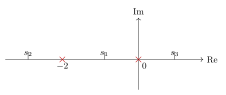

- $L_0(s)$ é negativo no segmento real entre $-2$ e $0$, de modo que $K=-1/L_0(s)>0$.
- Nos demais segmentos reais, $L_0(s)>0$, o que exigiria $K<0$.

**Regra do eixo real:** um ponto regular do eixo real pertence ao LGR de ganho positivo se houver um número ímpar de polos e zeros **reais** de malha aberta à sua direita, contando multiplicidades. Pares conjugados complexos não alteram essa paridade.

  

Pontos que pertencem ao LGR: $s_2,s_3,s_4,s_6$.

### Propriedades do LGR

#### 1. Número de ramos

Devemos marcar os polos e zeros de malha aberta do sistema: polo ($\times$), zero ($\circ$). Para uma função própria com $n$ polos, $m\leq n$ zeros e sem fatores comuns, o LGR tem $n$ ramos, contando multiplicidades. Para $m=n$, considera-se ainda que o coeficiente líder não se anula no intervalo de ganhos estudado.

  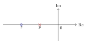

**Exemplo:** 2 ramos (quantidade de polos).

  

#### 2. Simetria

O lugar geométrico das raízes é simétrico em relação ao eixo real, uma vez que consideramos que os modelos do sistema usados são funções racionais, ou seja, razão entre dois polinômios com coeficientes reais.

#### 3. Pontos de início e término

Os ramos se iniciam nos polos de malha aberta ($K\to0$). Quando $K\to\infty$, $m$ ramos terminam nos zeros finitos e, se $n>m$, os outros $n-m$ ramos divergem para o infinito.

**Prova:** a equação característica do sistema em malha fechada é dada por:

$$
1+KL_0(s)=0
$$

$$
1+\frac{K(s-z_1)(s-z_2)\cdots(s-z_m)}{(s-p_1)(s-p_2)\cdots(s-p_n)}=0
$$

Reescrevendo a equação acima, temos:

$$
(s-p_1)(s-p_2)\cdots(s-p_n)+K(s-z_1)(s-z_2)\cdots(s-z_m)=0
$$

O ponto de partida corresponde a $K\to0$, logo:

$$
\boxed{(s-p_1)(s-p_2)\cdots(s-p_n)=0}
$$

Utilizando a condição de módulo, temos:

$$
|KL_0(s)|=1
$$

$$
\frac{K|s-z_1||s-z_2|\cdots|s-z_m|}{|s-p_1||s-p_2|\cdots|s-p_n|}=1
$$

$$
\frac{|s-z_1||s-z_2|\cdots|s-z_m|}{|s-p_1||s-p_2|\cdots|s-p_n|}=\frac{1}{K}\to0
$$

Se um ramo possui limite finito quando $K\to\infty$, dividindo a equação característica por $K$ obtém-se $N(s)+D(s)/K=0$, logo:

$$
\boxed{N(s)=0}
$$

Os demais $n-m$ ramos, quando $n>m$, não possuem limite finito e seguem as direções assintóticas.

#### 4. Assíntotas

Se a função de transferência de malha aberta $G(s)H(s)$ possui $n-m$ zeros no infinito, ou seja, $n-m\geq1$, o lugar geométrico das raízes tende a uma assíntota quando $K\to\infty$.

As assíntotas são determinadas pelos ângulos:

$$
\boxed{\alpha_i=\frac{2i+1}{n-m}\times180^\circ}
$$

$$
i=0,1,2,\ldots,n-m-1
$$

**Exemplo:** $n-m=2$.

$$
\alpha_0=\frac{2\times0+1}{2}\times180^\circ=90^\circ
$$
$$
\alpha_1=\frac{2\times1+1}{2}\times180^\circ=270^\circ
$$

  

**Caso geral:**

$$
\alpha_0=\frac{1}{n-m}\times180^\circ
$$
$$
\alpha_1=\frac{3}{n-m}\times180^\circ
$$
$$
\alpha_2=\frac{5}{n-m}\times180^\circ
$$

As assíntotas cruzam o eixo real em:

$$
\boxed{\sigma=\frac{\sum\text{polos de }G(s)H(s)-\sum\text{zeros de }G(s)H(s)}{n-m}}
$$

- Polos: $0$ e $-2$.
- Zeros: não tem.
- $\alpha_0=90^\circ$, $\alpha_1=270^\circ$, $n-m=2$.

$$
\boxed{\sigma=\frac{(0-2)-0}{2}=-1}
$$

Neste exemplo específico, o centroide coincide com o ponto de saída $s=-1$, correspondente a $K=1$. Essa coincidência não é uma regra geral.

Se os polos/zeros são complexos conjugados, temos:

$$
\boxed{\sigma=\frac{\sum\operatorname{Re}(p_i)-\sum\operatorname{Re}(z_i)}{n-m}}
$$

- Polos: $-x\pm jy$.
- Zeros: $-c\pm jy$.

#### 5. Pontos de saída e de entrada

Pontos em que as raízes da equação característica deixam de ser reais para se tornarem complexas conjugadas (ponto de saída) ou, inversamente, pontos de entrada.

**Prova:** considere a equação característica do sistema:

$$
1+KL_0(s)=0
$$

Supondo que:

$$
L_0(s)=\frac{N(s)}{D(s)},\qquad \deg D\geq\deg N
$$

No cálculo de $K(s)$, exige-se $N(s)\neq0$.

Reescrevendo a equação característica:

$$
1+K\frac{N(s)}{D(s)}=0
$$
$$
D(s)+KN(s)=0
$$
$$
\boxed{K=-\frac{D(s)}{N(s)}}
$$

Os pontos de saída e de entrada sobre o eixo real podem ser calculados a partir das raízes de:

$$
\frac{dK}{ds}=0
$$

$$
-\left[\frac{D'(s)N(s)-D(s)N'(s)}{N(s)^2}\right]=0
$$

$$
\boxed{D'(s)N(s)-D(s)N'(s)=0}
$$

Essa condição fornece candidatos a raízes múltiplas. Para pontos de saída/entrada no eixo real, selecione somente candidatos reais pertencentes ao LGR, com $N(s)\neq0$ e ganho $K>0$; confirme a natureza do ponto pelo comportamento local dos ramos. Polos múltiplos em $K=0$ são pontos iniciais, não pontos de saída para ganho positivo.

**Exemplo:**

$$
G(s)=\frac{1}{s(s+2)},\qquad H(s)=1
$$
$$
N(s)=1,\qquad D(s)=s^2+2s
$$
$$
D(s)+KN(s)=0
$$
$$
s^2+2s+K=0
$$
$$
K=-(s^2+2s)
$$

Aplicando a condição $dK/ds=0$, temos:

$$
[-(s^2+2s)]'=0
$$
$$
-2s-2=0
$$
$$
\boxed{s=-1},\qquad K=1
$$

#### 6. Cruzamento com o eixo imaginário

Os pontos do LGR no eixo imaginário são obtidos substituindo $s=j\omega$, com $\omega\in\mathbb R$.

$$
D(j\omega)+KN(j\omega)=0
$$

As partes real e imaginária da **soma completa** devem ser simultaneamente nulas:

$$
\begin{aligned}\operatorname{Re}[D(j\omega)+KN(j\omega)]&=0\\\operatorname{Im}[D(j\omega)+KN(j\omega)]&=0\end{aligned}
$$

A solução $\omega=0$ corresponde à origem e deve ser analisada separadamente; não se deve dividir por $\omega$ sem considerar esse caso.

Outra forma de determinar os pontos de cruzamento com o eixo imaginário seria utilizando o critério de estabilidade de Routh-Hurwitz.

| Potência | Primeira coluna | Segunda coluna |
|---|---|---|
| $s^n$ | $a_0$ | $a_2$ |
| $s^{n-1}$ | $a_1$ | $a_3$ |
| $s^{n-2}$ | $b_1$ | $\cdots$ |
| $\vdots$ | $\vdots$ | $\vdots$ |
| $s^0$ | $g_1$ | |

O número de mudanças de sinal na primeira coluna da tabela de Routh corresponde ao número de raízes no semiplano direito (tratando os casos especiais de elemento inicial nulo ou linha inteira nula). Para estabilidade assintótica, todas as raízes devem ter parte real negativa. Raízes simples no eixo imaginário, com os demais modos estáveis, implicam estabilidade marginal da dinâmica livre, não estabilidade BIBO de uma FT que contenha esses polos.

**Exemplo:** considere um sistema representado pela seguinte função de transferência:

$$
G(s)H(s)=\frac{K}{s(s+1)(s+2)}
$$

- Zeros: não tem.
- Polos: 3.
- Assíntotas: $n-m=3-0=3$.

$$
\alpha_0=\frac{180^\circ}{3}=60^\circ
$$
$$
\alpha_1=\frac{3\times180^\circ}{3}=180^\circ
$$
$$
\alpha_2=\frac{5\times180^\circ}{3}=300^\circ
$$

  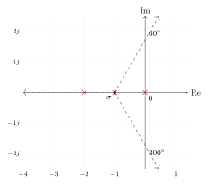

**Solução:**

Considere $s=j\omega$. Temos:

$$
D(s)+KN(s)=0
$$
$$
D(j\omega)+KN(j\omega)=0
$$
$$
D(s)=s^3+3s^2+2s
$$

$$
(j\omega)^3+3(j\omega)^2+2(j\omega)+K=0
$$
$$
j^3\omega^3+3j^2\omega^2+2j\omega+K=0
$$
$$
-j\omega^3-3\omega^2+2j\omega+K=0
$$

- Parte real: $K-3\omega^2$.
- Parte imaginária: $2\omega-\omega^3=0$.

$$
K-3\omega^2=0\qquad\text{e}\qquad2\omega-\omega^3=0
$$
$$
\omega(2-\omega^2)=0
$$

Raízes: $\omega=0$ e $\omega=\pm\sqrt2$.

A solução $\omega=0$ ocorre em $K=0$. Para $K>0$, os pontos não nulos são dados por $\omega=\pm\sqrt2$.

Pontos de cruzamento:

$$
s=\pm j\sqrt2
$$
$$
K-3(\sqrt2)^2=0
$$
$$
\boxed{K=6}
$$

**Utilizando o critério de Routh-Hurwitz:**

$$
s^3+3s^2+2s+K=0
$$

| Potência | Primeira coluna | Segunda coluna |
|---|---:|---:|
| $s^3$ | 1 | 2 |
| $s^2$ | 3 | $K$ |
| $s^1$ | $b_1$ | 0 |
| $s^0$ | $K$ | 0 |

$$
b_1=\frac{6-K}{3}
$$
$$
b_1=0\quad\longrightarrow\quad\boxed{K=6}
$$

Polinômio auxiliar (linha de $s^2$):

$$
Q(s)=3s^2+K=3s^2+6
$$
$$
\boxed{s=\pm j\sqrt2}
$$

Em $K=6$, o polinômio é $(s+3)(s^2+2)$. Portanto, $0<K<6$ é a faixa de estabilidade assintótica; $K>6$ implica dois polos no semiplano direito. Em $K=6$, a dinâmica livre é marginalmente estável; em $K=0$, há um polo simples na origem.

#### 7. Ângulos de partida de um polo complexo e chegada de um zero complexo

Esta propriedade permite determinar a direção dos ramos na proximidade dos polos e zeros complexos conjugados.

**1. Ângulo de partida:**

$$
\boxed{\phi_{p_j}=180^\circ+\sum_{i=1}^{m}\arg(p_j-z_i)-\sum_{i\neq j}^{n}\arg(p_j-p_i)\pmod{360^\circ}}
$$

**2. Ângulo de chegada:**

$$
\boxed{\theta_{z_j}=180^\circ+\sum_{i=1}^{n}\arg(z_j-p_i)-\sum_{i\neq j}^{m}\arg(z_j-z_i)\pmod{360^\circ}}
$$

As expressões valem para polos e zeros simples, com ângulos medidos a partir do semieixo real positivo. A direção de chegada indica a orientação geométrica do vetor que sai do zero em direção ao ramo próximo; o sentido de movimento para o zero é oposto. Para raízes múltiplas, aplicam-se as condições de fase com a multiplicidade correspondente.

## Exemplo 1 — Sistema de terceira ordem sem zeros

Considere um sistema representado pela seguinte função de transferência:

$$
G(s)H(s)=\frac{K}{s(s+2)(s+3)}
$$

**1. Marcar os polos e zeros no plano complexo:**

- Zeros: não tem ($m=0$).
- Polos: $0,-2,-3$ ($n=3$).

  

**a) Segmentos:**

| Segmento | Quantidade de polos e zeros à direita | Faz parte do LGR? |
|---|---:|---|
| $0$ a $+\infty$ | 0 | Não |
| $0$ a $-2$ | 1 | Sim |
| $-2$ a $-3$ | 2 | Não |
| $-3$ a $-\infty$ | 3 | Sim |

  

**2. Assíntotas:** $n-m=3-0=3$, com os seguintes ângulos:

$$
\alpha_0=\frac{180^\circ}{n-m}=\frac{180^\circ}{3}=60^\circ
$$
$$
\alpha_1=\frac{3\times180^\circ}{n-m}=\frac{3\times180^\circ}{3}=180^\circ
$$
$$
\alpha_2=\frac{5\times180^\circ}{n-m}=\frac{5\times180^\circ}{3}=300^\circ
$$

As assíntotas cruzam o eixo real em:

$$
\sigma=\frac{\sum\text{polos de }G(s)H(s)-\sum\text{zeros de }G(s)H(s)}{n-m}
$$
$$
\sigma=\frac{(0-2-3)-0}{3}
$$
$$
\boxed{\sigma=-\frac53\approx-1{,}6667}
$$

  

**3. Pontos de saída/entrada:**

$$
D(s)+KN(s)=0
$$
$$
N(s)=1,\qquad D(s)=s^3+5s^2+6s
$$
$$
s^3+5s^2+6s+K=0
$$
$$
K=-(s^3+5s^2+6s)
$$

Aplicando a condição $dK/ds=0$:

$$
-(3s^2+10s+6)=0
$$
$$
3s^2+10s+6=0
$$

Raízes:

$$
\boxed{s=\frac{-5+\sqrt7}{3}\approx-0{,}78475},\qquad s=\frac{-5-\sqrt7}{3}\approx-2{,}54858
$$

Somente o primeiro ponto pertence ao LGR para $K>0$; nele, $K\approx2{,}11261$. O segundo fornece ganho negativo.

**4. Cruzamento com o eixo imaginário:**

$$
s^3+5s^2+6s+K=0
$$

1º método: $s=0+j\omega=j\omega$.

$$
(j\omega)^3+5(j\omega)^2+6j\omega+K=0
$$
$$
-j\omega^3-5\omega^2+6j\omega+K=0
$$

- Parte real: $K-5\omega^2$.
- Parte imaginária: $-\omega^3+6\omega$.

$$
-(\omega^3-6\omega)=0
$$
$$
\omega(\omega^2-6)=0
$$
$$
\omega=0\quad\text{e}\quad\omega=\pm\sqrt6
$$
$$
s=\pm j\sqrt6
$$

$$
K-5\omega^2=0
$$
$$
K=5(\sqrt6)^2
$$
$$
\boxed{K=30}
$$

Representando no plano $s$:

  

**Exercício para casa:** determinar $K$ para estável e instável.

**K para o sistema ser estável — 2º método: Routh-Hurwitz.**

| Potência | Primeira coluna | Segunda coluna |
|---|---:|---:|
| $s^3$ | 1 | 6 |
| $s^2$ | 5 | $K$ |
| $s^1$ | $b_1$ | 0 |
| $s^0$ | $K$ | |

$$
b_1=-\frac{K-30}{5}
$$

Para o sistema ser estável, $b_1>0$ (positivo), pois não pode ter mudança de sinal.

$$
-\left(\frac{K-30}{5}\right)>0
$$

Multiplicando por $-1$:

$$
\frac{K-30}{5}<0
$$
$$
K-30<0
$$
$$
K<30
$$

Faixa de $K$ para estabilidade:

$$
\boxed{0<K<30}
$$

**K para o sistema ser instável — 2º método: Routh-Hurwitz.**

| Potência | Primeira coluna | Segunda coluna |
|---|---:|---:|
| $s^3$ | 1 | 6 |
| $s^2$ | 5 | $K$ |
| $s^1$ | $b_1$ | 0 |
| $s^0$ | $K$ | |

$$
b_1=-\frac{K-30}{5}
$$

Para o sistema ser instável, $b_1<0$ (negativo), pois tem que ter mudança de sinal.

$$
-\left(\frac{K-30}{5}\right)<0
$$
$$
\frac{K-30}{5}>0
$$
$$
K-30>0
$$
$$
\boxed{K>30}
$$

**Gabarito:**

| Estabilidade | Valores de $K$ |
|---|---|
| Estável | $0<K<30$ |
| Instável | $K>30$ |
| Marginalmente estável (dinâmica livre) | $K=0$ ou $K=30$ |

**K para o sistema ser marginalmente estável**

2º método: Routh-Hurwitz.

| Potência | Primeira coluna | Segunda coluna |
|---|---:|---:|
| $s^3$ | 1 | 6 |
| $s^2$ | 5 | $K$ |
| $s^1$ | $b_1$ | 0 |
| $s^0$ | $K$ | |

$$
b_1=-\frac{K-30}{5}
$$

Para operar marginalmente estável, $b_1=0$.

$$
0=-\frac{K-30}{5}
$$
$$
\boxed{K=30}
$$

Polinômio auxiliar:

$$
Q(s)=5s^2+30=0
$$
$$
s^2=-\frac{30}{5}=-6
$$
$$
\boxed{s=\pm j\sqrt6}
$$

Em $K=30$, o terceiro polo é $-5$, pois $\Delta(s)=(s+5)(s^2+6)$. Em $K=0$, há um polo simples na origem.

## Exemplo 2 — Adição de um zero em (s + 1)

Adicionando um zero em $(s+1)$, temos:

$$
G(s)H(s)=\frac{(s+1)K}{s(s+2)(s+3)}
$$

- Zero: $z=-1$.
- Polos: $p=0,-2,-3$.

**1. Marcar os polos e zeros no plano complexo $s$:**

  

**a) Segmentos:**

- $0$ a $+\infty$, $-1$ a $-2$, $-3$ a $-\infty$: não fazem parte do LGR.
- $0$ a $-1$ e $-2$ a $-3$: fazem parte do LGR.

**2. Assíntotas:** $n-m=3-1=2$.

$$
\alpha_0=\frac{180^\circ}{2}=90^\circ
$$
$$
\alpha_1=\frac{3\times180^\circ}{2}=270^\circ
$$

As assíntotas cruzam o eixo real em:

$$
\sigma=\frac{\sum\text{polos}-\sum\text{zeros}}{n-m}
$$
$$
\sigma=\frac{-5-(-1)}{2}=-2
$$

  

**3. Pontos de saída e entrada:** a equação característica do sistema é dada por:

$$
D(s)+KN(s)=0
$$
$$
D(s)=s(s+2)(s+3),\qquad N(s)=s+1
$$

$$
s^3+5s^2+6s+K(s+1)=0
$$
$$
K=-\left[\frac{s^3+5s^2+6s}{s+1}\right]
$$

Aplicando $dK/ds=0$, temos:

$$
\frac{dK}{ds}=-\left[\frac{(3s^2+10s+6)(s+1)-(s^3+5s^2+6s)(1)}{(s+1)^2}\right]=0
$$

$$
3s^3+3s^2+10s^2+10s+6s+6-s^3-5s^2-6s=0
$$
$$
2s^3+8s^2+10s+6=0
$$

Raízes:

$$
\boxed{s\approx-2{,}46557},\qquad s\approx-0{,}76721\pm0{,}79255j
$$

O ponto real pertence ao segmento $(-3,-2)$, com $K\approx0{,}41859$. Os candidatos complexos não são pontos de saída/entrada sobre o eixo real. A equação característica $s^3+5s^2+(6+K)s+K=0$ é Hurwitz para todo $K>0$, pois a primeira coluna de Routh é $1,5,(30+4K)/5,K$.

O LGR é dado por:

  

**Para casa: simular malha fechada.**

$$
G(s)H(s)=\frac{1}{s(s+2)(s+3)}
$$
$$
G(s)H(s)=\frac{s+1}{s(s+2)(s+3)}
$$
$$
R(s)=\frac{1}{s}\quad\text{e}\quad\frac{1}{s^2}
$$

## Exemplo 3 — Adição de dois zeros em (s − 2)²

$$
G(s)H(s)=\frac{K(s-2)^2}{s(s+2)(s+3)}
$$

**1. Polos e zeros:**

  

- Os segmentos $(0,2)$, $(2,+\infty)$ e $(-3,-2)$ não pertencem ao LGR.
- Os segmentos $(-2,0)$ e $(-\infty,-3)$ pertencem ao LGR. O zero duplo em $s=2$ é ponto de término de dois ramos; sua multiplicidade par não muda a paridade no eixo real.

**2. Assíntotas:** $n-m=1$.

$$
\alpha_0=\frac{180^\circ}{1}\quad\longrightarrow\quad\boxed{\alpha_0=180^\circ}
$$
$$
\sigma=\frac{-5-4}{1}=-9
$$

**3. Pontos de saída/entrada:**

$$
s^3+5s^2+6s+K(s^2-4s+4)=0
$$
$$
K=-\left(\frac{s^3+5s^2+6s}{s^2-4s+4}\right)
$$
$$
s^4-8s^3-14s^2+40s+24=0
$$

Raízes aproximadas:

$$
9{,}02738,\quad2,\quad\boxed{-0{,}53289},\quad-2{,}49449
$$

Somente $s\approx-0{,}53289$ é um ponto de saída para ganho positivo ($K\approx0{,}30065$). O candidato $s=2$ deve ser descartado, pois $N(2)=0$; os demais fornecem ganho negativo.

  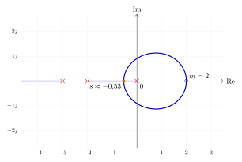

**4. Cruzamento com o eixo imaginário**

$$
s^3+5s^2+6s+K(s^2-4s+4)=0
$$
$$
s^3+5s^2+6s+Ks^2-4Ks+4K=0
$$

Substituindo $s=j\omega$:

$$
(j\omega)^3+5(j\omega)^2+6j\omega+K(j\omega)^2-4K(j\omega)+4K=0
$$
$$
-j\omega^3-5\omega^2+6j\omega-K\omega^2-4Kj\omega+4K=0
$$

Parte real:

$$
-5\omega^2-K\omega^2+4K=0
$$

Parte imaginária:

$$
-\omega^3+6\omega-4K\omega=0
$$

**Exercício para casa:** encontrar $K$ e $\omega$.

$$
s^3+(K+5)s^2+(6-4K)s+4K=0
$$

| Potência | Primeira coluna | Segunda coluna |
|---|---|---|
| $s^3$ | 1 | $6-4K$ |
| $s^2$ | $K+5$ | $4K$ |
| $s^1$ | $c_1$ | |
| $s^0$ | $d_1$ | |

$$
c_1=\frac{(K+5)(6-4K)-(4K\times1)}{K+5}
$$
$$
d_1=4K
$$
$$
6K-4K^2+30-20K-4K=0
$$
$$
-4K^2-18K+30=0
$$
$$
\boxed{K_{\mathrm{crit}}=\frac{-9+\sqrt{201}}{4}\approx1{,}29436},\qquad K_{\mathrm{neg}}\approx-5{,}79436
$$

$$
Q(s)=(K_{\mathrm{crit}}+5)s^2+4K_{\mathrm{crit}}
$$

$$
\boxed{s=\pm j\sqrt{\frac{4K_{\mathrm{crit}}}{K_{\mathrm{crit}}+5}}\approx\pm j0{,}90695}
$$

A faixa de estabilidade assintótica é $0<K<K_{\mathrm{crit}}$. Em $K=K_{\mathrm{crit}}$, há um par imaginário simples e o terceiro polo é $-(5+K_{\mathrm{crit}})$. Para $K>K_{\mathrm{crit}}$, a primeira coluna de Routh tem duas mudanças de sinal.

## Exemplo 4 — Sistema com zeros complexos

Considere um sistema representado pela seguinte função de transferência e esboce o LGR:

$$
G(s)H(s)=\frac{K(s^2+6s+12)}{s(s+2)^2}
$$

> Nota de revisão: o enunciado original trazia $s^2+6s+5$, cujas raízes são $-1$ e $-5$. Como o título, os zeros anotados, todos os cálculos subsequentes e os gráficos usam $s^2+6s+12$, esta resolução adota esse numerador. Se o enunciado original com $+5$ for confirmado pelo professor, trata-se de outro exercício, com LGR diferente.

- Zeros: $z=-3\pm j\sqrt3$ ($m=2$).
- Polos: $0,-2,-2$ ($n=3$).

**Solução:**

**1. Marcar polos e zeros:**

  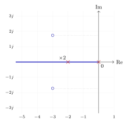

- $(0,+\infty)$ não pertence ao LGR.
- $(-2,0)$ e $(-\infty,-2)$ pertencem ao LGR. O polo duplo em $-2$ conta duas vezes.

**2. Assíntotas: $n-m=3-2=1$, somente uma assíntota em $180^\circ$.**

$$
\boxed{\alpha_0=180^\circ},\qquad \sigma=\frac{-4-(-6)}{1}=2
$$

**3. Pontos de saída/entrada:**

$$
D(s)+KN(s)=0
$$
$$
s^3+4s^2+4s+K(s^2+6s+12)=0
$$
$$
K=-\left[\frac{s^3+4s^2+4s}{s^2+6s+12}\right]
$$

Aplicando $dK/ds=0$.

$$
0=-\left[\frac{(3s^2+8s+4)(s^2+6s+12)-(s^3+4s^2+4s)(2s+6)}{(s^2+6s+12)^2}\right]
$$

$$
3s^4+18s^3+36s^2+8s^3+48s^2+96s+4s^2+24s+48-2s^4-8s^3-8s^2-6s^3-24s^2-24s=0
$$

$$
s^4+12s^3+56s^2+96s+48=0
$$

As raízes são $-2$, $-0{,}85051$ e $-4{,}57474\pm j2{,}69999$. O polo duplo $-2$ é ponto inicial ($K=0$). O ponto de saída para ganho positivo é $s\approx-0{,}85051$, com $K\approx0{,}14747$.

O polinômio de malha fechada é $s^3+(4+K)s^2+(4+6K)s+12K$. Para $K>0$, todos os elementos da primeira coluna de Routh são positivos, pois $(4+K)(4+6K)-12K=6K^2+16K+16>0$. Portanto, o sistema é assintoticamente estável para todo $K>0$.

*LGR para o numerador $s^2+6s+12$.*

  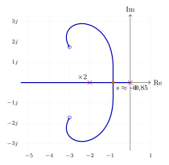

**4. Ângulo de chegada sobre os zeros complexos:**

$$
\phi_{z_j}=\sum_{i=1}^n\theta_{p_i}-\sum_{i\neq j}^m\theta_{z_i}+180^\circ
$$

  

$$
\phi_{p_0}=180^\circ-\arctan\left(\frac{\sqrt3}{3}\right)=150^\circ
$$
$$
\phi_{p_1}=180^\circ-\arctan(\sqrt3)=120^\circ
$$
$$
\phi_{z_1}=(150^\circ+2\cdot120^\circ)-90^\circ+180^\circ
$$
$$
\phi_{z_1}=480^\circ\equiv\boxed{120^\circ}\pmod{360^\circ}
$$

Para o zero inferior, por simetria, o ângulo é $-120^\circ$ (ou $240^\circ$).

*Traçado para os zeros indicados na resolução; a direção de chegada é representada pelo ângulo equivalente módulo $360^\circ$.*

  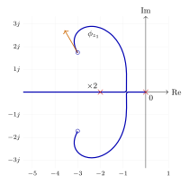

## Exemplo 5 — Sistema de quarta ordem

Esboce o gráfico do LGR para o sistema:

$$
G(s)H(s)=\frac{K}{s(s+3)(s^2+6s+64)}
$$

- Zeros: nenhum ($m=0$).
- Polos: $0,-3,-3\pm j\sqrt{55}\approx-3\pm j7{,}4162$ ($n=4$).
- Polos: $0,-3,-3\pm7{,}4j$ ($n=4$).

  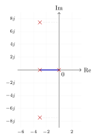

- $(-\infty,-3)$ e $(0,+\infty)$ não pertencem ao LGR.
- $(-3,0)$ pertence ao LGR.

**2. Assíntotas:** $n-m=4$.

$$
\alpha_0=\frac{180^\circ}{4}=45^\circ
$$
$$
\alpha_1=\frac{3\times180^\circ}{4}=135^\circ
$$
$$
\alpha_2=\frac{5\times180^\circ}{4}=225^\circ
$$
$$
\alpha_3=\frac{7\times180^\circ}{4}=315^\circ
$$

As assíntotas cruzam o eixo real em:

$$
\sigma=\frac{(0-3-3-3)-0}{4}=-\frac94=-2{,}25
$$

  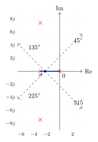

**3. Ponto de saída/entrada:**

$$
D(s)+KN(s)=0
$$
$$
s^4+6s^3+64s^2+3s^3+18s^2+192s+K=0
$$
$$
s^4+9s^3+82s^2+192s+K=0
$$
$$
K=-[s^4+9s^3+82s^2+192s]
$$

$$
\frac{dK}{ds}=0\quad\longrightarrow\quad4s^3+27s^2+164s+192=0
$$

Raízes:

$$
\boxed{s\approx-1{,}43895},\qquad s\approx-2{,}65553\pm j5{,}12892
$$

O ponto real é válido, com $K\approx129{,}01890$.

**4. Cruzamento com o eixo imaginário (complemento):**

$$
\Delta(j\omega)=\omega^4-82\omega^2+K+j(192\omega-9\omega^3)=0
$$

Para $\omega\neq0$, segue que $\omega^2=192/9=64/3$. Assim:

$$
\boxed{K_{\mathrm{crit}}=82\frac{64}{3}-\left(\frac{64}{3}\right)^2=\frac{11648}{9}\approx1294{,}2222}
$$
$$
\boxed{s=\pm j\frac{8}{\sqrt3}\approx\pm j4{,}6188}
$$

A primeira coluna de Routh é $1,9,182/3,(34944-27K)/182,K$. Logo, $0<K<11648/9$ garante estabilidade assintótica. Para $K>11648/9$, há dois polos no semiplano direito.

**5. Ângulo de partida (complemento):** no polo $p=-3+j\sqrt{55}$, os ângulos dos vetores dos outros polos são $112{,}0243^\circ$, $90^\circ$ e $90^\circ$. Portanto:

$$
\phi_p=180^\circ-(112{,}0243^\circ+90^\circ+90^\circ)\equiv247{,}9757^\circ\pmod{360^\circ}
$$

O polo inferior possui ângulo conjugado $112{,}0243^\circ$.

## Exemplo 6 — Sistema com malha interna e externa

Considere o seguinte sistema:

  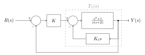

$$
D(s)+KN(s)=0
$$

**Solução — Malha interna:**

$$
G_1(s)=\frac{s^2+1}{s(s+2)},\qquad H_1(s)=K_t s
$$
$$
T_1(s)=\frac{G_1(s)}{1+G_1(s)H_1(s)}
$$
$$
T_1(s)=\frac{\frac{s^2+1}{s(s+2)}}{1+\frac{K_t s(s^2+1)}{s(s+2)}}
$$
$$
T_1(s)=\frac{s^2+1}{s(s+2)+K_t s(s^2+1)}
$$

**Malha externa:**

$$
G_2(s)=\frac{K(s^2+1)}{s(s+2)+K_t s(s^2+1)},\qquad H_2(s)=1
$$
$$
T_2(s)=\frac{G_2(s)}{1+G_2(s)H_2(s)}
$$
$$
T_2(s)=\frac{K(s^2+1)}{s(s+2)+K_t s(s^2+1)+K(s^2+1)}
$$

Equação característica:

$$
s(s+2)+K_t s(s^2+1)+K(s^2+1)=0
$$

Considerando $K_t=1$, temos:

$$
s(s+2)+s(s^2+1)+K(s^2+1)=0
$$
$$
s^3+s^2+3s+K(s^2+1)=0
$$
$$
L(s)=\frac{K(s^2+1)}{s^3+s^2+3s}
$$

- Zeros: $\pm j$, $m=2$.
- Polos: $0,-\frac12\pm j\frac{\sqrt{11}}2\approx-0{,}5\pm j1{,}65831$, $n=3$.
- Polos: $0,-0{,}5\pm1{,}65j$, $n=3$.

**1. Segmentos:** o intervalo de $-\infty$ a $0$ faz parte do LGR; de $0$ a $+\infty$ não faz parte.

  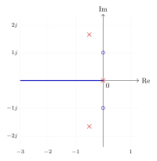

**2. Assíntotas:** $n-m=1$.

$$
\alpha_0=\frac{180^\circ}{1}=180^\circ,\qquad \sigma=-1
$$

**3. Pontos de saída/entrada:** a equação característica é dada por:

$$
s^3+s^2+3s+K(s^2+1)=0
$$
$$
K=-\left(\frac{s^3+s^2+3s}{s^2+1}\right)
$$

Aplicando $dK/ds=0$:

$$
\frac{(3s^2+2s+3)(s^2+1)-(s^3+s^2+3s)(2s)}{(s^2+1)^2}=0
$$
$$
s^4+2s+3=0
$$

Raízes aproximadas:

$$
0{,}95132\pm j1{,}19608,\qquad-0{,}95132\pm j0{,}61598
$$

Não há candidatos reais para pontos de saída/entrada no eixo real. A primeira coluna de Routh para $s^3+(1+K)s^2+3s+K=0$ é $1,1+K,(3+2K)/(1+K),K$. Para todo $K>0$, a dinâmica de malha fechada é assintoticamente estável.

**4. Ângulos de partida/chegada dos polos/zeros complexos:**

  

Para o polo superior $p_1=-0{,}5+j\sqrt{11}/2$:

$$
\phi_{p_2}=90^\circ
$$
$$
\phi_{p_0}=180^\circ-\arctan(\sqrt{11})\approx106{,}77865^\circ
$$
$$
\theta_{z_1}=180^\circ-\arctan(\sqrt{11}-2)\approx127{,}21732^\circ
$$
$$
\theta_{z_2}=180^\circ-\arctan(\sqrt{11}+2)\approx100{,}65227^\circ
$$
$$
\phi_{p_1}=180^\circ+\theta_{z_1}+\theta_{z_2}-\phi_{p_0}-\phi_{p_2}
$$
$$
\boxed{\phi_{p_1}\approx211{,}09093^\circ},\qquad \phi_{p_2}\approx148{,}90907^\circ
$$

Para a chegada ao zero superior $z_1=j$, os ângulos dos vetores dos polos $0,p_1,p_2$ são $90^\circ,-52{,}78268^\circ,79{,}34773^\circ$ e o do outro zero é $90^\circ$. Logo:

$$
\boxed{\theta_{z_1}\approx206{,}56505^\circ},\qquad\theta_{z_2}\approx153{,}43495^\circ
$$

### Exercícios para casa

  

No cálculo do ângulo de chegada ao zero superior, os vetores desde o polo na origem e desde o zero inferior têm ângulo $90^\circ$. Confira os demais ângulos e o esboço com o desenvolvimento anterior.

Exercício para casa:

- $K_t=0$ ($K\geq0$).
- $K=1$ ($K_t\geq0$).
- $K=0$ ($K_t\geq0$).

**Orientação para os exercícios:** varie apenas um ganho por vez, a partir da equação característica original. Para $K_t=0$, o polinômio é $(1+K)s^2+2s+K$. Para $K=1$, é $K_t s^3+2s^2+(2+K_t)s+1$. Para $K=0$, é $s[K_t s^2+s+(2+K_t)]$, com um modo fixo na origem. Neste último caso, a FT de referência para saída é nula; não confundir isso com ausência de modos internos. Ao variar $K_t$ a partir de zero, a ordem do polinômio muda, exigindo tratamento do ramo no infinito e do caso limite separadamente.

## Referências para estudo e revisão

- University of Washington — Xu Chen, [Lecture 13: The Root Locus Technique](https://faculty.washington.edu/chx/teaching/fbintro/lec13-root-locus-technique/): condições de fase e módulo, centroide, pontos de saída e cruzamento.
- University of Illinois Urbana-Champaign — [ECE 486: Lecture 11](https://courses.grainger.illinois.edu/ece486/sp2025/documentation/handbook/lec11.html): regras do LGR e análise de estabilidade.
- Kamran Iqbal — [Introduction to Control Systems, 5.1: Root Locus Fundamentals](https://eng.libretexts.org/Bookshelves/Industrial_and_Systems_Engineering/Introduction_to_Control_Systems_%28Iqbal%29/05%3A_Control_System_Design_with_Root_Locus/5.01%3A_Control_System_Design_with_Root_Locus).
- Bibliografia complementar: Katsuhiko Ogata, *Engenharia de Controle Moderno*; Norman S. Nise, *Engenharia de Sistemas de Controle*.

*Nota: revisão matemática das anotações, com complementos explicitados nos exemplos. As figuras são esboços e não substituem o cálculo da equação característica.*

