# Unidade 2 — Projeto de Controladores

## Projeto de controladores

  

  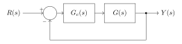

- Controlador $G_c(s)$: dispositivo físico ou algoritmo que modifica a dinâmica da malha fechada pela atuação de seus parâmetros.

**Exemplo:** motor elétrico CC. As funções de transferência usuais são $\Theta(s)/E_a(s)$ (posição angular) e $\Omega(s)/E_a(s)$ (velocidade angular). Um encoder pode medir posição e permitir estimar velocidade.

Projetar um controlador significa modificar a resposta de um sistema de modo que sua saída atenda a determinadas especificações:

1. Estabilidade interna da malha fechada.
2. Desempenho: sobressinal ($M_p$), tempo de acomodação ($t_s$, faixa de 2% ou 5%) e tempo de subida.
3. Erro em regime permanente.

**Convenções adotadas nesta unidade:** sistemas LTI contínuos, condições iniciais nulas, realimentação negativa unitária nos exercícios, salvo indicação contrária. Em série, $L(s)=G_c(s)G(s)$, $T(s)=L(s)/(1+L(s))$ e $E(s)=R(s)/(1+L(s))$. O teorema do valor final só é aplicável quando os polos de $sE(s)$ estão no semiplano esquerdo aberto. Para um degrau, $M_p$ e a faixa de acomodação são medidos em relação ao valor final da saída.

Para uma resposta padrão de segunda ordem subamortecida sem zeros:

$$
M_p(\%)=100e^{-\pi\zeta/\sqrt{1-\zeta^2}},\qquad t_s(2\%)\approx\frac{4}{\zeta\omega_n},\qquad t_s(5\%)\approx\frac{3}{\zeta\omega_n}
$$

$$
\zeta=\frac{-\ln(M_p/100)}{\sqrt{\pi^2+\ln^2(M_p/100)}}
$$

Esses tempos são aproximações; para sistemas de ordem superior ou com zeros relevantes, a localização dos polos não garante o desempenho temporal. Deve-se verificar a resposta completa. Nos exercícios revisados, as verificações numéricas utilizam o modelo contínuo ideal, sem saturação.

**Em série:**

  

**Por retroalimentação:**

  

## Controlador por avanço de fase

A compensação por avanço de fase introduz fase positiva, podendo aumentar a margem de fase, melhorar o amortecimento e acelerar a resposta. A redução do sobressinal não é garantida sem verificar a malha fechada.

O controlador por avanço de fase é dado pela seguinte FT:

$$
G_c(s)=K\frac{s+z}{s+p},\qquad K>0,\quad 0<z

  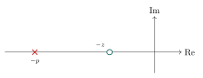

**Implementação analógica:** o circuito eletrônico de implementação é dado por:

  

1º estágio:

$$
\frac{V_{\text{saída}}}{V_{\text{entrada}}}=-\frac{Z_2}{Z_1}
$$

2º estágio:

$$
\frac{V_{\text{saída}}}{V_{\text{entrada}}}=-\frac{R}{R}=-1
$$

$$
Z_1=\frac{R_1\frac{1}{sC_1}}{R_1+\frac{1}{sC_1}}=\frac{R_1}{sC_1}\frac{sC_1}{1+sR_1C_1}=\frac{R_1}{sR_1C_1+1}
$$

$$
Z_2=\frac{R_2}{sR_2C_2+1}
$$

$$
\frac{V_{\text{saída}}}{V_{\text{entrada}}}=-\frac{\frac{R_2}{sR_2C_2+1}}{\frac{R_1}{sR_1C_1+1}}=-\frac{R_2}{sR_2C_2+1}\frac{sR_1C_1+1}{R_1}
$$

$$
=-\frac{sR_1R_2C_1+R_2}{sR_1R_2C_2+R_1}
$$

$$
\frac{V_{out}}{V_{in}}=-\left(\frac{sR_1R_2C_1+R_2}{sR_1R_2C_2+R_1}\right)(-1)
$$

$$
\frac{V_{out}}{V_{in}}=\frac{R_2}{R_1}\left(\frac{sR_1C_1+1}{sR_2C_2+1}\right)
$$

$$
\frac{V_{out}}{V_{in}}=\frac{R_2}{R_1}\left(\frac{R_1C_1(s+1/R_1C_1)}{R_2C_2(s+1/R_2C_2)}\right)
$$

$$
\frac{V_{out}}{V_{in}}=\frac{C_1}{C_2}\left(\frac{s+\frac{1}{R_1C_1}}{s+\frac{1}{R_2C_2}}\right)
$$

$$
K=\frac{C_1}{C_2},\qquad z=\frac{1}{R_1C_1},\qquad p=\frac{1}{R_2C_2}
$$

Para avanço, $R_1C_1>R_2C_2$. A análise supõe amplificadores operacionais ideais.

### Exemplo: servomecanismo composto por um motor de corrente contínua

Considere um servomecanismo composto por um motor de corrente contínua, dado pela seguinte função de transferência:

$$
\frac{\theta(s)}{E_a(s)}=\frac{5}{s(s+1)}
$$

**Solução:** análise do sistema sem controlador.

A função de transferência do sistema sem controlador é dada por:

$$
T(s)=\frac{G(s)}{1+G(s)H(s)}
$$

$$
T(s)=\frac{5}{s^2+s+5}
$$

$$
\boxed{T(s)=\frac{\omega_n^2}{s^2+2\zeta\omega_ns+\omega_n^2}}
$$

Comparando as duas equações:

$$
\omega_n^2=5\Rightarrow\boxed{\omega_n=\sqrt5\ \mathrm{rad/s}}
$$

(frequência natural não amortecida).

$$
2\zeta\omega_n=1\Rightarrow\zeta=\frac{1}{2\sqrt5}
$$

(razão de amortecimento, adimensional).

Segundo o critério de 2%:

$$
t_s\approx\frac{4}{\zeta\omega_n}=\frac{4}{1/2}=8\ \text{segundos}
$$

**Erro em regime permanente:**

$$
e(\infty)=\lim_{s\to0}sE(s)=\lim_{s\to0}s\left(\frac{1}{1+G(s)}\right)R(s)
$$

$$
e(\infty)=\lim_{s\to0}\frac{s(s+1)}{s(s+1)+5}=0
$$

O percentual de overshoot:

$$
M_p(\%)=\left[e^{-\zeta\pi/\sqrt{1-\zeta^2}}\right]\times100
$$

$$
M_p=48{,}6\%,\quad T_p=\frac{\pi}{\omega_d}\approx1{,}44\ \text{s},\quad T_r=\frac{\pi-\arccos\zeta}{\omega_d}\approx0{,}82\ \text{s}
$$

Aqui $T_r$ é o tempo de subida de 0% a 100% na primeira passagem; $t_s$ real (2%) é aproximadamente 7,56 s. O gráfico marca a estimativa de 8 s.

  

Tipo 1, $R(s)=1/s$, $e(\infty)=0$.

- $t_s(2\%)=8\,s$ ✗
- $M_p(\%)=48{,}6\%$ ✗
- $e(\infty)=0$ ✓

Projetando um controlador por avanço de fase com os seguintes critérios:

- $t_s=2\,s$.
- $M_p=16\%$.
- $e(\infty)=$ nulo.

Considerando um sistema em malha com controlador, o tempo de acomodação será:

$$
t_s\approx\frac{4}{\zeta\omega_n}\Rightarrow\zeta\omega_n=\frac42=2
$$

Para $M_p=16\%$, $\zeta\approx0{,}504$, arredondado para $0{,}5$ no projeto geométrico original:

$$
\omega_n\approx\frac{2}{0{,}5}=4\ \text{rad/s}
$$

Os polos dominantes do sistema do controlador são dados por:

$$
s=-\zeta\omega_n\pm\omega_n\sqrt{1-\zeta^2}\,j=-2\pm4\sqrt{1-1/4}\,j
$$

$$
s=-2\pm4\sqrt{3\times\frac14}\,j
$$

$$
s=-2\pm\frac{4\sqrt3}{2}\,j
$$

$$
\boxed{s=-2\pm2\sqrt3\,j}
$$

**Lugar geométrico das raízes (LGR):**

1. Condição de fase: $\angle G_{ma}(s)=(2k+1)180^\circ$, $k\in\mathbb Z$, para ganho real positivo.
2. Condição de módulo: $|G_{ma}(s)|=1$. Se $G_{ma}(s)=KF(s)$, então $K=1/|F(s)|$.

Controlador por avanço de fase:

$$
G_c=K\frac{s+z}{s+p}
$$

A FT do sistema com controlador é dada por:

$$
G_{ma}=G(s)G_c(s)
$$

$$
G_{ma}=\frac{K(s+z)}{s+p}\frac{5}{s(s+1)}=\frac{5K(s+z)}{s(s+1)(s+p)}
$$

Escolhe-se o zero em $-z=-2$. O diagrama a seguir mostra os vetores de fase no polo desejado (não o traçado completo do LGR):

  

$$
\angle(s+z)-\angle s-\angle(s+1)-\angle(s+p)\equiv180^\circ\pmod{360^\circ}
$$

$$
\theta_z=90^\circ,\quad\theta_{p0}=120^\circ,\quad\theta_{p1}=180^\circ-\arctan(2\sqrt3)\approx106{,}10^\circ
$$

$$
\theta_p=90^\circ-120^\circ-106{,}10^\circ+180^\circ\approx43{,}90^\circ
$$

$$
\arctan\left(\frac{2\sqrt3}{p-2}\right)=\theta_p\Rightarrow\boxed{p=5{,}6}
$$

Utilizando a condição de módulo:

$$
K=\left.\frac{|s|\,|s+1|\,|s+5{,}6|}{5|s+2|}\right|_{s=-2+2\sqrt3j}=4{,}16
$$

$$
\boxed{G_c(s)=4{,}16\frac{s+2}{s+5{,}6}}
$$

Verificação pela equação característica:

$$
\Delta(s)=s(s+1)(s+5{,}6)+20{,}8(s+2)=(s+2{,}6)(s^2+4s+16)
$$

O par desejado é obtido, mas o terceiro polo em $-2{,}6$ não está suficientemente afastado e o zero também influencia a resposta. A resposta completa ao degrau apresenta $M_p\approx27{,}4\%$, $t_s(2\%)\approx2{,}05\,\mathrm{s}$ e erro final nulo. Portanto, o projeto original **não atende** ao sobressinal de 16%.

**Alternativa revisada (se as metas forem limites máximos):** por ajuste numérico dos parâmetros mantendo a estrutura de avanço, $G_c(s)=26\,(s+2{,}8)/(s+56)$. A validação temporal é apresentada ao final da unidade. Se forem exigidas igualdades exatas, será necessário ajustar especificamente essas metas, em vez de interpretar os valores como limites.

## Controlador por atraso de fase

O controlador por atraso de fase é indicado quando se deseja melhorar o erro em regime permanente com pequena alteração da dinâmica na faixa dos polos originalmente dominantes. Pode introduzir uma cauda lenta na resposta.

$$
\boxed{G_c(s)=K\frac{s+z}{s+p},\qquad K>0,\quad 0<p<z}
$$

Representado no plano complexo $s$, temos:

  

**Observação:** o polo do controlador deve estar localizado mais próximo da origem, quando comparado ao zero.

**Implementação analógica:** o controlador por atraso de fase pode ser implementado pelo seguinte circuito:

  

A função de transferência do circuito é dada por:

$$
\frac{V_{out}}{V_{in}}=\frac{C_1}{C_2}\left(\frac{s+1/(R_1C_1)}{s+1/(R_2C_2)}\right)
$$

$$
K=\frac{C_1}{C_2},\qquad z=\frac{1}{R_1C_1},\qquad p=\frac{1}{R_2C_2}
$$

- $R_1C_1<R_2C_2$: controlador por **atraso** de fase ($z>p$).
- $R_1C_1>R_2C_2$: controlador por **avanço** de fase ($z<p$).

Atraso e avanço não são idênticos a PI e PD: ambos possuem polo e zero finitos; PI tem polo na origem e PD ideal não possui polo finito.

### Exemplo: redução do erro em regime permanente

Considere o sistema dado pela FT:

$$
G(s)=\frac{1}{(s+0{,}5)(s+2)}
$$

Considerando um degrau unitário na entrada, o erro em regime permanente é dado por:

$$
e(\infty)=\lim_{s\to0}sE(s)
$$

$$
e(\infty)=\lim_{s\to0}s\left(\frac{1}{1+G(s)}\right)R(s)
$$

$$
e(\infty)=\lim_{s\to0}s\left(\frac{1}{1+\frac{1}{(s+0{,}5)(s+2)}}\right)\frac{1}{s}
$$

$$
e(\infty)=\frac{1}{1+1/1}=\frac12=50\%
$$

  

Com base nessas informações, projete um controlador por atraso de fase de modo a reduzir o erro em regime permanente em 10 vezes sem alterar de forma significativa a resposta transitória do sistema.

A função de transferência do sistema de malha aberta é dada por:

$$
G_c=K\frac{s+z}{s+p},\qquad G(s)=\frac{1}{(s+0{,}5)(s+2)}
$$

$$
G_{ma}(s)=G_c(s)G(s)=\frac{K(s+z)}{(s+p)(s+0{,}5)(s+2)}
$$

$$
e(\infty)=\lim_{s\to0}s\left(\frac{1}{1+\frac{K(s+z)}{(s+p)(s+0{,}5)(s+2)}}\right)\frac1s
$$

$$
e(\infty)=\frac{1}{1+\frac{Kz}{p}}
$$

Escolhe-se $K=1$ para manter o ganho aproximadamente unitário em frequências muito superiores a $p$ e $z$. Isso não garante que a resposta transitória permaneça inalterada:

$$
e(\infty)=\frac{1}{1+\frac zp}
$$

$$
e(\infty)=0{,}05
$$

Reduzir 10 vezes: $(0{,}5/10)=0{,}05$.

$$
\frac{1}{1+z/p}=0{,}05
$$

$$
0{,}05+0{,}05\frac zp=1
$$

$$
\frac zp=\frac{1-0{,}05}{0{,}05}
$$

$$
\boxed{\frac zp=19}
$$

Como o zero deve ser localizado próximo da origem, considerando $p=0{,}01$, temos:

$$
z=19\times0{,}01=0{,}19
$$

$$
G_c(s)=\frac{s+0{,}19}{s+0{,}01}
$$

A malha fechada é estável (polos aproximadamente $-0{,}114$ e $-1{,}198\pm0{,}563j$), e o erro é de 5%. Porém, surge uma cauda lenta: $t_s(2\%)\approx27{,}6\,\mathrm{s}$. Logo, a redução do erro é atendida, mas a preservação da resposta transitória completa não está demonstrada. Deslocar o par polo-zero para mais perto da origem preserva melhor a dinâmica rápida, mas pode tornar a cauda ainda mais lenta. A especificação de resposta transitória precisa de uma tolerância quantitativa.

## Controlador proporcional (P)

Para um controlador proporcional, a relação entre o sinal de controle e o de erro é dada por:

$$
u(t)=K_pe(t)
$$

$K_p$: ganho proporcional.

Representando no domínio da frequência, temos:

$$
\frac{U(s)}{E(s)}=K_p
$$

**Análise:** considere a seguinte FT:

$$
G(s)=\frac{1}{(s+1)(s+5)},\qquad G_c(s)=K_p
$$

A função de transferência do sistema com controle é dada por:

$$
G_{ma}(s)=\frac{K_p}{(s+1)(s+5)}
$$

O erro é dado por:

$$
e(\infty)=\lim_{s\to0}sE(s),\qquad R(s)=\frac1s
$$

$$
e(\infty)=\lim_{s\to0}s\left(\frac{1}{1+\frac{K_p}{(s+1)(s+5)}}\right)\frac1s
$$

$$
\boxed{e(\infty)=\frac5{5+K_p}}
$$

- Para esta planta e $K_p>0$, aumentar $K_p$ reduz o erro final, mas pode aumentar o sobressinal. Em geral, deve-se verificar estabilidade e desempenho antes de aumentar o ganho.

**Implementação analógica:** o circuito de implementação de um controlador proporcional é dado por:

  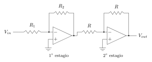

$$
\frac{V_{out}}{V_{in}}=\frac{R_2}{R_1}
$$

### Projeto de controlador P

Considere um sistema representado pela seguinte função de transferência:

$$
G(s)=\frac1{s(s+1)(s+2)},\qquad R(s)=\frac1s
$$

Projete um controlador proporcional de modo que a resposta do sistema em malha fechada com controle, para uma entrada do tipo degrau unitário, tenha:

- Tempo de acomodação $t_s(2\%)\leq10\,s$.
- Sobressinal $M_p\leq10\%$ ($\zeta=0{,}591$).

**Solução:** lugar geométrico das raízes do sistema $G(s)$.

  

Com controlador proporcional:

1. Tempo de acomodação:

$$
t_s\approx\frac4{\zeta\omega_n}\Rightarrow\zeta\omega_n=0{,}4
$$

$$
\omega_n=\frac{0{,}4}{0{,}591}=0{,}67\ \text{rad/s}
$$

2. Polos dominantes:

$$
s=-\zeta\omega_n\pm\omega_n\sqrt{1-\zeta^2}\,j
$$

$$
\boxed{s=-0{,}4\pm0{,}55j}
$$

A equação característica do sistema com o controlador é dada por:

$$
1+G_{ma}=0
$$

$$
1+\frac{K_p}{s(s+1)(s+2)}=0
$$

$$
s(s+1)(s+2)+K_p=0
$$

$$
K_p=-s(s+1)(s+2)
$$

No ponto aproximado $s=-0{,}4+0{,}55j$, a avaliação fornece:

$$
-s(s+1)(s+2)\approx0{,}9285+0{,}122375j
$$

Como o resultado não é real, o ponto não pertence ao LGR para ganho positivo. Não se pode usar apenas o módulo para calcular $K_p$. O valor do caderno, $K_p\approx0{,}93$, produz sobressinal real de aproximadamente 12,4%, acima do limite.

**Solução revisada:** escolhendo um ponto efetivo do LGR por ajuste do ganho, $\boxed{K_p=0{,}5}$. A malha fechada é

$$
T(s)=\frac{0{,}5}{s^3+3s^2+2s+0{,}5}
$$

Os polos são $-2{,}1915$ e $-0{,}4043\pm0{,}2544j$. A simulação ao degrau fornece $M_p\approx0{,}66\%$ e $t_s(2\%)\approx9{,}23\,\mathrm{s}$: ambos os limites são atendidos.

### Exemplo adicional

Considere um sistema representado pela seguinte FT:

$$
G(s)=\frac1{(s+1)(s+5)},\qquad R(s)=\frac1s
$$

Projete um controlador proporcional de modo que a resposta do sistema em malha fechada com controle, para uma entrada do tipo degrau unitário, tenha:

- Tempo de acomodação $t_s(2\%)\leq2\,s$.
- Sobressinal $M_p\leq10\%$ ($\zeta=0{,}591$).

Solução: para que as condições de desempenho sejam atendidas, temos que:

$$
t_s(2\%)=\frac4{\zeta\omega_n}\Rightarrow\zeta\omega_n=\frac42=2
$$

$$
\omega_n=\frac2{0{,}591}=3{,}4\ \text{rad/s}
$$

$$
s=-\zeta\omega_n\pm\omega_n\sqrt{1-\zeta^2}\,j=-2\pm2{,}7j
$$

O LGR do sistema é dado por:

  

$$
\theta=\tan^{-1}(2{,}7/2)=53{,}47^\circ
$$

$$
\theta=\tan^{-1}(\omega_d/3),\qquad\tan\theta=\omega_d/3
$$

$$
\omega_d=3\tan(53{,}47^\circ)=4{,}05
$$

Polos dominantes para o controlador proporcional:

$$
s=-3\pm4{,}05j
$$

$$
1+G_{ma}(s)=0,\qquad G_{ma}(s)=\frac{K_p}{(s+1)(s+5)}
$$

$$
1+\frac{K_p}{(s+1)(s+5)}=0
$$

$$
(s+1)(s+5)+K_p=0\Rightarrow K_p=-(s+1)(s+5)
$$

Aplicando o módulo em ambos os lados:

$$
K_p=|s+1|\,|s+5|
$$

Considerando $s=-3\pm4{,}05j$:

$$
K_p=|-3+4{,}05j+1|\,|-3+4{,}05j+5|
$$

$$
K_p=|-2+4{,}05j|\,|2+4{,}05j|
$$

$$
K_p=\sqrt{2^2+4{,}05^2}\sqrt{2^2+4{,}05^2}
$$

$$
\boxed{K_p\approx20{,}4}
$$

A malha fechada possui polos $-3\pm4{,}05j$, $M_p\approx9{,}76\%$ e $t_s(2\%)\approx1{,}18\,\mathrm{s}$, medidos em relação ao valor final $20{,}4/25{,}4\approx0{,}803$. Ambas as especificações transitórias são satisfeitas; o erro final não é nulo.

## Controlador proporcional e derivativo (PD)

O controlador PD é constituído pela soma de uma ação proporcional com uma ação derivativa. A relação do sinal de controle e o erro é dada por:

$$
u(t)=K_p\left(e(t)+\tau_d\frac{de(t)}{dt}\right)
$$

- $K_p$: ganho proporcional.
- $\tau_d$: constante de tempo.

A função de transferência do controlador PD é dada por:

$$
U(s)=K_p(1+\tau_ds)E(s)
$$

$$
U(s)=(K_p+K_ds)E(s),\qquad K_d=K_p\tau_d
$$

O PD ideal é impróprio; em aplicações físicas, limita-se a ação derivativa com um filtro, por exemplo $K_ds/(1+T_fs)$, $T_f>0$.

Zero: $s=-1/\tau_d$.

Representando no plano complexo $s$, temos um zero em $-1/\tau_d$.

  

**Implementação analógica:**

  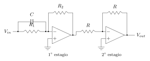

$$
Z_2(s)=R_2
$$

$$
Z_1(s)=R_1\parallel\frac1{sC}=\frac{R_1\frac1{sC}}{R_1+\frac1{sC}}
$$

$$
Z_1(s)=\frac{R_1}{sC}\frac{sC}{1+sR_1C}=\frac{R_1}{1+sR_1C}
$$

$$
\frac{V_{out}(s)}{V_{in}(s)}=\frac{R_2}{\frac{R_1}{1+sR_1C}}=\frac{R_2}{R_1}(1+sR_1C)
$$

$$
K_p=\frac{R_2}{R_1},\qquad\tau_d=R_1C
$$

$$
G_c(s)=K_p(1+s\tau_d)
$$

**Exemplo:** considere um sistema representado pela seguinte função de transferência:

$$
G(s)=\frac{40}{s(s+2)},\qquad R(s)=\frac1s
$$

Tipo 1, $e(\infty)=0$.

### Projeto de controlador PD

**Exemplo:** considere um sistema representado pela seguinte função de transferência:

$$
G(s)=\frac{40}{s(s+2)},\qquad R(s)=\frac1s
$$

Projete um controlador PD de modo que o sistema tenha:

1. Erro nulo em regime permanente.
2. Tempo de acomodação $t_s(2\%)=1\,s$.
3. Máximo sobressinal $M_p(\%)=25\%$ ($\zeta=0{,}4$).

**Solução:** polos desejados pelo modelo padrão de segunda ordem. Para 25%, $\zeta\approx0{,}404$; mantém-se o arredondamento $0{,}4$ das anotações.

$$
t_s\approx\frac4{\zeta\omega_n}\Rightarrow\omega_n\approx\frac4{0{,}4\times1}=10\ \mathrm{rad/s}
$$

$$
s=-4\pm10\sqrt{1-0{,}4^2}\,j
$$

$$
\boxed{s=-4\pm9{,}16j}
$$

O lugar geométrico das raízes do sistema é dado por:

  

$$
G_c(s)=K_p(1+s\tau_d)
$$

$$
z=\frac1{\tau_d}
$$

Com a inserção do controlador:

  

$$
\theta_0=180^\circ-\tan^{-1}\left(\frac{9{,}16}{4}\right)=113{,}59^\circ
$$

$$
\theta_1=180^\circ-\tan^{-1}\left(\frac{9{,}16}{2}\right)=102{,}31^\circ
$$

$$
\theta_z=\tan^{-1}\left(\frac{9{,}16}{z-4}\right)
$$

Utilizando a condição de fase, temos:

$$
\theta_z\equiv\theta_0+\theta_1+180^\circ\pmod{360^\circ}
$$

$$
\theta_z\approx35{,}9^\circ\Rightarrow z=4+\frac{\sqrt{84}}{\tan\theta_z}\approx16{,}67
$$

$$
\boxed{\tau_d=\frac1z=0{,}06\ \mathrm{s}}
$$

Utilizando a condição de módulo, temos:

$$
|G_{ma}(s)|=1
$$

$$
G_{ma}(s)=G_c(s)G(s)=\frac{K_p(1+0{,}06s)\times40}{s(s+2)}
$$

$$
\left.\left|\frac{40K_p(1+0{,}06s)}{s(s+2)}\right|\right|_{s=-4+9{,}16j}=1
$$

$$
K_p=\left.\frac{|s|\,|s+2|}{40|1+0{,}06s|}\right|_{s=-4+9{,}16j}
$$

$$
K_p=\frac{10\sqrt{88}}{40|1+0{,}06(-4+j\sqrt{84})|}=2{,}5
$$

$$
\boxed{G_c(s)=2{,}5+0{,}15s}
$$

Verificação: $T(s)=(6s+100)/(s^2+8s+100)$, com os polos desejados. O zero altera a resposta: $M_p\approx31{,}3\%$ e $t_s(2\%)\approx0{,}97\,\mathrm{s}$. O erro ao degrau é nulo, porém o sobressinal excede 25%.

**Alternativa revisada para limites máximos:** $G_c(s)=1+0{,}28s$, obtida por ajuste da resposta completa, com desempenho indicado na tabela final.

### Exemplo adicional

Considere um sistema dado por:

$$
G(s)=\frac1{s(s+4)(s+6)},\qquad R(s)=\frac1s
$$

$$
\zeta=0{,}456,\qquad\omega_n=5\ \text{rad/s}
$$

**Solução:** polos dominantes.

$$
s=-0{,}456\times5\pm5\sqrt{1-(0{,}456)^2}\,j
$$

$$
s=-2{,}3\pm4{,}45j
$$

Diagrama dos vetores de fase no polo desejado:

  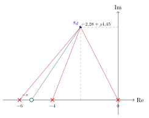

Com os valores não arredondados, $s_d=-2{,}28+j4{,}4499$. Pela condição de fase, $\theta_z\equiv\angle s_d+\angle(s_d+4)+\angle(s_d+6)+180^\circ\pmod{360^\circ}$.

A condição de módulo fornece $K_p=|s_d(s_d+4)(s_d+6)|/|1+s_d\tau_d|$. Uma conferência exata por comparação de coeficientes evita propagar arredondamentos:

$$
\Delta(s)=s^3+10s^2+(24+K_d)s+K_p=(s+5{,}44)(s^2+4{,}56s+25)
$$

$$
\boxed{K_p=136,\qquad K_d=25{,}8064}
$$

$$
\boxed{\tau_d=0{,}18975\ \mathrm{s},\qquad z=5{,}2700}
$$

A malha fechada tem os polos desejados, além do polo $-5{,}44$. O diagrama é aproximado. As fórmulas de segunda ordem não determinam exatamente a resposta com esse zero.

## Controlador proporcional-integral (PI)

A atuação do controlador PI corresponde à soma de uma ação proporcional com uma ação integral. Para o controlador PI, a relação entre o sinal de controle e o erro é dada por:

$$
u(t)=K_p\left(e(t)+\frac1{\tau_i}\int_0^t e(\tau)\,d\tau\right)
$$

A função de transferência do controlador PI é dada por:

$$
U(s)=\frac{K_ps+K_i}{s}E(s),\qquad K_i=\frac{K_p}{\tau_i}
$$

Baseado na equação acima, temos um polo na origem ($s=0$) e zero ($s=-1/\tau_i$).

Representando no plano complexo $s$, temos:

  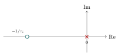

**Implementação analógica:** o controlador PI pode ser implementado pelo seguinte circuito:

  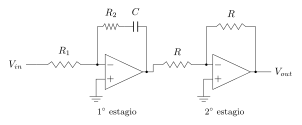

$$
Z_1(s)=R_1
$$

$$
Z_2(s)=R_2+\frac1{sC}=\frac{1+sR_2C}{sC}
$$

$$
\frac{V_{out}(s)}{V_{in}(s)}=\frac{\frac{1+sR_2C}{sC}}{R_1}=\frac{1+sR_2C}{sR_1C}
$$

Multiplicando a equação acima por $1/(R_2C)$, temos que:

$$
\frac{V_{out}(s)}{V_{in}(s)}=\frac{(1+sR_2C)\times1/(R_2C)}{(sR_1C)\times1/(R_2C)}
$$

$$
\frac{V_{out}(s)}{V_{in}(s)}=\frac{s+1/(R_2C)}{sR_1/R_2}
$$

$$
\frac{V_{out}}{V_{in}}=\frac{R_2}{R_1}\left(\frac{s+1/(R_2C)}s\right)
$$

$$
K_p=\frac{R_2}{R_1},\qquad\tau_i=R_2C
$$

$$
G_c(s)=K_p\frac{s+1/\tau_i}{s}
$$

### Projeto de controlador PI

Considere um sistema dado pela seguinte função de transferência:

$$
G(s)=\frac{10}{(s+2)(s+5)}
$$

Projete um controlador PI de modo que a resposta do sistema em malha fechada com o controlador, para uma entrada degrau unitário, tenha:

1. Erro nulo em regime permanente.
2. Tempo de acomodação $t_s(5\%)=1{,}5\,s$.
3. Máximo sobressinal $M_p(\%)=0{,}63\%$ (para o modelo padrão de segunda ordem, $\zeta\approx0{,}850$).

**Solução:** planta tipo 0 e $R(s)=1/s$. Para preservar o diagrama e o método das anotações, o projeto geométrico a seguir utiliza o valor aproximado original $\zeta=0{,}857$ e os polos arredondados $-2\pm1{,}2j$. A validação do sobressinal real é feita separadamente.

Polos dominantes:

$$
s=-\zeta\omega_n\pm\omega_n\sqrt{1-\zeta^2}\,j
$$

$$
t_s(5\%)=\frac3{\zeta\omega_n}\Rightarrow1{,}5=\frac3{\zeta\omega_n}\Rightarrow\zeta\omega_n=2
$$

$$
\omega_n=\frac2\zeta=\frac2{0{,}857}=2{,}33\ \text{rad/s}
$$

$$
s=-2\pm2{,}33\sqrt{1-0{,}857^2}\,j
$$

$$
s=-2\pm1{,}2j
$$

**Sem controlador:**

  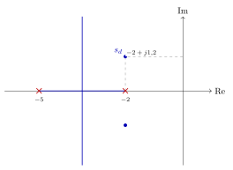

**Com controlador PI:** o traçado original do LGR é aproximado; o zero refinado está em $-2{,}19355$.

  

  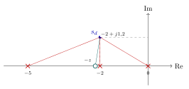

$$
\theta_0=180^\circ-\arctan\left(\frac{1{,}2}{2}\right)=149{,}03^\circ
$$

$$
\theta_1=90^\circ
$$

$$
\theta_2=\arctan\left(\frac{1{,}2}{3}\right)=21{,}8^\circ
$$

$$
\theta_z=\tan^{-1}\left(\frac{1{,}2}{z-2}\right)
$$

$$
\theta_z\equiv149{,}03^\circ+90^\circ+21{,}8^\circ+180^\circ\pmod{360^\circ}
$$

$$
\theta_z\approx80{,}83^\circ,\qquad z=2+\frac{1{,}2}{\tan\theta_z}\approx2{,}194
$$

**Condição de módulo:**

$$
K_p=\left.\frac{|s|\,|s+2|\,|s+5|}{10|s+z|}\right|_{s=-2+1{,}2j}=0{,}744
$$

Conferindo pelo polinômio característico:

$$
\Delta(s)=s^3+7s^2+(10+10K_p)s+10K_i=(s+3)(s^2+4s+5{,}44)
$$

$$
\boxed{K_p=0{,}744,\qquad K_i=1{,}632,\qquad G_c(s)=0{,}744+\frac{1{,}632}{s}}
$$

A resposta completa apresenta erro final nulo, $t_s(5\%)\approx1{,}33\,\mathrm{s}$ e $M_p\approx1{,}51\%$, superior a 0,63%. A aproximação de segunda ordem não é suficiente.

**Alternativa revisada para limites máximos:** $G_c(s)=1{,}7+2{,}5/s$, obtida por ajuste numérico e verificada na tabela final.

### Exemplo com entrada rampa unitária

Considerando um sistema representado pela seguinte função de transferência:

$$
G(s)=\frac1{s(s+4)}
$$

Considerando uma entrada do tipo rampa unitária, projete um controlador PI de modo que a resposta do sistema em malha fechada tenha:

1. Erro nulo em regime permanente.
2. Tempo de acomodação $t_s(5\%)=2\,s$.
3. Máximo sobressinal $M_p=10\%$ ($\zeta\approx0{,}6$).

**Ressalva:** para rampa, a saída cresce indefinidamente; o sobressinal percentual e o tempo de acomodação usuais do degrau não estão definidos da mesma forma. A seguir preserva-se o projeto geométrico original como meta de polos, e verifica-se o erro de rastreamento. Se forem exigidas métricas de rampa, é preciso definir a banda e a grandeza de referência.

**1. Polos dominantes**

$$
t_s=\frac3{\zeta\omega_n}\Rightarrow2=\frac3{\zeta\omega_n}\Rightarrow\zeta\omega_n=1{,}5
$$

$$
\boxed{\omega_n=\frac{1{,}5}{0{,}6}=2{,}5\ \text{rad/s}}
$$

$$
s=-\zeta\omega_n\pm\omega_n\sqrt{1-\zeta^2}\,j
$$

$$
s=-1{,}5\pm2j
$$

**2. LGR**

  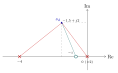

Condição de fase:

$$
\theta_0=180^\circ-\tan^{-1}\left(\frac2{1{,}5}\right)=126{,}87^\circ
$$

$$
\theta_1=\tan^{-1}\left(\frac2{2{,}5}\right)=38{,}67^\circ
$$

$$
\theta_z=180^\circ-\tan^{-1}\left(\frac2{1{,}5-z}\right)
$$

$$
\theta_z\equiv2(126{,}87^\circ)+38{,}66^\circ+180^\circ\pmod{360^\circ}\approx112{,}40^\circ
$$

$$
z=1{,}5+\frac{2}{\tan\theta_z}\approx0{,}6757
$$

**Condição de módulo:**

$$
K_p=\left.\frac{|s|^2|s+4|}{|s+z|}\right|_{s=-1{,}5+2j}=9{,}25
$$

Conferindo: $\Delta(s)=s^3+4s^2+K_ps+K_i=(s+1)(s^2+3s+6{,}25)$.

$$
\boxed{G_c(s)=9{,}25+\frac{6{,}25}{s}}
$$

O sistema é tipo 2, estável e possui erro final nulo para rampa unitária. Entretanto, o terceiro polo $-1$ está mais próximo do eixo imaginário que o par escolhido; portanto, o par não é dominante por localização. Se as especificações fossem de degrau, o projeto também não as atenderia ($M_p\approx33{,}4\%$, $t_s(5\%)\approx2{,}62\,\mathrm{s}$).

## Controlador PID

Une as ações de controle proporcional, integral e derivativo, atuando tanto no período transitório quanto no regime permanente. Matematicamente, temos:

$$
u(t)=K_p\left(e(t)+\frac1{\tau_i}\int_0^t e(\tau)\,d\tau+\tau_d\frac{de(t)}{dt}\right)
$$

Aplicando Laplace, temos:

$$
G_c(s)=K_p\left(1+\frac1{\tau_is}+\tau_ds\right)
$$

$$
G_c(s)=K_p+\frac{K_i}{s}+K_ds,\qquad K_i=\frac{K_p}{\tau_i},\qquad K_d=K_p\tau_d
$$

$$
G_c(s)=\frac{K_p\tau_i\tau_ds^2+K_p\tau_is+K_p}{\tau_is}
$$

- Dois zeros (contando multiplicidade, para ganhos não nulos).
- Um polo na origem.

O PID ideal é impróprio e a implementação prática exige filtragem da derivada; a integral pode exigir anti-windup quando há saturação.
Considerando zeros reais e iguais, temos:

$$
s_{1,2}=\frac{-\tau_i\pm\sqrt{\tau_i^2-4\tau_i\tau_d}}{2\tau_i\tau_d}
$$

$$
\tau_i=4\tau_d
$$

Representando no plano complexo, temos zeros coincidentes em $-1/(2\tau_d)$.

  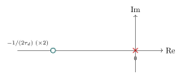

### Implementação analógica do PID

Circuito com dois estágios:

  

$$
\frac{V_{out}(s)}{V_{in}(s)}=\frac{\frac{1+sR_2C_2}{sC_2}}{\frac{R_1}{1+sR_1C_1}}=\frac{1+sR_2C_2}{sC_2}\frac{1+sR_1C_1}{R_1}
$$

$$
=\frac{1+sR_1C_1+sR_2C_2+R_1R_2C_1C_2s^2}{sR_1C_2}
$$

$$
=\frac1{sR_1C_2}+\frac{C_1}{C_2}+\frac{R_2}{R_1}+sR_2C_1
$$

$$
=\frac{C_1}{C_2}+\frac{R_2}{R_1}+\frac1{sR_1C_2}+sR_2C_1
$$

$$
K_p=\frac{C_1}{C_2}+\frac{R_2}{R_1},\qquad K_i=\frac1{R_1C_2},\qquad K_d=R_2C_1
$$

Na forma com constantes de tempo:

$$
\boxed{\tau_i=\frac{K_p}{K_i}=K_pR_1C_2=R_1C_1+R_2C_2}
$$

$$
\boxed{\tau_d=\frac{K_d}{K_p}=\frac{R_2C_1}{C_1/C_2+R_2/R_1}}
$$

### Exemplo de projeto PID com cancelamento de polo e zero

Considere um sistema representado por:

$$
G(s)=\frac1{(s+1)(s-1)}
$$

Projete um controlador PID de modo que a resposta ao degrau unitário tenha:

- Erro nulo.
- Polos dominantes $s=-1\pm\sqrt3j$.

**Solução:**

$$
G_c(s)=\frac{K_d(s+z_1)(s+z_2)}s
$$

O ganho multiplicador é $K_d$ (coeficiente de $s$ do PID), não $K_p$. Escolhe-se o zero em $-1$ para cancelar apenas o polo estável. Nunca se deve cancelar o polo instável em $+1$ para tentar obter estabilidade interna.

$$
G_c(s)=\frac{K_d(s+1)(s+z_2)}s
$$

$$
G_{ma}(s)=\frac{K_d(s+1)(s+z_2)}{s(s+1)(s-1)}=\frac{K_d(s+z_2)}{s(s-1)}
$$

**Condição de fase:**

  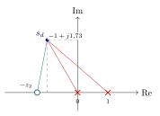

$$
\theta_0=180^\circ-\tan^{-1}\left(\frac{\sqrt3}{1}\right)
$$

$$
\theta_1=180^\circ-\tan^{-1}\left(\frac{\sqrt3}{2}\right)
$$

Ângulos: $120^\circ$ e $139{,}1^\circ$, respectivamente.

$$
\theta_{z_2}\equiv120^\circ+139{,}1^\circ+180^\circ\pmod{360^\circ}=79{,}1^\circ
$$

$$
z_2=1+\frac{\sqrt3}{\tan\theta_{z_2}}\approx1{,}3333
$$

**Condição de módulo:**

$$
K_d=\left.\frac{|s|\,|s-1|}{|s+z_2|}\right|_{s=-1+\sqrt3j}=3
$$

Verificação exata: $s(s-1)+K_d(s+z_2)=s^2+2s+4$, portanto $K_d=3$ e $z_2=4/3$.

$$
\boxed{G_c(s)=\frac{3(s+1)(s+4/3)}{s}=7+\frac4s+3s}
$$

$$
\boxed{K_p=7,\quad K_i=4,\quad K_d=3}
$$

A função de transferência reduzida é $T(s)=(3s+4)/(s^2+2s+4)$ e o erro final ao degrau é nulo. O polinômio interno completo contém ainda o modo estável $-1$, cancelado na transferência nominal. Esse cancelamento é sensível a incertezas e não justifica chamar o par de estritamente dominante em toda a dinâmica interna.

### Exemplo adicional de PID com zeros iguais

Considere um sistema dado por:

$$
G(s)=\frac1{s(s+4)(s+8)}
$$

Considerando uma rampa unitária na entrada, projete um controlador PID de modo que a resposta tenha:

- Erro nulo.
- Polos dominantes $s=-2\pm2\sqrt3j$ .

**Solução:**

$$
G_c(s)=\frac{K_d(s+z)^2}s
$$

Condição de fase:

  

$$
2\angle(s+z)\equiv2\angle s+\angle(s+4)+\angle(s+8)+180^\circ\pmod{360^\circ}
$$

$$
\theta_0=120^\circ,\qquad\theta_{-4}=60^\circ,\qquad\theta_{-8}=30^\circ
$$

$$
2\theta_z\equiv510^\circ\equiv150^\circ\pmod{360^\circ}
$$

Escolhendo $0<\theta_z<180^\circ$, segue $\theta_z=75^\circ$.

$$
\boxed{z=2+\frac{2\sqrt3}{\tan75^\circ}\approx2{,}9282}
$$

O cálculo do ganho e a conferência dos polos estão na continuação.

### PID com cancelamento de polo e zero — condição de fase e módulo

Revisão do exemplo anterior com cancelamento: a equação de fase deve ser interpretada módulo $360^\circ$. Com $z_2=4/3$ e $K_d=3$, a condição de módulo e a de fase são satisfeitas simultaneamente. O ganho proporcional é $K_p=7$, e não 3, pois

$$
\frac{K_d(s+1)(s+z_2)}{s}=K_ds+K_d(1+z_2)+\frac{K_dz_2}{s}
$$

$$
\boxed{K_p=7,\quad K_i=4,\quad K_d=3}
$$

### PID com zeros iguais (continuação)

**Exemplo:** considere um sistema dado por:

$$
G(s)=\frac1{s(s+4)(s+8)}
$$

Considerando uma rampa unitária na entrada, projete um controlador PID de modo que a resposta tenha:

- Erro nulo.
- Polos dominantes $s=-2\pm2\sqrt3j$.

**Solução:**

$$
G_c(s)=\frac{K_d(s+z)^2}s,\qquad z=2+\frac{2\sqrt3}{\tan75^\circ}\approx2{,}928203
$$

**Condição de módulo:**

$$
G_{ma}(s)=\frac{K_d(s+z)^2}{s^2(s+4)(s+8)}
$$

$$
K_d=\left.\frac{|s|^2|s+4|\,|s+8|}{|s+z|^2}\right|_{s=-2+2\sqrt3j}\approx34{,}4752
$$

Expandindo o PID:

$$
G_c(s)=K_ds+2K_dz+\frac{K_dz^2}{s}
$$

$$
\boxed{K_d\approx34{,}4752,\quad K_p\approx201{,}9008,\quad K_i\approx295{,}6033}
$$

O polinômio característico completo é $s^4+12s^3+(32+K_d)s^2+2K_dzs+K_dz^2$. Os polos são $-2\pm j3{,}4641$ e $-4\pm j1{,}5733$; todos são estáveis e o par especificado tem a menor taxa de decaimento. A malha é tipo 2, logo o erro final para rampa unitária é nulo.

### Implementação analógica do PID (continuação)

  

Impedâncias:

$$
Z_1(s)=\frac{R_1}{1+sR_1C_1}
$$

$$
Z_2(s)=\frac{1+sR_2C_2}{sC_2}
$$

$$
\frac{V_{out}(s)}{V_{in}(s)}=\frac{\frac{1+sR_2C_2}{sC_2}}{\frac{R_1}{1+sR_1C_1}}=\frac{1+sR_2C_2}{sC_2}\frac{1+sR_1C_1}{R_1}
$$

$$
\frac{V_{out}(s)}{V_{in}(s)}=\frac{1+sR_1C_1+sR_2C_2+R_1R_2C_1C_2s^2}{sR_1C_2}
$$

$$
\frac{V_{out}(s)}{V_{in}(s)}=\frac1{sR_1C_2}+\frac{C_1}{C_2}+\frac{R_2}{R_1}+sR_2C_1
$$

$$
\frac{V_{out}(s)}{V_{in}(s)}=\frac{C_1}{C_2}+\frac{R_2}{R_1}+\frac1{sR_1C_2}+sR_2C_1
$$

$$
K_p=\frac{C_1}{C_2}+\frac{R_2}{R_1},\qquad K_i=\frac1{R_1C_2},\qquad K_d=R_2C_1
$$

Na forma com constantes de tempo:

$$
\boxed{\tau_i=\frac{K_p}{K_i}=K_pR_1C_2=R_1C_1+R_2C_2}
$$

$$
\boxed{\tau_d=\frac{K_d}{K_p}=\frac{R_2C_1}{C_1/C_2+R_2/R_1}}
$$

## Conferência dos projetos por resposta temporal

A tabela distingue a solução geométrica (polos desejados) da verificação de desempenho do modelo completo. Os números são aproximados, calculados com `scipy.signal.step` em malha fechada, com condições iniciais nulas, amostragem temporal de 0,001 s e faixa medida em relação ao valor final. O erro final foi verificado pelo teorema do valor final após conferir a estabilidade. As alternativas numéricas são exemplos de soluções para limites máximos, não os únicos ganhos possíveis nem garantias de robustez para a planta real.

| Projeto | Controlador | $M_p$ | $t_s$ | Erro ao degrau | Parecer |
| --- | --- | ---: | ---: | ---: | --- |
| Avanço — original (ganhos refinados) | $4{,}16(s+2)/(s+5{,}6)$ | 27,40% | 2,05 s (2%) | 0 | Não atende |
| Avanço — alternativa | $26(s+2{,}8)/(s+56)$ | 14,34% | 1,95 s (2%) | 0 | Atende a limites de 16% e 2 s |
| Atraso | $(s+0{,}19)/(s+0{,}01)$ | 0% | 27,62 s (2%) | 5% | Reduz o erro; cauda lenta |
| P — primeiro exemplo (original) | $0{,}93$ | 12,40% | 9,63 s (2%) | 0 | Não atende |
| P — primeiro exemplo (revisado) | $0{,}5$ | 0,66% | 9,23 s (2%) | 0 | Atende |
| P — segundo exemplo | $20{,}4$ | 9,76% | 1,18 s (2%) | 19,69% | Atende aos limites transitórios |
| PD — original (ganhos refinados) | $2{,}5+0{,}15s$ | 31,30% | 0,97 s (2%) | 0 | Não atende |
| PD — alternativa | $1+0{,}28s$ | 5,16% | 0,73 s (2%) | 0 | Atende a limites de 25% e 1 s |
| PI — original (ganhos refinados) | $0{,}744+1{,}632/s$ | 1,51% | 1,33 s (5%) | 0 | Não atende |
| PI — alternativa | $1{,}7+2{,}5/s$ | 0,04% | 0,74 s (5%) | 0 | Atende a limites de 0,63% e 1,5 s |

Nos projetos com rampa, verifica-se separadamente o erro final. Não se aplica diretamente o sobressinal percentual de um degrau à saída de uma rampa.

## Referências acadêmicas da revisão

- University of Michigan. [Control Tutorials for MATLAB and Simulink — System Analysis](https://ctms.engin.umich.edu/CTMS/?example=Introduction&section=SystemAnalysis). Métricas temporais, estabilidade e modelos de segunda ordem.
- University of Michigan. [Motor Position: Root Locus Controller Design](https://ctms.engin.umich.edu/CTMS/?example=MotorPosition&section=ControlRootLocus). Projeto pelo LGR e conferência da resposta temporal.
- Iqbal, K. [Introduction to Control Systems — Chapter 5: Control System Design with Root Locus](https://eng.libretexts.org/Bookshelves/Industrial_and_Systems_Engineering/Introduction_to_Control_Systems_%28Iqbal%29/05%3A_Control_System_Design_with_Root_Locus). Condições de fase e módulo, avanço, atraso, PD, PI e PID.
- Iqbal, K. [Controller Realization](https://eng.libretexts.org/Bookshelves/Industrial_and_Systems_Engineering/Introduction_to_Control_Systems_%28Iqbal%29/05%3A_Control_System_Design_with_Root_Locus/5.06%3A_Controller_Realization). Implementações analógicas com amplificadores operacionais.

Leituras complementares recomendadas: Katsuhiko Ogata, *Engenharia de Controle Moderno*; Norman S. Nise, *Engenharia de Sistemas de Controle*. Não foram consultadas páginas específicas desses livros nesta revisão.
