# Unidade 2 — Projeto de Controladores

## Projeto de controladores

  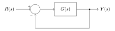

  

- Controlador $G_c$: um dispositivo físico que, inserido no sistema, visa à modificação de sua dinâmica, alterando a relação entre $R(s)$ e $Y(s)$ por meio da atuação de seus parâmetros.

**Exemplo:** motor elétrico CC.

FT:

1. $E_a/\theta$ → sensor → encoder.
2. $E_a/\omega$ → sensor → encoder.

Análise para escolher o controlador:

1. Estabilidade.

Projetar um controlador significa modificar a resposta de um sistema de modo que sua saída atenda a determinadas especificações:

1. Estabilidade.
2. Desempenho: baixo sobressinal ($M_p\%$) e pequeno tempo de resposta transitória ($t_s$, 2% ou 5%).
3. Erro em regime permanente.

**Em série:**

  

**Por retroalimentação:**

  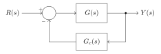

## Controlador por avanço de fase

A compensação por avanço de fase visa aumentar a margem de fase, reduzindo, por conseguinte, o sobressinal da resposta transitória.

O controlador por avanço de fase é dado pela seguinte FT:

$$
G_c(s)=K\frac{s+z}{s+p},\qquad z

  

**Implementação analógica:** o circuito eletrônico de implementação é dado por:

  

1º estágio:

$$
\frac{V_{saída}}{V_{entrada}}=-\frac{Z_2}{Z_1}
$$

2º estágio:

$$
\frac{V_{saída}}{V_{entrada}}=-\frac{R}{R}=-1
$$

$$
Z_1=\frac{R_1\frac{1}{sC_1}}{R_1+\frac{1}{sC_1}}=\frac{R_1}{sC_1}\frac{sC_1}{1+sR_1C_1}=\frac{R_1}{sR_1C_1+1}
$$

$$
Z_2=\frac{R_2}{sR_2C_2+1}
$$

$$
\frac{V_{saída}}{V_{entrada}}=-\frac{\frac{R_2}{sR_2C_2+1}}{\frac{R_1}{sR_1C_1+1}}=-\frac{R_2}{sR_2C_2+1}\frac{sR_1C_1+1}{R_1}
$$

$$
=-\frac{sR_1R_2C_1+R_2}{sR_1R_2C_2+R_1}
$$

$$
\frac{V_{out}}{V_{in}}=-\left(\frac{sR_1R_2C_1+R_2}{sR_1R_2C_2+R_1}\right)(-1)
$$

$$
\frac{V_{out}}{V_{in}}=\frac{R_2}{R_1}\left(\frac{sR_1C_1+1}{sR_2C_2+1}\right)
$$

$$
\frac{V_{out}}{V_{in}}=\frac{R_2}{R_1}\left(\frac{R_1C_1(s+1/R_1C_1)}{R_2C_2(s+1/R_2C_2)}\right)
$$

$$
\frac{V_{out}}{V_{in}}=\frac{C_1}{C_2}\left(\frac{s+\frac{1}{R_1C_1}}{s+\frac{1}{R_2C_2}}\right)
$$

$$
K=\frac{C_1}{C_2},\qquad z=\frac{1}{R_1C_1},\qquad p=\frac{1}{R_2C_2}
$$

### Exemplo: servomecanismo composto por um motor de corrente contínua

Considere um servomecanismo composto por um motor de corrente contínua, dado pela seguinte função de transferência:

$$
\frac{\theta(s)}{E_a(s)}=\frac{5}{s(s+1)}
$$

**Solução:** análise do sistema sem controlador.

A função de transferência do sistema sem controlador é dada por:

$$
T(s)=\frac{G(s)}{1+G(s)H(s)}
$$

$$
T(s)=\frac{5}{s^2+s+5}
$$

$$
\boxed{T(s)=\frac{\omega_n^2}{s^2+2\zeta\omega_ns+\omega_n^2}}
$$

Comparando as duas equações:

$$
\omega_n^2=5\Rightarrow\omega_n=5
$$

(frequência não amortecida).

> Obs.: na expressão acima, $\omega_n=\sqrt5$; o caderno registra $5$.

$$
2\zeta\omega_n=1\Rightarrow\zeta=\frac{1}{2\sqrt5}
$$

(coeficiente de amortecimento).

Segundo o critério de 2%:

$$
t_s=\frac{4}{\zeta\omega_n}=\frac{4}{1/2}=8\ \text{segundos}
$$

**Erro em regime permanente:**

$$
e(\infty)=\lim_{s\to0}sE(s)=\lim_{s\to0}s\left(\frac{1}{1+G(s)}\right)R(s)
$$

$$
=\lim_{s\to0}s\left(\frac{1}{1+\frac{5}{0}}\right)\frac1s=0
$$

O percentual de overshoot:

$$
M_p(\%)=\left[e^{-\zeta\pi/\sqrt{1-\zeta^2}}\right]\times100
$$

$$
M_p=48{,}6\%,\quad T_p=1{,}44\ \text{segundos},\quad T_r=0{,}82\ \text{segundos}
$$

  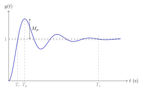

Tipo 1, $R(s)=1/s$, $e(\infty)=0$.

- $t_s(2\%)=8\,s$ ✗
- $M_p(\%)=48{,}6\%$ ✗
- $e(\infty)=0$ ✓

Projetando um controlador por avanço de fase com os seguintes critérios:

- $t_s=2\,s$.
- $M_p=16\%$.
- $e(\infty)=$ nulo.

Considerando um sistema em malha com controlador, o tempo de acomodação será:

$$
t_s=\frac{4}{\zeta\omega_n}\Rightarrow\zeta\omega_n=\frac42=2
$$

$$
\omega_n=\frac{2}{0{,}5}=4\ \text{rad/s}
$$

Os polos dominantes do sistema do controlador são dados por:

$$
s=-\zeta\omega_n\pm\omega_n\sqrt{1-\zeta^2}\,j=-2\pm4\sqrt{1-1/4}\,j
$$

$$
s=-2\pm4\sqrt{3\times\frac14}\,j
$$

$$
s=-2\pm\frac{4\sqrt3}{2}\,j
$$

$$
\boxed{s=-2\pm2\sqrt3\,j}
$$

**Lugar geométrico das raízes (LGR):**

1. Condição de fase: $\angle G_{ma}(s)=\pm$ múltiplo de $180^\circ$.
2. Condição de módulo: $|G_{ma}(s)|=1$.

Controlador por avanço de fase:

$$
G_c=K\frac{s+z}{s+p}
$$

A FT do sistema com controlador é dada por:

$$
G_{ma}=G(s)G_c(s)
$$

$$
G_{ma}=\frac{K(s+z)}{s+p}\frac{5}{s(s+1)}=\frac{5K(s+z)}{s(s+1)(s+p)}
$$

O LGR é dado por:

  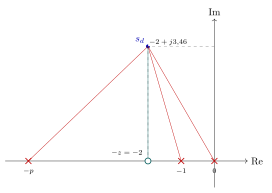

$$
\angle(s+z)-\angle s-\angle(s+1)-\angle(s+p)=\pm180^\circ
$$

$$
\angle(s+p)=\angle(s+z)-\angle s-\angle(s+1)\pm180^\circ
$$

$$
\theta_z=90^\circ
$$

$$
\theta_{p0}=180^\circ-\arctan\left(\frac{2\sqrt3}{2}\right)=120^\circ
$$

$$
\theta_{p1}=180^\circ-\arctan\left(\frac{2\sqrt3}{1}\right)=106{,}1^\circ
$$

$$
\theta_p=\arctan\left(\frac{2\sqrt3}{p-2}\right)
$$

$$
\arctan\left(\frac{2\sqrt3}{p-2}\right)=90-120-106+180
$$

$$
\frac{2\sqrt3}{p-2}=0{,}96
$$

$$
2\sqrt3=0{,}96p-2\times0{,}96
$$

$$
p=\frac{2\sqrt3+2\times0{,}96}{0{,}96}\Rightarrow\boxed{p=5{,}6}
$$

$$
G_{ma}=\frac{5K(s+2)}{s(s+1)(s+5{,}6)}
$$

Utilizando a condição do módulo:

$$
\left.\left|\frac{5K(s+2)}{s(s+1)(s+5{,}6)}\right|\right|_{s=-2+2\sqrt3j}=1
$$

$$
K=\frac{|-2+2\sqrt3j|\,|-1+2\sqrt3j|\,|3{,}6+2\sqrt3j|}{5|2\sqrt3j|}
$$

$$
K=\frac{4\times3{,}6\times5}{5\times3{,}46}\Rightarrow\boxed{K\approx4{,}2}
$$

$$
\boxed{G_c(s)=4{,}2\left(\frac{s+2}{s+5{,}6}\right)}
$$

## Controlador por atraso de fase

O controlador por avanço de fase (sic) é indicado quando a resposta transitória é satisfatória, porém o erro em regime permanente precisa ser melhorado. O controlador por atraso de fase é dado pela seguinte FT:

$$
\boxed{G_c(s)=K\frac{s+z}{s+p},\qquad z>p}
$$

Representado no plano complexo $s$, temos:

  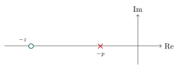

**Observação:** o polo do controlador deve estar localizado mais próximo da origem, quando comparado ao zero.

**Implementação analógica:** o controlador por atraso de fase pode ser implementado pelo seguinte circuito:

  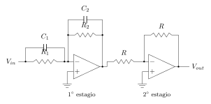

A função de transferência do circuito é dada por:

$$
\frac{V_{out}}{V_{in}}=\frac{C_1}{C_2}\left(\frac{s+1/R_1C_1}{s+1/R_2C_2}\right)
$$

$$
K=\frac{C_1}{C_2};\qquad z=\frac{1}{R_1C_1};\qquad p=\frac{1}{R_2C_2}
$$

- $R_1C_1>R_2C_2$: controlador por atraso de fase (PI).
- $R_1C_1<R_2C_2$: controlador por avanço de fase (PD).

> Obs.: as desigualdades acima estão invertidas em relação a $z>p$ para atraso e $z<p$ para avanço.

### Exemplo: redução do erro em regime permanente

Considere o sistema dado pela FT:

$$
G(s)=\frac{1}{(s+0{,}5)(s+2)}
$$

Considerando um degrau unitário na entrada, o erro em regime permanente é dado por:

$$
e(\infty)=\lim_{s\to0}sE(s)
$$

$$
e(\infty)=\lim_{s\to0}s\left(\frac{1}{1+G(s)}\right)R(s)
$$

$$
e(\infty)=\lim_{s\to0}s\left(\frac{1}{1+\frac{1}{(s+0{,}5)(s+2)}}\right)\frac{1}{s}
$$

$$
e(\infty)=\frac{1}{1+1/1}=\frac12=50\%
$$

  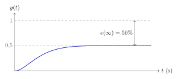

Com base nessas informações, projete um controlador por atraso de fase de modo a reduzir o erro em regime permanente em 10 vezes sem alterar de forma significativa a resposta transitória do sistema.

A função de transferência do sistema de malha aberta é dada por:

$$
G_c=K\frac{s+z}{s+p},\qquad G(s)=\frac{1}{(s+0{,}5)(s+2)}
$$

$$
G_{ma}(s)=G_c(s)G(s)=\frac{K(s+z)}{(s+p)(s+0{,}5)(s+2)}
$$

$$
e(\infty)=\lim_{s\to0}s\left(\frac{1}{1+\frac{K(s+z)}{(s+p)(s+0{,}5)(s+2)}}\right)\frac1s
$$

$$
e(\infty)=\frac{1}{1+\frac{Kz}{p}}
$$

Para que a resposta transitória não seja afetada, temos que $K=1$:

$$
e(\infty)=\frac{1}{1+\frac zp}
$$

$$
e(\infty)=0{,}05
$$

Reduzir 10 vezes: $(0{,}5/10)=0{,}05$.

$$
\frac{1}{1+z/p}=0{,}05
$$

$$
0{,}05+0{,}05\frac zp=1
$$

$$
\frac zp=\frac{1-0{,}05}{0{,}05}
$$

$$
\boxed{\frac zp=19}
$$

Como o zero deve ser localizado próximo da origem, considerando $p=0{,}01$, temos:

$$
z=19\times0{,}01=0{,}19
$$

$$
G_c=\frac{1(s+0{,}19)}{s+0{,}01}
$$

## Controlador proporcional (P)

Para um controlador proporcional, a relação entre o sinal de controle e o de erro é dada por:

$$
u(t)=K_pe(t)
$$

$K_p$: ganho proporcional.

Representando no domínio da frequência, temos:

$$
\frac{U(s)}{E(s)}=K_p
$$

**Análise:** considere a seguinte FT:

$$
G(s)=\frac{1}{(s+1)(s+5)},\qquad G_c(s)=K_p
$$

A função de transferência do sistema com controle é dada por:

$$
G_{ma}(s)=\frac{K_p}{(s+1)(s+5)}
$$

O erro é dado por:

$$
e(\infty)=\lim_{s\to0}sE(s),\qquad R(s)=\frac1s
$$

$$
e(\infty)=\lim_{s\to0}s\left(\frac{1}{1+\frac{K_p}{(s+1)(s+5)}}\right)\frac1s
$$

$$
\boxed{e(\infty)=\frac5{5+K_p}}
$$

- $K_p$ pequeno: o erro é "grande".
- $K_p$ grande: o erro é "pequeno".

**Implementação analógica:** o circuito de implementação de um controlador proporcional é dado por:

  

$$
\frac{V_{out}}{V_{in}}=\frac{R_2}{R_1}
$$

### Projeto de controlador P

Considere um sistema representado pela seguinte função de transferência:

$$
G(s)=\frac1{s(s+1)(s+2)},\qquad R(s)=\frac1s
$$

Projete um controlador proporcional de modo que a resposta do sistema em malha fechada com controle, para uma entrada do tipo degrau unitário, tenha:

- Tempo de acomodação $t_s(2\%)\leq10\,s$.
- Sobressinal $M_p\leq10\%$ ($\zeta=0{,}591$).

**Solução:** lugar geométrico das raízes do sistema $G(s)$.

  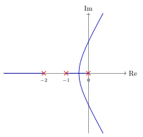

Com controlador proporcional:

1. Tempo de acomodação:

$$
t_s=\frac4{\zeta\omega_n}\Rightarrow\zeta\omega_n=0{,}4
$$

$$
\omega_n=\frac{0{,}4}{0{,}591}=0{,}67\ \text{rad/s}
$$

2. Polos dominantes:

$$
s=-\zeta\omega_n\pm\omega_n\sqrt{1-\zeta^2}\,j
$$

$$
\boxed{s=-0{,}4\pm0{,}55j}
$$

A equação característica do sistema com o controlador é dada por:

$$
1+G_{ma}=0
$$

$$
1+\frac{K_p}{s(s+1)(s+2)}=0
$$

$$
s(s+1)(s+2)+K_p=0
$$

$$
K_p=-s(s+1)(s+2)
$$

No ponto $s=-0{,}4+0{,}55j$:

$$
|K_p|=|-s(s+1)(s+2)|
$$

$$
K_p=\left.|s|\,|s+1|\,|s+2|\right|_{s=-0{,}4+0{,}55j}
$$

$$
K_p=\sqrt{0{,}4^2+0{,}55^2}\sqrt{0{,}6^2+0{,}55^2}\sqrt{1{,}6^2+0{,}55^2}
$$

$$
\boxed{K_p=0{,}93}
$$

### Exemplo adicional

Considere um sistema representado pela seguinte FT:

$$
G(s)=\frac1{(s+1)(s+5)},\qquad R(s)=\frac1s
$$

Projete um controlador proporcional de modo que a resposta do sistema em malha fechada com controle, para uma entrada do tipo degrau unitário, tenha:

- Tempo de acomodação $t_s(2\%)\leq2\,s$.
- Sobressinal $M_p\leq10\%$ ($\zeta=0{,}591$).

Solução: para que as condições de desempenho sejam atendidas, temos que:

$$
t_s(2\%)=\frac4{\zeta\omega_n}\Rightarrow\zeta\omega_n=\frac42=2
$$

$$
\omega_n=\frac2{0{,}591}=3{,}4\ \text{rad/s}
$$

$$
s=-\zeta\omega_n\pm\omega_n\sqrt{1-\zeta^2}\,j=-2\pm2{,}7j
$$

O LGR do sistema é dado por:

  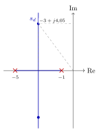

$$
\theta=\tan^{-1}(2{,}7/2)=53{,}47^\circ
$$

$$
\theta=\tan^{-1}(\omega_d/3),\qquad\tan\theta=\omega_d/3
$$

$$
\omega_d=3\tan(53{,}47^\circ)=4{,}05
$$

Polos dominantes para o controlador proporcional:

$$
s=-3\pm4{,}05j
$$

$$
1+G_{ma}(s)=0,\qquad G_{ma}(s)=\frac{K_p}{(s+1)(s+5)}
$$

$$
1+\frac{K_p}{(s+1)(s+5)}=0
$$

$$
(s+1)(s+5)+K_p=0\Rightarrow K_p=-(s+1)(s+5)
$$

Aplicando o módulo em ambos os lados:

$$
K_p=|s+1|\,|s+5|
$$

Considerando $s=-3\pm4{,}05j$:

$$
K_p=|-3+4{,}05j+1|\,|-3+4{,}05j+5|
$$

$$
K_p=|-2+4{,}05j|\,|2+4{,}05j|
$$

$$
K_p=\sqrt{2^2+4{,}05^2}\sqrt{2^2+4{,}05^2}
$$

$$
K_p=20{,}4
$$

## Controlador proporcional e derivativo (PD)

O controlador PD é constituído pela soma de uma ação proporcional com uma ação derivativa. A relação do sinal de controle e o erro é dada por:

$$
u(t)=K_p\left(e(t)+\tau_d\frac{de(t)}{dt}\right)
$$

- $K_p$: ganho proporcional.
- $\tau_d$: constante de tempo.

A função de transferência do controlador PD é dada por:

$$
U(s)=K_p(1+\tau_ds)E(s)
$$

$$
U(s)=(K_p+K_ds)E(s)
$$

Zero: $s=-1/\tau_d$.

Representando no plano complexo $s$, temos um zero em $-1/\tau_d$.

  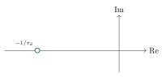

**Implementação analógica:**

  

$$
Z_2(s)=R_2
$$

$$
Z_1(s)=R_1\parallel\frac1{sC}=\frac{R_1\frac1{sC}}{R_1+\frac1{sC}}
$$

$$
Z_1(s)=\frac{R_1}{sC}\frac{sC}{1+sR_1C}=\frac{R_1}{1+sR_1C}
$$

$$
\frac{V_{out}(s)}{V_{in}(s)}=\frac{R_2}{\frac{R_1}{1+sR_1C}}=\frac{R_2}{R_1}(1+sR_1C)
$$

$$
K_p=\frac{R_2}{R_1},\qquad\tau_d=R_1C
$$

$$
G_c(s)=K_p(1+s\tau_d)
$$

**Exemplo:** considere um sistema representado pela seguinte função de transferência:

$$
G(s)=\frac{40}{s(s+2)},\qquad R(s)=\frac1s
$$

Tipo 1, $e(\infty)=0$.

### Projeto de controlador PD

**Exemplo:** considere um sistema representado pela seguinte função de transferência:

$$
G(s)=\frac{40}{s(s+2)},\qquad R(s)=\frac1s
$$

Projete um controlador PD de modo que o sistema tenha:

1. Erro nulo em regime permanente.
2. Tempo de acomodação $t_s(2\%)=1\,s$.
3. Máximo sobressinal $M_p(\%)=25\%$ ($\zeta=0{,}4$).

**Solução:** polos dominantes.

$$
t_s=\frac4{\zeta\omega_n}\Rightarrow\omega_n=\frac4{\zeta t_s}=\frac4{0{,}4\times1}\Rightarrow\boxed{\omega_n=10}
$$

$$
s=-4\pm10\sqrt{1-0{,}4^2}\,j
$$

$$
\boxed{s=-4\pm9{,}16j}
$$

O lugar geométrico das raízes do sistema é dado por:

  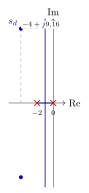

$$
G_c(s)=K_p(1+s\tau_d)
$$

$$
z=\frac1{\tau_d}
$$

Com a inserção do controlador:

  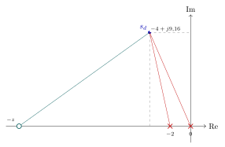

$$
\theta_0=180^\circ-\tan^{-1}\left(\frac{9{,}16}{4}\right)=113{,}59^\circ
$$

$$
\theta_1=180^\circ-\tan^{-1}\left(\frac{9{,}16}{2}\right)=102{,}31^\circ
$$

$$
\theta_z=\tan^{-1}\left(\frac{9{,}16}{z-4}\right)
$$

Utilizando a condição de fase, temos:

$$
\theta_z=(\theta_0+\theta_1)+180^\circ
$$

$$
\tan^{-1}\left(\frac{9{,}16}{z-4}\right)=113{,}59+102{,}31+180
$$

$$
\tan^{-1}\left(\frac{9{,}16}{z-4}\right)=395{,}9-360
$$

$$
\frac{9{,}16}{z-4}=\tan(35{,}9^\circ)=0{,}72
$$

$$
z=\frac{9{,}16+4\times0{,}72}{0{,}72}
$$

$$
\boxed{z=16{,}72}
$$

$$
z=-\frac1{\tau_d}\Rightarrow\boxed{\tau_d=-0{,}06}
$$

Utilizando a condição de módulo, temos:

$$
|G_{ma}(s)|=1
$$

$$
G_{ma}(s)=G_c(s)G(s)=\frac{K_p(1+0{,}06s)\times40}{s(s+2)}
$$

$$
\left.\left|\frac{40K_p(1+0{,}06s)}{s(s+2)}\right|\right|_{s=-4+9{,}16j}=1
$$

$$
K_p=\left.\frac{|s|\,|s+2|}{40|1+0{,}06s|}\right|_{s=-4+9{,}16j}
$$

$$
|s|=9{,}96,\qquad |s+2|=9{,}37,\qquad |1+0{,}06s|=0{,}94
$$

$$
K_p=\frac{10\times9{,}37}{40\times0{,}94}
$$

$$
\boxed{K_p=2{,}5}
$$

### Exemplo adicional

Considere um sistema dado por:

$$
G(s)=\frac1{s(s+4)(s+6)},\qquad R(s)=\frac1s
$$

$$
\zeta=0{,}456,\qquad\omega_n=5\ \text{rad/s}
$$

**Solução:** polos dominantes.

$$
s=-0{,}456\times5\pm5\sqrt{1-(0{,}456)^2}\,j
$$

$$
s=-2{,}3\pm4{,}45j
$$

O LGR do sistema:

  

$$
\theta_z=(\theta_0+\theta_1+\theta_2)+180^\circ
$$

$$
\tan^{-1}\left(\frac{4{,}45}{z-2{,}3}\right)=\left(180^\circ-\tan^{-1}\frac{4{,}45}{2{,}3}\right)+\tan^{-1}\frac{4{,}45}{1{,}7}+\tan^{-1}\frac{4{,}45}{3{,}7}+180^\circ
$$

$$
\tan^{-1}\left(\frac{4{,}45}{z-2{,}3}\right)=117{,}33+69{,}09+50{,}25+180^\circ
$$

$$
\tan^{-1}\left(\frac{4{,}45}{z-2{,}3}\right)=56{,}67^\circ
$$

$$
\frac{4{,}45}{z-2{,}3}=1{,}52
$$

$$
z=\frac{4{,}45+2{,}3\times1{,}52}{1{,}52}
$$

$$
\boxed{z=5{,}2}\qquad\boxed{\tau_d=0{,}19}
$$

Utilizando a condição de módulo, temos:

$$
|G_{ma}(s)|=1
$$

$$
G_{ma}(s)=G_c(s)G(s)=\frac{K_p(1+0{,}19s)}{s(s+4)(s+6)}
$$

$$
K_p=\left.\frac{|s|\,|s+4|\,|s+6|}{|1+0{,}19s|}\right|_{s=-2{,}3+4{,}45j}
$$

$$
|s|=5,\quad |s+4|=4{,}76,\quad |s+6|=5{,}78,\quad |1+0{,}19s|=1{,}015
$$

$$
K_p=\frac{5\times4{,}76\times5{,}78}{1{,}015}=135{,}53
$$

## Controlador proporcional-integral (PI)

A atuação do controlador PI corresponde à soma de uma ação proporcional com uma ação integral. Para o controlador PI, a relação entre o sinal de controle e o erro é dada por:

$$
u(t)=K_p\left(e(t)+\frac1{\tau_i}\int_0^t e(\tau)\,d\tau\right)
$$

A função de transferência do controlador PI é dada por:

$$
U(s)=\frac{K_ps+K_i}{s}E(s)
$$

Baseado na equação acima, temos um polo na origem ($s=0$) e zero ($s=-1/\tau_i$).

Representando no plano complexo $s$, temos:

  

**Implementação analógica:** o controlador PI pode ser implementado pelo seguinte circuito:

  

$$
Z_1(s)=R_1
$$

$$
Z_2(s)=R_2+\frac1{sC}=\frac{1+sR_2C}{sC}
$$

$$
\frac{V_{out}(s)}{V_{in}(s)}=\frac{\frac{1+sR_2C}{sC}}{R_1}=\frac{1+sR_2C}{sR_1C}
$$

Multiplicando a equação acima por $1/(R_2C)$, temos que:

$$
\frac{V_{out}(s)}{V_{in}(s)}=\frac{(1+sR_2C)\times1/(R_2C)}{(sR_1C)\times1/(R_2C)}
$$

$$
\frac{V_{out}(s)}{V_{in}(s)}=\frac{s+1/(R_2C)}{sR_1/R_2}
$$

$$
\frac{V_{out}}{V_{in}}=\frac{R_2}{R_1}\left(\frac{s+1/(R_2C)}s\right)
$$

$$
K_p=\frac{R_2}{R_1},\qquad\tau_i=R_2C
$$

$$
G_c(s)=K_p\frac{s+1/\tau_i}{s}
$$

### Projeto de controlador PI

Considere um sistema dado pela seguinte função de transferência:

$$
G(s)=\frac{10}{(s+2)(s+5)}
$$

Projete um controlador PI de modo que a resposta do sistema em malha fechada com o controlador, para uma entrada degrau unitário, tenha:

1. Erro nulo em regime permanente.
2. Tempo de acomodação $t_s(5\%)=1{,}5\,s$.
3. Máximo sobressinal $M_p(\%)=0{,}63\%$ ($\zeta=0{,}857$).

**Solução:** tipo 0 e $R(s)=1/s$.

Polos dominantes:

$$
s=-\zeta\omega_n\pm\omega_n\sqrt{1-\zeta^2}\,j
$$

$$
t_s(5\%)=\frac3{\zeta\omega_n}\Rightarrow1{,}5=\frac3{\zeta\omega_n}\Rightarrow\zeta\omega_n=2
$$

$$
\omega_n=\frac2\zeta=\frac2{0{,}857}=2{,}33\ \text{rad/s}
$$

$$
s=-2\pm2{,}33\sqrt{1-0{,}857^2}\,j
$$

$$
s=-2\pm1{,}2j
$$

**Sem controlador:**

  

**Com controlador PI:**

  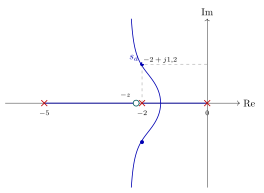

  

$$
\theta_0=180^\circ-\arctan\left(\frac{1{,}2}{2}\right)=149{,}03^\circ
$$

$$
\theta_1=90^\circ
$$

$$
\theta_2=\arctan\left(\frac{1{,}2}{3}\right)=21{,}8^\circ
$$

$$
\theta_z=\tan^{-1}\left(\frac{1{,}2}{z-2}\right)
$$

$$
\tan^{-1}\left(\frac{1{,}2}{z-2}\right)=(149{,}03+90+21{,}8)+180^\circ
$$

$$
\tan^{-1}\left(\frac{1{,}2}{z-2}\right)=81{,}1^\circ
$$

Aplicando a tangente em ambos os lados:

$$
\frac{1{,}2}{z-2}=81{,}1
$$
$$
\boxed{z=\frac{1{,}2+2\times6{,}38}{6{,}38}=2{,}18}
$$

**Condição de módulo:**

$$
|G_{ma}(s)|=1
$$

$$
G_{ma}(s)=\frac{10K_p(s+2{,}18)}{s(s+2)(s+5)}
$$

$$
\left|\frac{10K_p(s+2{,}18)}{s(s+2)(s+5)}\right|=1
$$

$$
K_p=\frac{|s|\,|s+2|\,|s+5|}{10|s+2{,}18|}
$$

$$
\boxed{K_p=0{,}75}
$$

### Exemplo com entrada rampa unitária

Considerando um sistema representado pela seguinte função de transferência:

$$
G(s)=\frac1{s(s+4)}
$$

Considerando uma entrada do tipo rampa unitária, projete um controlador PI de modo que a resposta do sistema em malha fechada tenha:

1. Erro nulo em regime permanente.
2. Tempo de acomodação $t_s(5\%)=2\,s$.
3. Máximo sobressinal $M_p\%=10\%$ ($\zeta=0{,}6$).

**1. Polos dominantes**

$$
t_s=\frac3{\zeta\omega_n}\Rightarrow2=\frac3{\zeta\omega_n}\Rightarrow\zeta\omega_n=1{,}5
$$

$$
\boxed{\omega_n=\frac{1{,}5}{0{,}6}=2{,}5\ \text{rad/s}}
$$

$$
s=-\zeta\omega_n\pm\omega_n\sqrt{1-\zeta^2}\,j
$$

$$
s=-1{,}5\pm2j
$$

**2. LGR**

  

Condição de fase:

$$
\theta_0=180^\circ-\tan^{-1}\left(\frac2{1{,}5}\right)=126{,}87^\circ
$$

$$
\theta_1=\tan^{-1}\left(\frac2{2{,}5}\right)=38{,}67^\circ
$$

$$
\theta_z=180^\circ-\tan^{-1}\left(\frac2{1{,}5-z}\right)
$$

$$
180^\circ-\tan^{-1}\left(\frac2{1{,}5-z}\right)=126{,}87\times2+38{,}67+180^\circ
$$

Aplicando a tangente em ambos os lados:

$$
180^\circ-\tan^{-1}\left(\frac2{1{,}5-z}\right)\Rightarrow\tan(112{,}41^\circ)
$$

$$
0-\frac2{1{,}5-z}=-2{,}42
$$

$$
z=\frac{2{,}42\times1{,}5-2}{2{,}42}=0{,}67
$$

**Condição de módulo:**

$$
\left.\left|\frac{K_p(s+0{,}67)}{s^2(s+4)}\right|\right|_{s=-1{,}5+2j}=1
$$

$$
K_p=\frac{|s^2|\,|s+4|}{|s+0{,}67|}\Rightarrow K_p\approx9{,}24
$$

## Controlador PID

Une as ações de controle proporcional, integral e derivativo, atuando tanto no período transitório quanto no regime permanente. Matematicamente, temos:

$$
u(t)=K_p\left(e(t)+\frac1{\tau_i}\int_0^t e(\tau)\,d\tau+\tau_d\frac{de(t)}{dt}\right)
$$

Aplicando Laplace, temos:

$$
G_c(s)=K_p\left(1+\frac1{\tau_is}+\tau_ds\right)
$$

$$
G_c(s)=K_p+\frac{K_i}{s}+K_ds
$$

$$
G_c(s)=\frac{K_p\tau_i\tau_ds^2+K_p\tau_is+K_p}{\tau_is}
$$

- Dois zeros.
- Um polo.

Considerando zeros reais e iguais, temos:

$$
s_{1,2}=\frac{-\tau_i\pm\sqrt{\tau_i^2-4\tau_i\tau_d}}{2\tau_i\tau_d}
$$

$$
\tau_i=4\tau_d
$$

Representando no plano complexo, temos zeros coincidentes em $-1/(2\tau_d)$.

  

### Implementação analógica do PID

Circuito com dois estágios:

  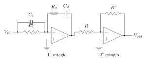

$$
\frac{V_{out}(s)}{V_{in}(s)}=\frac{\frac{1+sR_2C_2}{sC_2}}{\frac{R_1}{1+sR_1C_1}}=\frac{1+sR_2C_2}{sC_2}\frac{1+sR_1C_1}{R_1}
$$

$$
=\frac{1+sR_1C_1+sR_2C_2+R_1R_2C_1C_2s^2}{sR_1C_2}
$$

$$
=\frac1{sR_1C_2}+\frac{C_1}{C_2}+\frac{R_2}{R_1}+sR_2C_1
$$

$$
=\frac{C_1}{C_2}+\frac{R_2}{R_1}+\frac1{sR_1C_2}+sR_2C_1
$$

$$
K_p=\frac{C_1}{C_2}+\frac{R_2}{R_1},\qquad\tau_i=R_1C_2,\qquad\tau_d=R_2C_1
$$

### Exemplo de projeto PID com cancelamento de polo e zero

Considere um sistema representado por:

$$
G(s)=\frac1{(s+1)(s-1)}
$$

Projete um controlador PID de modo que a resposta ao degrau unitário tenha:

- Erro nulo.
- Polos dominantes $s=-1\pm\sqrt3j$.

**Solução:**

$$
G_c(s)=\frac{K_p(s+z_1)(s+z_2)}s
$$

Considerando o cancelamento polo/zero, temos polos em $-1$ e $+1$. Zero escolhido em $-1$ (mais afastado da origem no semiplano esquerdo).

$$
G_c(s)=\frac{K_p(s+1)(s+z_2)}s
$$

$$
G_{ma}(s)=\frac{K_p(s+1)(s+z_2)}s\frac1{(s+1)(s-1)}
$$

$$
G_{ma}(s)=\frac{K_p(s+z_2)}{s(s-1)}
$$

**Condição de fase:**

  

$$
\theta_0=180^\circ-\tan^{-1}\left(\frac{\sqrt3}{1}\right)
$$

$$
\theta_1=180^\circ-\tan^{-1}\left(\frac{\sqrt3}{2}\right)
$$

Ângulos: $120^\circ$ e $139{,}1^\circ$, respectivamente.

$$
\theta_{-z_2}=180^\circ-\tan^{-1}\left(\frac{\sqrt3}{1-z_2}\right)=\theta_0+\theta_1+180^\circ
$$

$$
\theta_{-z_2}=180^\circ-\tan^{-1}\left(\frac{\sqrt3}{1-z_2}\right)=79{,}1^\circ
$$

Aplicando a tangente dos dois lados:

$$
0-\frac{\sqrt3}{1-z_2}=5{,}2\Rightarrow-\sqrt3=5{,}2-5{,}2z_2
$$

$$
\frac{-\sqrt3-5{,}2}{-5{,}2}=z_2=1{,}33
$$

**Condição de módulo:**

$$
G_{ma}(s)=\frac{K_p(s+1{,}3)}{s(s-1)}
$$

$$
\left.\left|\frac{K_p(s+1{,}3)}{s(s-1)}\right|\right|_{s=-1+\sqrt3j}=1
$$

$$
\left.\frac{K_p|s+1{,}3|}{|s|\,|s-1|}\right|_{s=-1+\sqrt3j}=1
$$

$$
K_p=\left.\frac{|s|\,|s-1|}{|s+1{,}3|}\right|_{s=-1+\sqrt3j}
$$

$$
K_p=\frac{|-1+\sqrt3j|\,|-2+\sqrt3j|}{|0{,}3+\sqrt3j|}
$$

$$
K_p\approx3
$$

$$
G_{ma}(s)=\frac{3(s+1{,}3)}{s(s-1)}
$$

### Exemplo adicional de PID com zeros iguais

Considere um sistema dado por:

$$
G(s)=\frac1{s(s+4)(s+8)}
$$

Considerando uma rampa unitária na entrada, projete um controlador PID de modo que a resposta tenha:

- Erro nulo.
- Polos dominantes $s=-2\pm2\sqrt3j$ .

**Solução:**

$$
G_c(s)=\frac{K_p(s+z)^2}s
$$

Condição de fase:

  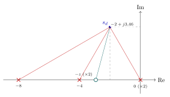

$$
2\angle(s+z)=2\angle s+\angle(s+4)+\angle(s+8)+180^\circ
$$

$$
\theta_0=180^\circ-\tan^{-1}\left(\frac{2\sqrt3}{2}\right)=120^\circ
$$

$$
\theta_{-4}=\tan^{-1}\left(\frac{2\sqrt3}{2}\right)=60^\circ
$$

$$
\theta_{-8}=\tan^{-1}\left(\frac{2\sqrt3}{6}\right)=30^\circ
$$

$$
2\left[180^\circ-\tan^{-1}\left(\frac{2\sqrt3}{2-z}\right)\right]=150^\circ
$$

$$
180^\circ-\tan^{-1}\left(\frac{2\sqrt3}{2-z}\right)=75^\circ
$$

Aplicando a tangente em ambos os lados:

$$
0-\frac{2\sqrt3}{2-z}=3{,}73
$$

$$
-2\sqrt3=3{,}73(2-z)
$$

$$
-2\sqrt3=7{,}46-3{,}73z
$$

$$
z=2{,}92
$$

### PID com cancelamento de polo e zero — condição de fase e módulo

Função de transferência em malha aberta:

$$
G_{ma}(s)=\frac{K_p(s+1)(s+z_2)}s\frac1{(s+1)(s-1)}=\frac{K_p(s+z_2)}{s(s-1)}
$$

**Condição de fase:**

$$
\angle(s+z_2)=\angle s+\angle(s-1)+180^\circ
$$

$$
\theta_{z_2}=\tan^{-1}\left(\frac{\sqrt3}{z_2-1}\right)
$$

$$
\theta_1=180^\circ-\tan^{-1}\left(\frac{\sqrt3}{1}\right)=120^\circ
$$

$$
\theta_0=180^\circ-\tan^{-1}\left(\frac{\sqrt3}{2}\right)=139{,}1^\circ
$$

$$
\tan^{-1}\left(\frac{\sqrt3}{z_2-1}\right)=120^\circ+139{,}1^\circ+180^\circ
$$

$$
\tan^{-1}\left(\frac{\sqrt3}{z_2-1}\right)=79{,}1^\circ
$$

$$
\frac{\sqrt3}{z_2-1}=5{,}2\Rightarrow z_2=\frac{\sqrt3+5{,}2}{5{,}2}
$$

$$
\boxed{z_2=1{,}3}
$$

**Condição de módulo:**

$$
G_{ma}(s)=\frac{K_p(s+1{,}3)}{s(s-1)}
$$

$$
\left.\left|\frac{K_p(s+1{,}3)}{s(s-1)}\right|\right|_{s=-1+\sqrt3j}=1
$$

$$
K_p=\left.\frac{|s|\,|s-1|}{|s+1{,}3|}\right|_{s=-1+\sqrt3j}
$$

$$
K_p=\frac{|-1+\sqrt3j|\,|-2+\sqrt3j|}{|0{,}3+\sqrt3j|}
$$

$$
\boxed{K_p\approx3}
$$

### PID com zeros iguais (continuação)

**Exemplo:** considere um sistema dado por:

$$
G(s)=\frac1{s(s+4)(s+8)}
$$

Considerando uma rampa unitária na entrada, projete um controlador PID de modo que a resposta tenha:

- Erro nulo.
- Polos dominantes $s=-2\pm2\sqrt3j$.

**Solução:**

$$
G_c(s)=\frac{K_p(s+z)^2}s
$$

$$
2\angle(s+z)=2\angle s+\angle(s+4)+\angle(s+8)+180^\circ
$$

$$
2\tan^{-1}\left(\frac{2\sqrt3}{z-2}\right)=2\left(180^\circ-\tan^{-1}\frac{2\sqrt3}{2}\right)+\tan^{-1}\frac{2\sqrt3}{2}+\tan^{-1}\frac{2\sqrt3}{6}+180^\circ
$$

$$
2\tan^{-1}\left(\frac{2\sqrt3}{z-2}\right)=150^\circ
$$

$$
\tan^{-1}\left(\frac{2\sqrt3}{z-2}\right)=75^\circ
$$

$$
\frac{2\sqrt3}{z-2}=3{,}73
$$

$$
z=\frac{2\sqrt3+2\times3{,}73}{3{,}73}\Rightarrow\boxed{z=2{,}9}
$$

**Condição de módulo:**

$$
G_{ma}(s)=\frac{K_p(s+2{,}9)^2}s\frac1{s(s+4)(s+8)}
$$

$$
G_{ma}(s)=\frac{K_p(s+2{,}9)^2}{s^2(s+4)(s+8)}
$$

Continuação da condição de módulo:

$$
\left.\left|\frac{K_p(s+2{,}9)^2}{s^2(s+4)(s+8)}\right|\right|_{s=-2+2\sqrt3j}=1
$$

$$
K_p=\left.\frac{|s^2|\,|s+4|\,|s+8|}{|s+2{,}9|^2}\right|_{s=-2+2\sqrt3j}
$$

$$
K_p=\frac{|(-2+2\sqrt3j)^2|\,|2+2\sqrt3j|\,|6+2\sqrt3j|}{|(0{,}9+2\sqrt3j)^2|}
$$

$$
\boxed{K_p\approx34{,}5}
$$

### Implementação analógica do PID (continuação)

  

Impedâncias:

$$
Z_1(s)=\frac{R_1}{1+sR_1C_1}
$$

$$
Z_2(s)=\frac{1+sR_2C_2}{sC_2}
$$

$$
\frac{V_{out}(s)}{V_{in}(s)}=\frac{\frac{1+sR_2C_2}{sC_2}}{\frac{R_1}{1+sR_1C_1}}=\frac{1+sR_2C_2}{sC_2}\frac{1+sR_1C_1}{R_1}
$$

$$
\frac{V_{out}(s)}{V_{in}(s)}=\frac{1+sR_1C_1+sR_2C_2+R_1R_2C_1C_2s^2}{sR_1C_2}
$$

$$
\frac{V_{out}(s)}{V_{in}(s)}=\frac1{sR_1C_2}+\frac{C_1}{C_2}+\frac{R_2}{R_1}+sR_2C_1
$$

$$
\frac{V_{out}(s)}{V_{in}(s)}=\frac{C_1}{C_2}+\frac{R_2}{R_1}+\frac1{sR_1C_2}+sR_2C_1
$$

$$
K_p=\frac{C_1}{C_2}+\frac{R_2}{R_1},\qquad\tau_i=R_1C_1,\qquad\tau_d=R_2C_1
$$
