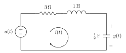
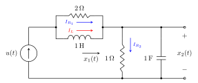
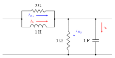
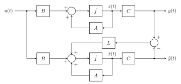

# Unidade 3 — Representação por Variáveis de Estado

## Representação por variáveis de estado

**Definição:** o estado $x(t_0)$ de um sistema no instante $t_0$ é a informação em $t_0$ que, junto com a entrada $u(t)$ conhecida para $t\ge t_0$ e o modelo do sistema, determina, de forma única, a evolução do estado e a resposta do sistema para $t>t_0$.

O estado é geralmente representado na forma de um vetor:

$$
x(t)=\begin{bmatrix}x_1(t)\\x_2(t)\\\vdots\\x_n(t)\end{bmatrix}
$$

$x_1,x_2,\ldots,x_n$ são as variáveis de estado. A quantidade $n$ é a ordem da representação de estado. Em uma realização mínima de um sistema LTI SISO, ela coincide com o grau do denominador da função de transferência após cancelamentos. As variáveis de estado não são únicas.

**Exemplo:** considere um sistema dado por:

  

**Solução:**

$$
u(t)=3i(t)+\frac{di(t)}{dt}+y(t)
$$

$$
i(t)=i_C(t)\Rightarrow i(t)=C\frac{dy(t)}{dt}=\frac12\frac{dy(t)}{dt}
$$

$$
u(t)=3\cdot\frac12\frac{dy(t)}{dt}+\frac12\frac{d^2y(t)}{dt^2}+y(t)
$$

$$
2u(t)=3\frac{dy(t)}{dt}+\frac{d^2y(t)}{dt^2}+2y(t)
$$

$$
\boxed{\frac{d^2y(t)}{dt^2}+3\frac{dy(t)}{dt}+2y(t)=2u(t)}
$$

Aplicando Laplace, temos:

$$
\begin{aligned}
s^2Y(s)-sy(0)-\dot y(0)+3(sY(s)-y(0))+2Y(s)&=2U(s)\\
s^2Y(s)-sy(0)-\dot y(0)+3sY(s)-3y(0)+2Y(s)&=2U(s)\\
Y(s)(s^2+3s+2)&=y(0)(s+3)+\dot y(0)+2U(s)
\end{aligned}
$$

$$
\underbrace{Y(s)}_{\text{Saída}}=
\underbrace{\frac{s+3}{s^2+3s+2}y(0)+\frac{1}{s^2+3s+2}\dot y(0)}_{\text{Condições iniciais}}
+\underbrace{\frac{2}{s^2+3s+2}U(s)}_{\text{Entrada}}
$$

**Obs.:** em circuitos elétricos, correntes de indutores e tensões de capacitores independentes são escolhas naturais de variáveis de estado. Também é possível escolher combinações equivalentes dessas grandezas. Neste exemplo, $x_2=\dot y=2i$.

**Equações de estado:** considere a equação diferencial anterior:

$$
\frac{d^2y(t)}{dt^2}+3\frac{dy(t)}{dt}+2y(t)=2u(t)
$$

Definindo $x_1(t)=y(t)$ e $x_2(t)=\dot y(t)$ como variáveis de estado, temos:

$$
\begin{aligned}
\dot x_1(t)&=\dot y(t)=x_2(t)\\
\dot x_2(t)&=\ddot y(t)
\end{aligned}
$$

$$
\begin{aligned}
\ddot y(t)+3\dot y(t)+2y(t)&=2u(t)\\
\ddot y(t)&=-3\dot y(t)-2y(t)+2u(t)\\
\ddot y(t)&=-3x_2(t)-2x_1(t)+2u(t)
\end{aligned}
$$

Substituindo em $\dot x_2(t)=\ddot y(t)$:

$$
\dot x_2(t)=-2x_1(t)-3x_2(t)+2u(t)
$$

$$
y(t)=x_1(t)
$$

Representando na forma matricial, temos:

$$
\begin{bmatrix}\dot x_1(t)\\\dot x_2(t)\end{bmatrix}=
\begin{bmatrix}0&1\\-2&-3\end{bmatrix}
\begin{bmatrix}x_1(t)\\x_2(t)\end{bmatrix}+
\begin{bmatrix}0\\2\end{bmatrix}u(t)
$$

$$
y(t)=\begin{bmatrix}1&0\end{bmatrix}\begin{bmatrix}x_1(t)\\x_2(t)\end{bmatrix}
$$

Neste exemplo, $D=0$. De uma forma geral, para sistemas lineares invariantes no tempo (LTI) contínuos, temos:

$$
\begin{aligned}
\dot x(t)&=Ax(t)+Bu(t)\\
y(t)&=Cx(t)+Du(t)
\end{aligned}
$$

$$
A\in\mathbb R^{n\times n},\quad B\in\mathbb R^{n\times m},\quad C\in\mathbb R^{p\times n},\quad D\in\mathbb R^{p\times m}
$$

em que $x(t)\in\mathbb R^n$, $u(t)\in\mathbb R^m$ e $y(t)\in\mathbb R^p$. As matrizes $A$, $B$, $C$ e $D$ representam, respectivamente, a dinâmica de estado, a ação da entrada sobre o estado, a relação estado–saída e a transmissão direta da entrada à saída.

## Relação entre representação de estado e função de transferência

Considere o sistema dado pela seguinte representação:

$$
\begin{aligned}\dot x(t)&=Ax(t)+Bu(t)\\y(t)&=Cx(t)+Du(t)\end{aligned}
$$

Aplicando a transformada de Laplace e considerando condições iniciais nulas, temos:

$$
\begin{aligned}sX(s)&=AX(s)+BU(s)\\Y(s)&=CX(s)+DU(s)\end{aligned}
$$

$$
\begin{aligned}(sI-A)X(s)&=BU(s)\\X(s)&=(sI-A)^{-1}BU(s)\end{aligned}
$$

Substituindo, obtemos:

$$
\begin{aligned}
Y(s)&=C\big((sI-A)^{-1}BU(s)\big)+DU(s)\\
Y(s)&=\big[C(sI-A)^{-1}B+D\big]U(s)
\end{aligned}
$$

$$
\boxed{G(s)=C(sI-A)^{-1}B+D}
$$

Aqui, $I=I_n$ e a inversa existe para $s$ que não seja autovalor de $A$. Para sistemas SISO, $G(s)=Y(s)/U(s)$ com condições iniciais nulas; para sistemas MIMO, $G(s)$ é uma matriz de transferência de dimensão $p\times m$. A ordem dos fatores matriciais não pode ser invertida.

**Exemplo:**

$$
\begin{bmatrix}\dot x_1(t)\\\dot x_2(t)\end{bmatrix}=\begin{bmatrix}0&1\\-2&-3\end{bmatrix}\begin{bmatrix}x_1(t)\\x_2(t)\end{bmatrix}+\begin{bmatrix}0\\2\end{bmatrix}u(t)
$$

$$
y(t)=\begin{bmatrix}1&0\end{bmatrix}\begin{bmatrix}x_1(t)\\x_2(t)\end{bmatrix}
$$

$$
G(s)=C(sI-A)^{-1}B+D
$$

$$
\begin{aligned}
G(s)&=\begin{bmatrix}1&0\end{bmatrix}\left(\begin{bmatrix}s&0\\0&s\end{bmatrix}-\begin{bmatrix}0&1\\-2&-3\end{bmatrix}\right)^{-1}\begin{bmatrix}0\\2\end{bmatrix}\\
&=\begin{bmatrix}1&0\end{bmatrix}\begin{bmatrix}s&-1\\2&s+3\end{bmatrix}^{-1}\begin{bmatrix}0\\2\end{bmatrix}
\end{aligned}
$$

$$
\begin{bmatrix}s&-1\\2&s+3\end{bmatrix}^{-1}=\frac{1}{s^2+3s+2}\begin{bmatrix}s+3&1\\-2&s\end{bmatrix}
$$

$$
\begin{aligned}
G(s)&=\begin{bmatrix}1&0\end{bmatrix}\frac{1}{s^2+3s+2}\begin{bmatrix}s+3&1\\-2&s\end{bmatrix}\begin{bmatrix}0\\2\end{bmatrix}\\
&=\begin{bmatrix}1&0\end{bmatrix}\frac{1}{s^2+3s+2}\begin{bmatrix}2\\2s\end{bmatrix}\\
&=\frac{2}{s^2+3s+2}
\end{aligned}
$$

## Realização da FT

Considere uma função de transferência racional própria SISO ($m\le n$), com denominador mônico. Se $m<n$, a função de transferência é estritamente própria e $D=0$; se $m=n$, há transmissão direta e $D=b_n$. Uma mesma função de transferência admite diferentes realizações.

$$
G(s)=\frac{b_ms^m+b_{m-1}s^{m-1}+\cdots+b_1s+b_0}{s^n+a_{n-1}s^{n-1}+\cdots+a_1s+a_0}
$$

**Exemplo:**

$$
G(s)=\frac{2s+3}{s^3+5s^2+7s+3}=\frac{Y(s)}{U(s)}
$$

Introduzindo a variável auxiliar $W(s)$, com condições iniciais nulas:

$$
W(s)=\frac{U(s)}{s^3+5s^2+7s+3}
$$

$$
\begin{aligned}Y(s)&=(2s+3)W(s)\\U(s)&=(s^3+5s^2+7s+3)W(s)\end{aligned}
$$

Definindo $X_1(s)=W(s)$, $X_2(s)=sW(s)$ e $X_3(s)=s^2W(s)$, temos:

$$
\begin{aligned}sX_1(s)&=sW(s)=X_2(s)\\sX_2(s)&=s^2W(s)=X_3(s)\end{aligned}
$$

$$
sX_3(s)=s^3W(s)
$$

$$
\begin{aligned}
s^3W(s)+5s^2W(s)+7sW(s)+3W(s)&=U(s)
\\
s^3W(s)&=-3W(s)-7sW(s)-5s^2W(s)+U(s)
\\
s^3W(s)&=-3X_1(s)-7X_2(s)-5X_3(s)+U(s)
\end{aligned}
$$

$$
\begin{aligned}Y(s)&=(2s+3)W(s)\\Y(s)&=3W(s)+2sW(s)\\Y(s)&=3X_1(s)+2X_2(s)\end{aligned}
$$

No domínio do tempo, temos:

$$
\begin{aligned}\dot x_1(t)&=x_2(t)\\\dot x_2(t)&=x_3(t)\\\dot x_3(t)&=-3x_1(t)-7x_2(t)-5x_3(t)+u(t)\\y(t)&=3x_1(t)+2x_2(t)\end{aligned}
$$

Na forma matricial, temos:

$$
\dot x(t)=\begin{bmatrix}0&1&0\\0&0&1\\-3&-7&-5\end{bmatrix}x(t)+\begin{bmatrix}0\\0\\1\end{bmatrix}u(t)
$$

$$
y(t)=\begin{bmatrix}3&2&0\end{bmatrix}x(t)
$$

Esta é uma realização na forma canônica controlável (convenção com os coeficientes na última linha de $A$). Neste exemplo, $D=0$.

## Controlabilidade

Considere um sistema representado por:

$$
\dot x(t)=Ax(t)+Bu(t)
$$

**Definição:** um sistema é dito controlável se, para todo estado inicial $x(t_0)=x_0$ e todo estado final $x(t_f)=x_f$, para qualquer $t_f>t_0$ finito, existe uma entrada admissível $u(t)$ em $t_0\le t\le t_f$ que transfere $x_0$ a $x_f$. Para sistemas LTI contínuos, considera-se aqui a controlabilidade sem restrições adicionais de amplitude da entrada.

Portanto, um sistema representado pelo par $(A,B)$ é dito controlável se, e somente se, a matriz de controlabilidade dada por:

$$
\mathcal C=\begin{bmatrix}B&AB&A^2B&\cdots&A^{n-1}B\end{bmatrix}
$$

tiver posto igual a $n$ ($\operatorname{posto}(\mathcal C)=n$). Para $m$ entradas, $\mathcal C\in\mathbb R^{n\times nm}$.

**Exemplo:** considere um circuito elétrico:

  

**Solução:**

$$
V=Ri,\qquad i=i_C=C\frac{dv}{dt}
$$

$$
\begin{aligned}u(t)-x_1(t)-V_{R_1}&=0\\u(t)-x_1(t)-\dot x_1(t)&=0\\\boxed{\dot x_1(t)=-x_1(t)+u(t)}&\end{aligned}
$$

$$
\begin{aligned}u(t)-x_2(t)-V_{R_2}&=0\\u(t)-x_2(t)-\dot x_2(t)&=0\\\boxed{\dot x_2(t)=-x_2(t)+u(t)}&\end{aligned}
$$

Representando na forma matricial, temos:

$$
\dot x(t)=\underbrace{\begin{bmatrix}-1&0\\0&-1\end{bmatrix}}_{A_{n\times n}}x(t)+\underbrace{\begin{bmatrix}1\\1\end{bmatrix}}_B u(t)
$$

A matriz de controlabilidade é dada por:

$$
\mathcal C=\begin{bmatrix}B&AB\end{bmatrix}
$$

$$
AB=\begin{bmatrix}-1&0\\0&-1\end{bmatrix}\begin{bmatrix}1\\1\end{bmatrix}=\begin{bmatrix}-1\\-1\end{bmatrix}
$$

$$
\mathcal C=\begin{bmatrix}1&-1\\1&-1\end{bmatrix},\qquad\operatorname{posto}(\mathcal C)=1
$$

**Sistema não controlável.**

Para o caso de uma única entrada (SISO ou SIMO), $\mathcal C$ é quadrada e o teste de posto equivale ao teste do determinante:

$$
\det(\mathcal C)=0\quad (\text{LD})
$$

$$
\det(\mathcal C)\ne0\quad (\text{LI})
$$

**Exemplo:** considere um sistema dado por:

  

$$
u(t)-V_R-V_L-V_C=0
$$

$$
\begin{aligned}i(t)&=x_1(t)\\V_R&=Rx_1(t)\\V_L&=L\frac{di(t)}{dt}=L\dot x_1(t)\\V_C&=x_2(t)\end{aligned}
$$

$$
L\dot x_1(t)=-Rx_1(t)-x_2(t)+u(t)
$$

$$
\boxed{\dot x_1(t)=-\frac RLx_1(t)-\frac1Lx_2(t)+\frac1Lu(t)}\tag{I}
$$

$$
\begin{aligned}i(t)&=i_C(t)\\x_1(t)&=C\dot x_2(t)\\\boxed{\dot x_2(t)=\frac1C x_1(t)}&\end{aligned}
$$

Na forma matricial:

$$
\dot x(t)=\begin{bmatrix}-R/L&-1/L\\1/C&0\end{bmatrix}x(t)+\begin{bmatrix}1/L\\0\end{bmatrix}u(t)
$$

A matriz de controlabilidade é dada por:

$$
\mathcal C=\begin{bmatrix}B&AB\end{bmatrix}
$$

$$
AB=\begin{bmatrix}-R/L&-1/L\\1/C&0\end{bmatrix}\begin{bmatrix}1/L\\0\end{bmatrix}=\begin{bmatrix}-R/L^2\\1/(LC)\end{bmatrix}
$$

$$
\mathcal C=\begin{bmatrix}1/L&-R/L^2\\0&1/(LC)\end{bmatrix}
$$

$\det(\mathcal C)=1/(L^2C)\ne0$ para $L>0$ e $C>0$. Logo, as colunas são LI. **Sistema controlável.**

## Controle por realimentação de estado

Considere um sistema que é representado por:

$$
\begin{cases}\dot x(t)=Ax(t)+Bu(t)\\y(t)=Cx(t)+Du(t)\end{cases}
$$

  

$$
u(t)=-Kx(t)+r(t)
$$

Para uma única entrada, o ganho de realimentação é:

$$
K=\begin{bmatrix}K_1&K_2&K_3&\cdots&K_n\end{bmatrix}
$$

Em geral, $K\in\mathbb R^{m\times n}$, e nessa lei $r(t)\in\mathbb R^m$ é o sinal externo aplicado à entrada (não necessariamente a referência de saída). Assume-se acesso ao estado completo.

**Malha fechada:**

$$
\begin{aligned}\dot x(t)&=Ax(t)+B(-Kx(t)+r(t))\\y(t)&=Cx(t)+D(-Kx(t)+r(t))\end{aligned}
$$

$$
\begin{aligned}\dot x(t)&=Ax(t)-BKx(t)+Br(t)\\y(t)&=Cx(t)-DKx(t)+Dr(t)\end{aligned}
$$

$$
\begin{aligned}\dot x(t)&=(A-BK)x(t)+Br(t)\\y(t)&=(C-DK)x(t)+Dr(t)\end{aligned}
$$

**Observação:** os autovalores de $A-BK$ determinam os modos naturais e a estabilidade interna da malha fechada. São obtidos pelas raízes de $\det(sI-(A-BK))=0$. A resposta completa também depende das condições iniciais, das entradas, das matrizes de entrada e saída e da estrutura modal. Em sistemas estáveis, os modos dominantes são geralmente aqueles associados aos autovalores mais próximos do eixo imaginário, quando excitados e visíveis na saída. A estabilidade assintótica interna exige que todos os autovalores tenham parte real estritamente negativa.

## Projeto por alocação de polos

Consiste em determinar a matriz $K$, de modo que os autovalores de $A-BK$ sejam os desejados.

**Teorema:** os autovalores de $A-BK$ podem ser alocados arbitrariamente por uma escolha adequada de $K$ se, e somente se, o par $(A,B)$ for controlável. Para matrizes reais e ganho real, autovalores complexos devem ocorrer em pares conjugados.

O polinômio característico mônico de uma matriz $M$ de ordem $q$ é $\det(sI-M)$. Também se pode usar $\det(M-sI)=(-1)^q\det(sI-M)$ para determinar as raízes, mas é necessário normalizar o sinal antes de comparar coeficientes.

**Exemplo:** calcule a matriz $K$ de modo que os autovalores de $(A-BK)$ sejam iguais a $-1$ e $-2$ para o seguinte sistema:

$$
\dot x(t)=\begin{bmatrix}-1&2\\-2&-1\end{bmatrix}x(t)+\begin{bmatrix}1\\0\end{bmatrix}u(t)
$$

$$
y(t)=\begin{bmatrix}0&1\end{bmatrix}x(t)
$$

**Solução:** a matriz de controlabilidade do sistema é dada por:

$$
\mathcal C=\begin{bmatrix}B&AB\end{bmatrix}
$$

$$
AB=\begin{bmatrix}-1&2\\-2&-1\end{bmatrix}\begin{bmatrix}1\\0\end{bmatrix}=\begin{bmatrix}-1\\-2\end{bmatrix}
$$

$$
\mathcal C=\begin{bmatrix}1&-1\\0&-2\end{bmatrix}
$$

$\det(\mathcal C)\ne0$, $\operatorname{posto}(\mathcal C)=2$ (sistema controlável).

**1) Polinômio desejado:**

$$
\Delta_d=(s+2)(s+1)
$$

$$
\Delta_d=s^2+3s+2\tag{1}
$$

**2) Polinômio de malha fechada:**

$$
\Delta_{mf}(s)=\det((A-BK - sI))=\det(A-BK-sI)
$$

$$
\begin{aligned}A-BK-sI&=\begin{bmatrix}-1&2\\-2&-1\end{bmatrix}-\begin{bmatrix}1\\0\end{bmatrix}\begin{bmatrix}K_1&K_2\end{bmatrix}-\begin{bmatrix}s&0\\0&s\end{bmatrix}\\
&=\begin{bmatrix}-1&2\\-2&-1\end{bmatrix}-\begin{bmatrix}K_1&K_2\\0&0\end{bmatrix}-\begin{bmatrix}s&0\\0&s\end{bmatrix}\\
&=\begin{bmatrix}-1-K_1-s&2-K_2\\-2&-1-s\end{bmatrix}\end{aligned}
$$

$$
\begin{aligned}\Delta_{mf}&=\begin{vmatrix}-1-K_1-s&2-K_2\\-2&-1-s\end{vmatrix}\\
&=(-1-K_1-s)(-1-s)-(-2)(2-K_2)\\
&=1+K_1+s+s+sK_1+s^2+4-2K_2\\
&=s^2+s(K_1+2)+K_1-2K_2+5\end{aligned}
$$

Fazendo a igualdade de polinômios, temos:

$$
\begin{cases}\Delta_d=s^2+3s+2\\\Delta_{mf}=s^2+s(K_1+2)+K_1-2K_2+5\end{cases}
$$

$$
s^2+3s+2=s^2+s(K_1+2)+K_1-2K_2+5
$$

**I)**

$$
s(K_1+2)=3s
$$

$$
K_1=3-2\Rightarrow\boxed{K_1=1}
$$

**II)**

$$
\begin{aligned}K_1-2K_2+5&=2\\1-2K_2+5&=2\\-2K_2&=-5+2-1\\K_2&=\frac{-5+2-1}{-2}=\frac{-4}{-2}\end{aligned}
$$

$$
\boxed{K_2=2}
$$

Portanto, $K=\begin{bmatrix}1&2\end{bmatrix}$. Verificando:

$$
A-BK=\begin{bmatrix}-2&0\\-2&-1\end{bmatrix}
$$

Os autovalores são $-2$ e $-1$, como solicitado.

## Seguidor robusto de referência

Considere o seguinte diagrama de blocos:

  

**Sistema:**

$$
\dot x(t)=Ax(t)+Bu(t)\tag{I}
$$

$$
y(t)=Cx(t)\tag{II}
$$

**Lei de controle:**

$$
u(t)=-Kx(t)-K_Iv(t)\tag{III}
$$

$$
e(t)=r(t)-y(t)\tag{IV}
$$

Substituindo (III) em (I):

$$
\begin{aligned}\dot x(t)&=Ax(t)+B(-Kx(t)-K_Iv)\\\dot x(t)&=Ax(t)-BKx(t)-BK_Iv\end{aligned}
$$

$$
\dot v(t)=e(t)=r(t)-y(t)\tag{V}
$$

Substituindo (II) em (V):

$$
\boxed{\dot v(t)=e(t)=r(t)-Cx(t)}
$$

Na forma matricial, temos:

$$
\begin{bmatrix}\dot x\\\dot v\end{bmatrix}=
\underbrace{\begin{bmatrix}A&0\\-C&0\end{bmatrix}}_{\hat A}\begin{bmatrix}x\\v\end{bmatrix}-
\underbrace{\begin{bmatrix}B\\0\end{bmatrix}}_{\hat B}
\underbrace{\begin{bmatrix}K&K_I\end{bmatrix}}_{\hat K}\begin{bmatrix}x\\v\end{bmatrix}+
\begin{bmatrix}0\\1\end{bmatrix}r
$$

O diagrama considera $D=0$ e uma única entrada e saída. Definindo $\hat x=\begin{bmatrix}x^T&v\end{bmatrix}^T$, a matriz de malha fechada é:

$$
\hat A-\hat B\hat K=\begin{bmatrix}A-BK&-BK_I\\-C&0\end{bmatrix}
$$

**Convenção de sinais:** adotamos $\dot v=r-y$ e $\hat K=\begin{bmatrix}K&K_I\end{bmatrix}$, de modo que $u=-\hat K\hat x=-Kx-K_Iv$. O símbolo $K_I$ aparece sem sinal negativo no vetor de ganhos, mas seu valor é determinado pelo projeto e pode ser negativo. Se a lei for escrita com $+K_I^{(+)}v$, então $K_I^{(+)}=-K_I$.

**Teorema:** para o sistema aumentado com $D=0$ e $p$ saídas integradas, o par $(\hat A,\hat B)$ é controlável se, e somente se, $(A,B)$ for controlável e

$$
\operatorname{posto}\begin{bmatrix}A&B\\C&0_{p\times m}\end{bmatrix}=n+p.
$$

No caso SISO, a matriz do teste é quadrada, de ordem $n+1$. A condição adicional pode ser obtida pelo teste PBH aplicado ao modo em $s=0$ do sistema aumentado; a controlabilidade da planta, sozinha, não é suficiente.

Se a malha fechada aumentada for assintoticamente estável e $r$ for constante, então $\dot v(t)\to0$ e, consequentemente, $e(t)\to0$. A propriedade pressupõe o modelo e a lei de controle adotados, sem saturação do atuador que inviabilize o equilíbrio. A ação integral permite rejeitar erros constantes enquanto a estabilidade e a existência do equilíbrio forem preservadas.

**Exemplo:** calcule $K$ e $K_I$ de modo a se ter rastreamento de referência constante e os seguintes autovalores de malha fechada: $-2$, $-2$ e $-2$, para o seguinte sistema:

$$
\dot x(t)=\begin{bmatrix}-1&2\\2&-1\end{bmatrix}x(t)+\begin{bmatrix}0\\1\end{bmatrix}u(t)
$$

$$
y(t)=\begin{bmatrix}0&1\end{bmatrix}x(t)
$$

**Solução:**

$$
\mathcal C=\begin{bmatrix}B&AB\end{bmatrix}
$$

$$
AB=\begin{bmatrix}-1&2\\2&-1\end{bmatrix}\begin{bmatrix}0\\1\end{bmatrix}=\begin{bmatrix}2\\-1\end{bmatrix}
$$

$$
\mathcal C=\begin{bmatrix}0&2\\1&-1\end{bmatrix}
$$

$\det(\mathcal C)\ne0\Rightarrow$ controlável. Posto = 2.

$$
\hat A=\begin{bmatrix}A&0\\-C&0\end{bmatrix},\qquad\hat B=\begin{bmatrix}B\\0\end{bmatrix}
$$

$$
\hat A=\begin{bmatrix}-1&2&0\\2&-1&0\\0&-1&0\end{bmatrix},\qquad\hat B=\begin{bmatrix}0\\1\\0\end{bmatrix}
$$

A matriz de controlabilidade é dada por:

$$
\hat{\mathcal C}=\begin{bmatrix}\hat B&\hat A\hat B&\hat A^2\hat B\end{bmatrix}
$$

$$
\hat A\hat B=\begin{bmatrix}-1&2&0\\2&-1&0\\0&-1&0\end{bmatrix}\begin{bmatrix}0\\1\\0\end{bmatrix}=\begin{bmatrix}2\\-1\\-1\end{bmatrix}
$$

$$
\begin{aligned}\hat A^2\hat B&=\begin{bmatrix}-1&2&0\\2&-1&0\\0&-1&0\end{bmatrix}\begin{bmatrix}-1&2&0\\2&-1&0\\0&-1&0\end{bmatrix}\begin{bmatrix}0\\1\\0\end{bmatrix}\\
&=\begin{bmatrix}-1&2&0\\2&-1&0\\0&-1&0\end{bmatrix}\begin{bmatrix}2\\-1\\-1\end{bmatrix}=\begin{bmatrix}-4\\5\\1\end{bmatrix}\end{aligned}
$$

$$
\hat{\mathcal C}=\begin{bmatrix}0&2&-4\\1&-1&5\\0&-1&1\end{bmatrix}
$$

$$
\det(\hat{\mathcal C})=2\ne0,\qquad\operatorname{posto}(\hat{\mathcal C})=3
$$

Logo, o sistema aumentado é controlável e os três polos podem ser alocados.

**1) Polinômio desejado:**

$$
\Delta_d=(s+2)(s+2)(s+2)
$$

$$
\Delta_d=s^3+6s^2+12s+8
$$

**2) Polinômio de malha fechada:**

$$
\hat K=\begin{bmatrix}K&K_I\end{bmatrix}=\begin{bmatrix}K_1&K_2&K_I\end{bmatrix}
$$

$$
\Delta_{mf}(s)=\det(\hat A-\hat B\hat K-sI)
$$

$$
\hat A-\hat B\hat K=\begin{bmatrix}-1&2&0\\2&-1&0\\0&-1&0\end{bmatrix}-\begin{bmatrix}0\\1\\0\end{bmatrix}\begin{bmatrix}K_1&K_2&K_I\end{bmatrix}
$$

$$
\hat A-\hat B\hat K=\begin{bmatrix}-1&2&0\\2-K_1&-1-K_2&-K_I\\0&-1&0\end{bmatrix}
$$

$$
\Delta_{mf}(s)=\begin{vmatrix}-1-s&2&0\\2-K_1&-1-K_2-s&-K_I\\0&-1&-s\end{vmatrix}
$$

Aplicando a regra de Sarrus (ou expandindo pela primeira linha):

$$
\begin{aligned}
\Delta_{mf}(s)&=-(s+1)[s(s+1+K_2)-K_I]+2s(2-K_1)\\
&=-s^3-(K_2+2)s^2-(K_2+2K_1-K_I-3)s+K_I
\end{aligned}
$$

Como a matriz aumentada é de ordem 3, $\det(\hat A-\hat B\hat K-sI)=-\det(sI-(\hat A-\hat B\hat K))$. Multiplicamos todo o polinômio por $-1$ para obter o polinômio mônico, sem alterar suas raízes:

$$
-\Delta_{mf}(s)=s^3+(K_2+2)s^2+(K_2+2K_1-K_I-3)s-K_I
$$

Igualando $-\Delta_{mf}(s)=\Delta_d(s)$ e comparando os coeficientes:

$$
-K_I=8\Rightarrow\boxed{K_I=-8}
$$

$$
K_2+2=6\Rightarrow\boxed{K_2=4}
$$

$$
K_2+2K_1-K_I-3=12\Rightarrow\boxed{K_1=\frac32}
$$

Portanto:

$$
\boxed{K=\begin{bmatrix}\frac32&4\end{bmatrix},\qquad K_I=-8}
$$

$$
\boxed{\hat K=\begin{bmatrix}\frac32&4&-8\end{bmatrix}}
$$

A lei de controle é $u(t)=-Kx(t)-K_Iv(t)=-\frac32x_1(t)-4x_2(t)+8v(t)$.

Verificando:

$$
\hat A-\hat B\hat K=\begin{bmatrix}-1&2&0\\\frac12&-5&8\\0&-1&0\end{bmatrix}
$$

$$
\det(\hat A-\hat B\hat K-sI)=-s^3-6s^2-12s-8=-(s+2)^3
$$

Assim, os três autovalores são iguais a $-2$ e a malha fechada aumentada é assintoticamente estável.

## Observabilidade

Considere um sistema representado por:

$$
\begin{aligned}\dot x(t)&=Ax(t)+Bu(t)\\y(t)&=Cx(t)+Du(t)\end{aligned}
$$

**Definição:** um sistema é dito observável se, para todo $x(0)$ desconhecido, o conhecimento da entrada $u(t)$ e da saída $y(t)$ em qualquer intervalo de tempo finito de duração positiva, iniciado em $t=0$, é suficiente para se determinar de forma única o estado inicial $x(0)$.

Portanto, um sistema representado pelo par $(A,C)$ é observável se, e somente se, a matriz de observabilidade dada por:

$$
\mathcal O=\begin{bmatrix}C\\CA\\\vdots\\CA^{n-1}\end{bmatrix}
$$

tiver posto igual a $n$. Para $p$ saídas, $\mathcal O\in\mathbb R^{np\times n}$. O teste por determinante só se aplica diretamente quando a matriz é quadrada (por exemplo, uma única saída).

- $n$: ordem da matriz $A$.
- Se for igual, é observável; caso contrário, não é.

**Exemplo:** considere o seguinte circuito:

  

$$
u(t)=I_{R_1}+I_L=I_{R_1}+x_1(t)
$$

$$
I_{R_1}=\frac{V_{R_1}}2=\frac{V_L}2=\frac{L\,di(t)/dt}{2}=\frac{\dot x_1(t)}2
$$

$$
\boxed{\dot x_1(t)=-2x_1(t)+2u(t)}
$$

  

$$
\begin{aligned}u(t)&=i_C+i_{R_2}\\i_C&=C\frac{dv}{dt}\\i_C&=\dot x_2(t)\\i_{R_2}&=x_2(t)\end{aligned}
$$

$$
\begin{aligned}u(t)&=\dot x_2(t)+x_2(t)\\\dot x_2(t)&=-x_2(t)+u(t)\\y(t)&=x_2(t)\end{aligned}
$$

$$
\dot x(t)=\begin{bmatrix}-2&0\\0&-1\end{bmatrix}x(t)+\begin{bmatrix}2\\1\end{bmatrix}u(t)
$$

$$
y(t)=\begin{bmatrix}0&1\end{bmatrix}x(t)
$$

A matriz de observabilidade:

$$
\mathcal O=\begin{bmatrix}C\\CA\end{bmatrix}
$$

$$
CA=\begin{bmatrix}0&1\end{bmatrix}\begin{bmatrix}-2&0\\0&-1\end{bmatrix}=\begin{bmatrix}0&-1\end{bmatrix}
$$

$$
\mathcal O=\begin{bmatrix}0&1\\0&-1\end{bmatrix}\Rightarrow\det(\mathcal O)=0
$$

**Sistema não observável.** A saída $y=x_2$ não contém informação sobre $x_1$ porque a dinâmica de $x_2$ é independente de $x_1$. O posto de $\mathcal O$ é 1. O modo não observável, em $-2$, é estável; portanto, este sistema é detectável.

## Observador de estado

Tem por objetivo estimar o vetor de estado a partir do modelo, da entrada conhecida e das saídas medidas, inclusive os estados que não são medidos diretamente. A seguir, considera-se um observador de ordem completa de Luenberger, com $D=0$.

  

**Sistema:**

$$
\begin{cases}\dot x(t)=Ax(t)+Bu(t)\\y(t)=Cx(t)\end{cases}
$$

**Estimador em malha aberta (sem correção pela saída):**

$$
\begin{cases}\dot{\hat x}(t)=A\hat x(t)+Bu(t)\\\hat y(t)=C\hat x(t)\end{cases}
$$

O erro de observação é dado por:

$$
e(t)=x(t)-\hat x(t)
$$

$$
\begin{aligned}\dot e(t)&=\dot x(t)-\dot{\hat x}(t)\\
\dot e(t)&=Ax(t)+Bu(t)-(A\hat x(t)+Bu(t))\\
\dot e(t)&=Ax(t)+Bu(t)-A\hat x(t)-Bu(t)\\
\dot e(t)&=Ax(t)-A\hat x(t)\\
\dot e(t)&=A(x(t)-\hat x(t))\\
\dot e(t)&=Ae(t)
\end{aligned}
$$

Como $\dot e=Ae$, o estimador sem correção só garante convergência para zero para todo erro inicial quando $A$ é Hurwitz (todos os autovalores com parte real negativa).

**Observador em malha fechada:**

$$
\begin{aligned}\dot{\hat x}(t)&=A\hat x(t)+Bu(t)+L(y(t)-\hat y(t))\\
\hat y(t)&=C\hat x(t)\end{aligned}
$$

$$
\begin{aligned}
\dot e(t)&=\dot x(t)-\dot{\hat x}(t)\\
\dot e(t)&=Ax(t)+Bu(t)-[A\hat x(t)+Bu(t)+L(y(t)-\hat y(t))]\\
\dot e(t)&=Ax(t)+Bu(t)-A\hat x(t)-Bu(t)-L(y(t)-\hat y(t))\\
\dot e(t)&=Ax(t)-A\hat x(t)-L(y(t)-\hat y(t))
\end{aligned}
$$

$$
y(t)=Cx(t)\qquad\text{e}\qquad\hat y(t)=C\hat x(t)
$$

$$
\begin{aligned}\dot e(t)&=Ax(t)-A\hat x(t)-LC[x(t)-\hat x(t)]\\
\dot e(t)&=Ae-LCe\\
\dot e(t)&=(A-LC)e(t)
\end{aligned}
$$

Portanto, a dinâmica do erro é dada por $\dot e(t)=(A-LC)e(t)$. Se $A-LC$ for Hurwitz, então $e(t)\to0$ para qualquer erro inicial no modelo nominal.

A matriz de ganho do observador é $L\in\mathbb R^{n\times p}$. Para uma única saída:

$$
L=\begin{bmatrix}l_1&l_2&\cdots&l_n\end{bmatrix}^{T}
$$

**Se $\hat x(t)=x(t)$, o erro é nulo.** Em geral, a convergência é assintótica; não se garante erro exatamente nulo em tempo finito. Se $D\ne0$, usa-se $\hat y=C\hat x+Du$ e o termo direto se cancela em $y-\hat y$, mantendo a mesma dinâmica do erro nominal.

| Símbolo | Significado |
| --- | --- |
| $\hat x$ | Estado estimado |
| $x$ | Estado |
| $\dot{\hat x}$ | Derivada do estado estimado |
| $\dot x$ | Derivada do estado |

**Teorema:** os autovalores de $A-LC$ podem ser arbitrariamente alocados por uma escolha adequada de $L$ se, e somente se, o sistema representado pelo par $(A,C)$ for observável (com pares conjugados para ganhos reais). Para obter apenas convergência assintótica do erro, a detectabilidade é suficiente e necessária: os modos não observáveis devem ser assintoticamente estáveis.

**Exemplo:** considere o seguinte sistema:

$$
\dot x(t)=\begin{bmatrix}-1&2\\2&-1\end{bmatrix}x(t)+\begin{bmatrix}1\\0\end{bmatrix}u(t)
$$

$$
y(t)=\begin{bmatrix}0&1\end{bmatrix}x(t)
$$

Calcule a matriz $L$ de modo a alocar os autovalores de $A-LC$ em $-12$ e $-12$.

**Solução:**

$$
\mathcal O=\begin{bmatrix}C\\CA\end{bmatrix}
$$

$$
CA=\begin{bmatrix}0&1\end{bmatrix}\begin{bmatrix}-1&2\\2&-1\end{bmatrix}=\begin{bmatrix}2&-1\end{bmatrix}
$$

$$
\mathcal O=\begin{bmatrix}0&1\\2&-1\end{bmatrix}\Rightarrow\det(\mathcal O)\ne0
$$

**Sistema observável.**

**1) Polinômio desejado:**

$$
\Delta_d=(s+12)(s+12)
$$

$$
\Delta_d=s^2+24s+144
$$

**2) Polinômio de malha fechada:**

$$
\Delta_{mf}(s)=\det(sI-(A-LC))=\det(A-LC-sI)
$$

$$
\begin{aligned}A-LC-sI&=\begin{bmatrix}-1&2\\2&-1\end{bmatrix}-\begin{bmatrix}l_1\\l_2\end{bmatrix}\begin{bmatrix}0&1\end{bmatrix}-\begin{bmatrix}s&0\\0&s\end{bmatrix}\\
&=\begin{bmatrix}-1&2\\2&-1\end{bmatrix}-\begin{bmatrix}0&l_1\\0&l_2\end{bmatrix}-\begin{bmatrix}s&0\\0&s\end{bmatrix}\\
&=\begin{bmatrix}-1-s&2-l_1\\2&-1-l_2-s\end{bmatrix}
\end{aligned}
$$

$$
\begin{aligned}\Delta_{mf}(s)&=(-1-s)(-1-l_2-s)-2(2-l_1)\\
&=1+l_2+s+s+l_2s+s^2+2l_1-4\\
&=s^2+(2+l_2)s+2l_1+l_2-3
\end{aligned}
$$

Comparando com o polinômio desejado:

$$
2+l_2=24\Rightarrow\boxed{l_2=22}
$$

$$
l_2+2l_1-3=144\Rightarrow\boxed{l_1=62{,}5}
$$

$$
\boxed{L=\begin{bmatrix}62{,}5&22\end{bmatrix}^{T}}
$$

Verificando:

$$
A-LC=\begin{bmatrix}-1&-60{,}5\\2&-23\end{bmatrix}
$$

$$
\det(sI-(A-LC))=s^2+24s+144=(s+12)^2
$$

Logo, os dois autovalores são $-12$, como solicitado.

## Referências para conferência teórica

- University of Michigan / Carnegie Mellon University. *Control Tutorials for MATLAB and Simulink — Introduction: State-Space Methods for Controller Design*. [Material acadêmico](https://ctms.engin.umich.edu/CTMS/?example=Introduction&section=ControlStateSpace). Representação, controlabilidade, observabilidade, realimentação e estimação.
- IQBAL, Kamran. *Introduction to Control Systems*. Engineering LibreTexts, seções [8.3 — State-Space Realization of Transfer Function Models](https://eng.libretexts.org/Bookshelves/Industrial_and_Systems_Engineering/Introduction_to_Control_Systems_%28Iqbal%29/08%3A_State_Variable_Models/8.03%3A_Realization_of_Transfer_Function_Models) e [9.1 — Controller Design in State-Space](https://eng.libretexts.org/Bookshelves/Industrial_and_Systems_Engineering/Introduction_to_Control_Systems_%28Iqbal%29/09%3A_Controller_Design_for_State_Variable_Models/9.01%3A_Controller_Design_in_Sate-Space).
- DAHLEH, Mohammed; DAHLEH, Munther A.; VERGHESE, George. *Dynamic Systems and Control*. [Seção 12.1 — The Transfer Function Matrix](https://eng.libretexts.org/Bookshelves/Industrial_and_Systems_Engineering/Book%3A_Dynamic_Systems_and_Control_%28Dahleh_Dahleh_and_Verghese%29/12%3A_Modal_decomposition_of_state-space_models/12.01%3A_The_Transfer_Function_Matrix).
- ÅSTRÖM, Karl J.; MURRAY, Richard M. *Feedback Systems: An Introduction for Scientists and Engineers*. [State Feedback — FBSwiki](https://www.cds.caltech.edu/~murray/FBS/State_Feedback.html), seção sobre ação integral. A convenção de sinal do integrador pode diferir da adotada nesta unidade.
- University of Illinois Urbana-Champaign. *ECE 486 Control Systems — Lecture 22*. [State observers and pole placement](https://courses.physics.illinois.edu/ece486/sp2026/documentation/handbook/lec22.html).

Leituras clássicas complementares (não utilizadas para citações de páginas específicas nesta revisão): K. Ogata, *Modern Control Engineering*; N. S. Nise, *Control Systems Engineering*; C.-T. Chen, *Linear System Theory and Design*.
