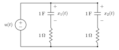
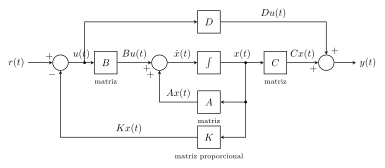
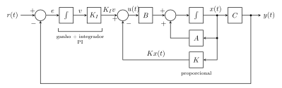

# Unidade 3 — Representação por Variáveis de Estado

## Representação por variáveis de estado

**Definição:** o estado $x(t_0)$ de um sistema no instante $t_0$ é a informação em $t_0$ que, junto com a entrada $u(t)$, determina, de forma única, a resposta do sistema para $t>t_0$.

O estado é geralmente representado na forma de um vetor:

$$
x(t)=\begin{bmatrix}x_1(t)\\x_2(t)\\\vdots\\x_n(t)\end{bmatrix}
$$

$x_1,x_2,\ldots,x_n$ são as variáveis de estado. A quantidade depende da ordem do sistema.

**Exemplo:** considere um sistema dado por:

  

**Solução:**

$$
u(t)=3i(t)+\frac{di(t)}{dt}+y(t)
$$

$$
i(t)=i_C(t)\Rightarrow i(t)=C\frac{dy(t)}{dt}=\frac12\frac{dy(t)}{dt}
$$

$$
u(t)=3\cdot\frac12\frac{dy(t)}{dt}+\frac12\frac{d^2y(t)}{dt^2}+y(t)
$$

$$
\frac{2u(t)}{2}=\frac{3\,dy(t)/dt+d^2y(t)/dt^2+2y(t)}{2}
$$

$$
\boxed{\frac{d^2y(t)}{dt^2}+3\frac{dy(t)}{dt}+2y(t)=u(t)}
$$

> Obs.: na equação em destaque está anotado $u(t)$; pelos valores do circuito e pelos cálculos seguintes, o termo é $2u(t)$.

Aplicando Laplace, temos:

$$
\begin{aligned}
s^2Y(s)-sy(0)-\dot y(0)+3(sY(s)-y_0)+2Y(s)&=2U(s)\\
s^2Y(s)-sy(0)-\dot y(0)+3sY(s)-3y_0+2Y(s)&=2U(s)\\
Y(s)(s^2+3s+2)&=y(0)(s+3)+\dot y_0+2U(s)
\end{aligned}
$$

$$
\underbrace{Y(s)}_{\text{Saída}}=
\underbrace{\frac{s+3}{s^2+3s+2}y(0)+\frac{1}{s^2+3s+2}\dot y(0)}_{\text{Condições iniciais}}
+\underbrace{\frac{2}{s^2+3s+2}U(s)}_{\text{Entrada}}
$$

**Obs.:** as variáveis de estado estão relacionadas a elementos “acumuladores de energia” do sistema.

**Equações de estado:** considere a equação diferencial anterior:

$$
\frac{d^2y(t)}{dt^2}+3\frac{dy(t)}{dt}+2y(t)=u(t)
$$

Definindo $x_1(t)=y(t)$ e $x_2(t)=\dot y(t)$ como variáveis de estado, temos:

$$
\begin{aligned}
\dot x_1(t)&=\dot y(t)=x_2(t)\tag{1}\\
\dot x_2(t)&=\ddot y(t)
\end{aligned}
$$

$$
\begin{aligned}
\ddot y(t)+3\dot y(t)+2y(t)&=2u(t)\\
\ddot y(t)&=-3\dot y(t)-2y(t)+2u(t)\\
\ddot y(t)&=-3x_2(t)-2x_1(t)+2u(t)
\end{aligned}
$$

Substituindo em $\dot x_2(t)=\ddot y(t)$:

$$
\dot x_2(t)=-2x_1(t)-3x_2(t)+2u(t)\tag{2}
$$

$$
y(t)=x_1
$$

Representando na forma matricial, temos:

$$
\begin{bmatrix}\dot x_1(t)\\\dot x_2(t)\end{bmatrix}=
\begin{bmatrix}0&1\\-2&-3\end{bmatrix}
\begin{bmatrix}x_1(t)\\x_2(t)\end{bmatrix}+
\begin{bmatrix}0\\2\end{bmatrix}u(t)
$$

$$
y(t)=\begin{bmatrix}1&0\end{bmatrix}\begin{bmatrix}x_1(t)\\x_2(t)\end{bmatrix}
$$

De uma forma geral, temos:

$$
\begin{aligned}
\dot x(t)&=Ax(t)+Bu(t)\\
y(t)&=Cx(t)+Du(t)
\end{aligned}
$$

$$
A\in\mathbb R^{n\times n},\quad B\in\mathbb R^{n\times m},\quad C\in\mathbb R^{p\times n},\quad D\in\mathbb R^{p\times m}
$$

## Relação entre representação de estado e função de transferência

Considere o sistema dado pela seguinte representação:

$$
\begin{aligned}\dot x(t)&=Ax(t)+Bu(t)\\y(t)&=Cx(t)+Du(t)\end{aligned}
$$

Aplicando a transformada de Laplace e considerando condições iniciais nulas, temos:

$$
\begin{aligned}sX(s)&=AX(s)+BU(s)\\Y(s)&=CX(s)+DU(s)\end{aligned}
$$

$$
\begin{aligned}X(s)(sI-A)&=BU(s)\\X(s)&=BU(s)(sI-A)^{-1}\end{aligned}
$$

Substituindo, obtemos:

$$
\begin{aligned}
Y(s)&=C\big(BU(s)(sI-A)^{-1}\big)+DU(s)\\
Y(s)&=\big[C(sI-A)^{-1}B+D\big]U(s)
\end{aligned}
$$

$$
\frac{Y(s)}{U(s)}=C(sI-A)^{-1}B+D
$$

> Obs.: a ordem dos fatores nos passos intermediários está como no caderno; para vetores-coluna, $X(s)=(sI-A)^{-1}BU(s)$.

**Exemplo:**

$$
\begin{bmatrix}\dot x_1(t)\\\dot x_2(t)\end{bmatrix}=\begin{bmatrix}0&1\\-2&-3\end{bmatrix}\begin{bmatrix}x_1(t)\\x_2(t)\end{bmatrix}+\begin{bmatrix}0\\2\end{bmatrix}u(t)
$$

$$
y(t)=\begin{bmatrix}1&0\end{bmatrix}\begin{bmatrix}x_1(t)\\x_2(t)\end{bmatrix}
$$

$$
G(s)=C(sI-A)^{-1}B+D
$$

$$
\begin{aligned}
G(s)&=\begin{bmatrix}1&0\end{bmatrix}\left(\begin{bmatrix}s&0\\0&s\end{bmatrix}-\begin{bmatrix}0&1\\-2&-3\end{bmatrix}\right)^{-1}\begin{bmatrix}0\\2\end{bmatrix}\\
&=\begin{bmatrix}1&0\end{bmatrix}\begin{bmatrix}s&-1\\2&s+3\end{bmatrix}^{-1}\begin{bmatrix}0\\2\end{bmatrix}
\end{aligned}
$$

$$
\begin{bmatrix}s&-1\\2&s+3\end{bmatrix}^{-1}=\frac{1}{s^2+3s+2}\begin{bmatrix}s+3&1\\-2&s\end{bmatrix}
$$

$$
\begin{aligned}
G(s)&=\begin{bmatrix}1&0\end{bmatrix}\frac{1}{s^2+3s+2}\begin{bmatrix}s+3&1\\-2&s\end{bmatrix}\begin{bmatrix}0\\2\end{bmatrix}\\
&=\begin{bmatrix}1&0\end{bmatrix}\frac{1}{s^2+3s+2}\begin{bmatrix}2\\2s\end{bmatrix}\\
&=\frac{2}{s^2+3s+2}
\end{aligned}
$$

## Realização da FT

$$
G(s)=\frac{b_ms^m+b_{m-1}s^{m-1}+\cdots+b_1s+b_0}{s^n+a_{n-1}s^{n-1}+\cdots+a_1s+a_0}
$$

**Exemplo:**

$$
G(s)=\frac{2s+3}{s^3+5s^2+7s+3}=\frac{Y(s)}{U(s)}
$$

$$
\frac{Y(s)}{U(s)}=\frac{2s+3}{s^3+5s^2+7s+3}\cdot\frac{W(s)}{W(s)}
$$

$$
\begin{aligned}Y(s)&=(2s+3)W(s)\\U(s)&=(s^3+5s^2+7s+3)W(s)\end{aligned}
$$

Definindo $X_1(s)=W(s)$, $X_2(s)=sW(s)$ e $X_3(s)=s^2W(s)$, temos:

$$
\begin{aligned}sX_1(s)&=sW(s)=X_2(s)\\sX_2(s)&=s^2W(s)=X_3(s)\end{aligned}
$$

$$
sX_3(s)=s^3W(s)
$$

$$
\begin{aligned}s^3W(s)+5s^2W(s)+7sW(s)+3W(s)&=U(s)\\s^3W(s)&=-3W(s)-7sW(s)-5s^2W(s)+U(s)\\s^3W(s)&=-3X_1(s)-7X_2(s)-5X_3(s)+U(s)\tag{3}\end{aligned}
$$

$$
\begin{aligned}Y(s)&=(2s+3)W(s)\\Y(s)&=3W(s)+2sW(s)\\Y(s)&=3X_1(s)+2X_2(s)\tag{4}\end{aligned}
$$

No domínio do tempo, temos:

$$
\begin{aligned}\dot x_1(t)&=x_2(t)\\\dot x_2(t)&=x_3(t)\\\dot x_3(t)&=-3x_1(t)-7x_2(t)-5x_3(t)+u(t)\\y(t)&=3x_1(t)+2x_2(t)\end{aligned}
$$

Na forma matricial, temos:

$$
\dot x(t)=\begin{bmatrix}0&1&0\\0&0&1\\-3&-7&-5\end{bmatrix}x(t)+\begin{bmatrix}0\\0\\1\end{bmatrix}u(t)
$$

$$
y(t)=\begin{bmatrix}3&2&0\end{bmatrix}x(t)
$$

## Controlabilidade

Considere um sistema representado por:

$$
\dot x(t)=Ax(t)+Bu(t)
$$

**Definição:** um sistema é dito controlável se, para todo estado inicial $x(t_0)=x_0$ e todo estado final $x(t_f)=x_f$, existe $u(t)$, $0\le t\le t_f$, tal que transfere o estado $x_0$ ao estado $x_f$ em um intervalo de tempo finito $t_f$ qualquer.

Portanto, um sistema representado pelo par $(A,B)$ é dito controlável se, e somente se, a matriz de controlabilidade dada por:

$$
\mathcal C=\begin{bmatrix}B&AB&A^2B&\cdots&A^{n-1}B\end{bmatrix}
$$

for tal que o posto da matriz de controlabilidade seja igual a $n$ ($\operatorname{posto}(\mathcal C)=n$).

**Exemplo:** considere um circuito elétrico:

  

**Solução:**

$$
V=Ri,\qquad i=i_C=C\frac{dv}{dt}
$$

$$
\begin{aligned}u(t)-x_1(t)-V_{R_1}&=0\\u(t)-x_1(t)-\dot x_1(t)&=0\\\boxed{\dot x_1(t)=-x_1(t)+u(t)}&\tag{I}\end{aligned}
$$

$$
\begin{aligned}u(t)-x_2(t)-V_{R_2}&=0\\u(t)-x_2(t)-\dot x_2(t)&=0\\\boxed{\dot x_2(t)=-x_2(t)+u(t)}&\tag{II}\end{aligned}
$$

Representando na forma matricial, temos:

$$
\dot x(t)=\underbrace{\begin{bmatrix}-1&0\\0&-1\end{bmatrix}}_{A_{n\times n}}x(t)+\underbrace{\begin{bmatrix}1\\1\end{bmatrix}}_B u(t)
$$

A matriz de controlabilidade é dada por:

$$
\mathcal C=\begin{bmatrix}B&AB\end{bmatrix}
$$

$$
AB=\begin{bmatrix}-1&0\\0&-1\end{bmatrix}\begin{bmatrix}1\\1\end{bmatrix}=\begin{bmatrix}-1\\-1\end{bmatrix}
$$

$$
\mathcal C=\begin{bmatrix}1&-1\\1&-1\end{bmatrix},\qquad\operatorname{posto}(\mathcal C)=1
$$

**Sistema não controlável.**

$$
\det(\mathcal C)=0\quad (\text{LD})
$$

$$
\det(\mathcal C)\ne0\quad (\text{LI})
$$

**Exemplo:** considere um sistema dado por:

  

$$
u(t)-V_R-V_L-V_C
$$

$$
\begin{aligned}i(t)&=x_1(t)\\V_R&=Rx_1(t)\\V_L&=L\frac{di(t)}{dt}=L\dot x_1(t)\\V_C&=x_2(t)\end{aligned}
$$

$$
L\dot x_1(t)=-Rx_1(t)-x_2(t)+u(t)
$$

$$
\boxed{\dot x_1(t)=-\frac RLx_1(t)-\frac1Lx_2(t)+\frac1Lu(t)}\tag{I}
$$

$$
\begin{aligned}i(t)&=i_C(t)\\x_1(t)&=C\dot x_2(t)\\\boxed{\dot x_2(t)=\frac1C x_1(t)}&\tag{II}\end{aligned}
$$

Na forma matricial:

$$
\dot x(t)=\begin{bmatrix}-R/L&-1/L\\1/C&0\end{bmatrix}x(t)+\begin{bmatrix}1/L\\0\end{bmatrix}u(t)
$$

A matriz de controlabilidade é dada por:

$$
\mathcal C=\begin{bmatrix}B&AB\end{bmatrix}
$$

$$
AB=\begin{bmatrix}-R/L&-1/L\\1/C&0\end{bmatrix}\begin{bmatrix}1/L\\0\end{bmatrix}=\begin{bmatrix}-R/L^2\\1/(LC)\end{bmatrix}
$$

$$
\mathcal C=\begin{bmatrix}1/L&-R/L^2\\0&1/(LC)\end{bmatrix}
$$

$\det(\mathcal C)\ne0\Rightarrow$ é LI. **Sistema controlável.**

## Controle por realimentação de estado

Considere um sistema que é representado por:

$$
\begin{cases}\dot x(t)=Ax(t)+Bu(t)\\y(t)=Cx(t)+Du(t)\end{cases}
$$

  

$$
u(t)=-Kx(t)+r(t)
$$

$$
K=\begin{bmatrix}K_1&K_2&K_3&\cdots&K_n\end{bmatrix}
$$

**Malha fechada:**

$$
\begin{aligned}\dot x(t)&=Ax(t)+B(-Kx(t)+r(t))\\y(t)&=Cx(t)+D(-Kx(t)+r(t))\end{aligned}
$$

$$
\begin{aligned}\dot x(t)&=Ax(t)-BKx(t)+Br(t)\\y(t)&=Cx(t)-DKx(t)+Dr(t)\end{aligned}
$$

$$
\begin{aligned}\dot x(t)&=(A-BK)x(t)+Br(t)\\y(t)&=(C-DK)x(t)+Dr(t)\end{aligned}
$$

- Controle: polos dominantes.
- Álgebra: 1) autovalores — determinante da matriz (acha os polos dominantes); 2) autovetores.

**Observação:** o comportamento do sistema em malha fechada é determinado pelos autovalores de $A-BK$.

## Projeto por alocação de polos

Consiste em determinar a matriz $K$, de modo que os autovalores de $A-BK$ sejam os desejados.

**Teorema:** se o par $(A,B)$ for controlável, então os valores de $A-BK$ podem ser alocados arbitrariamente.

**Exemplo:** calcule a matriz $K$ de modo que os autovalores de $(A-BK)$ sejam iguais a $-1$ e $-2$ para o seguinte sistema:

$$
\dot x(t)=\begin{bmatrix}-1&2\\-2&-1\end{bmatrix}x(t)+\begin{bmatrix}1\\0\end{bmatrix}u(t)
$$

$$
y(t)=\begin{bmatrix}0&1\end{bmatrix}x(t)
$$

**Solução:** a matriz de controlabilidade do sistema é dada por:

$$
\mathcal C=\begin{bmatrix}B&AB\end{bmatrix}
$$

$$
AB=\begin{bmatrix}-1&2\\-2&-1\end{bmatrix}\begin{bmatrix}1\\0\end{bmatrix}=\begin{bmatrix}-1\\-2\end{bmatrix}
$$

$$
\mathcal C=\begin{bmatrix}1&-1\\0&-2\end{bmatrix}
$$

$\det(\mathcal C)\ne0$, $\operatorname{posto}(\mathcal C)=2$ (sistema controlável).

**1) Polinômio desejado:**

$$
\Delta_d=(s+2)(s+1)
$$

$$
\Delta_d=s^2+3s+2\tag{1}
$$

**2) Polinômio de malha fechada:**

$$
\Delta_{mf}(s)=\det(A-BK-sI)
$$

$$
\begin{aligned}A-BK-sI&=\begin{bmatrix}-1&2\\-2&-1\end{bmatrix}-\begin{bmatrix}1\\0\end{bmatrix}\begin{bmatrix}K_1&K_2\end{bmatrix}-\begin{bmatrix}s&0\\0&s\end{bmatrix}\\
&=\begin{bmatrix}-1&2\\-2&-1\end{bmatrix}-\begin{bmatrix}K_1&K_2\\0&0\end{bmatrix}-\begin{bmatrix}s&0\\0&s\end{bmatrix}\\
&=\begin{bmatrix}-1-K_1-s&2-K_2\\-2&-1-s\end{bmatrix}\end{aligned}
$$

> Obs.: o manuscrito rotula as três primeiras linhas com $+sI$, embora as matrizes mostrem a subtração de $sI$.

$$
\begin{aligned}\Delta_{mf}&=\begin{vmatrix}-1-K_1-s&2-K_2\\-2&-1-s\end{vmatrix}\\
&=(-1-K_1-s)(-1-s)-(-2)(2-K_2)\\
&=1+K_1+s+s+sK_1+s^2+4-2K_2\\
&=s^2+s(K_1+2)+K_1-2K_2+5\end{aligned}
$$

Fazendo a igualdade de polinômios, temos:

$$
\begin{cases}\Delta_d=s^2+3s+2\\\Delta_{mf}=s^2+s(K_1+2)+K_1-2K_2+5\end{cases}
$$

$$
s^2+3s+2=s^2+s(K_1+2)+K_1-2K_2+5
$$

**I)**

$$
s(K_1+2)=3s
$$

$$
K_1=3-2\Rightarrow\boxed{K_1=1}
$$

**II)**

$$
\begin{aligned}K_1-2K_2+5&=2\\1-2K_2+5&=2\\-2K_2&=-5+2-1\\K_2&=\frac{-5+2-1}{-2}=\frac{-4}{-2}\end{aligned}
$$

$$
\boxed{K_2=2}
$$

## Seguidor robusto de referência

Considere o seguinte diagrama de blocos:

  

**Sistema:**

$$
\dot x(t)=Ax(t)+Bu(t)\tag{I}
$$

$$
y(t)=Cx(t)\tag{II}
$$

**Lei de controle:**

$$
u(t)=-Kx(t)+K_Iv\tag{III}
$$

$$
e(t)=r(t)-y(t)\tag{IV}
$$

Substituindo (III) em (I):

$$
\begin{aligned}\dot x(t)&=Ax(t)+B(-Kx(t)+K_Iv)\\\dot x(t)&=Ax(t)-BKx(t)+BK_Iv\end{aligned}
$$

> Obs.: o último termo da segunda linha está abreviado como $B_Iv$ no manuscrito.

$$
\dot v=e=r(t)-y(t)\tag{V}
$$

Substituindo (II) em (V):

$$
\boxed{\dot v=e=r(t)-Cx(t)}
$$

Na forma matricial, temos:

$$
\begin{bmatrix}\dot x\\\dot v\end{bmatrix}=
\underbrace{\begin{bmatrix}A&0\\-C&0\end{bmatrix}}_{\hat A}\begin{bmatrix}x\\v\end{bmatrix}-
\underbrace{\begin{bmatrix}B\\0\end{bmatrix}}_{\hat B}
\underbrace{\begin{bmatrix}K&K_I\end{bmatrix}}_{\hat K}\begin{bmatrix}x\\v\end{bmatrix}+
\begin{bmatrix}0\\1\end{bmatrix}r
$$

> Obs.: o sinal do ganho integral na expressão matricial difere do sinal apresentado na lei de controle anterior. Mantido conforme o manuscrito.

**Teorema:** se o sistema representado pelo par $(A,B)$ for controlável, então o par $(\hat A,\hat B)$ também é controlável.

> Obs.: em geral, a controlabilidade do sistema aumentado exige condições adicionais.

**Exemplo:** calcule $K$ e $K_I$ de modo a se ter rastreamento de referência constante e os seguintes autovalores de malha fechada: $-2$, $-2$ e $-2$, para o seguinte sistema:

$$
\dot x(t)=\begin{bmatrix}-1&2\\2&-1\end{bmatrix}x(t)+\begin{bmatrix}0\\1\end{bmatrix}u(t)
$$

$$
y(t)=\begin{bmatrix}0&1\end{bmatrix}x(t)
$$

**Solução:**

$$
\mathcal C=\begin{bmatrix}B&AB\end{bmatrix}
$$

$$
AB=\begin{bmatrix}-1&2\\2&-1\end{bmatrix}\begin{bmatrix}0\\1\end{bmatrix}=\begin{bmatrix}2\\-1\end{bmatrix}
$$

$$
\mathcal C=\begin{bmatrix}0&2\\1&-1\end{bmatrix}
$$

$\det(\mathcal C)\ne0\Rightarrow$ controlável. Posto = 2.

$$
\hat A=\begin{bmatrix}A&0\\C&0\end{bmatrix},\qquad\hat B=\begin{bmatrix}B\\0\end{bmatrix}
$$

> Obs.: nesta última expressão aparece $C$, sem o sinal negativo; a matriz numérica abaixo utiliza $-C$.

$$
\hat A=\begin{bmatrix}-1&2&0\\2&-1&0\\0&-1&0\end{bmatrix},\qquad\hat B=\begin{bmatrix}0\\1\\0\end{bmatrix}
$$

A matriz de controlabilidade é dada por:

$$
\mathcal C=\begin{bmatrix}\hat B&\hat A\hat B&\hat A^2\hat B\end{bmatrix}
$$

$$
\hat A\hat B=\begin{bmatrix}-1&2&0\\2&-1&0\\0&-1&0\end{bmatrix}\begin{bmatrix}0\\1\\0\end{bmatrix}=\begin{bmatrix}2\\-1\\-1\end{bmatrix}
$$

$$
\begin{aligned}\hat A^2\hat B&=\begin{bmatrix}-1&2&0\\2&-1&0\\0&-1&0\end{bmatrix}\begin{bmatrix}-1&2&0\\2&-1&0\\0&-1&0\end{bmatrix}\begin{bmatrix}0\\1\\0\end{bmatrix}\\
&=\begin{bmatrix}-1&2&0\\2&-1&0\\0&-1&0\end{bmatrix}\begin{bmatrix}2\\-1\\-1\end{bmatrix}=\begin{bmatrix}-4\\5\\1\end{bmatrix}\end{aligned}
$$

**1) Polinômio desejado:**

$$
\Delta_d=(s+2)(s+2)(s+2)
$$

$$
\Delta_d=s^3+6s^2+12s+8
$$

**2) Polinômio de malha fechada:**

$$
\Delta_{mf}(s)=\det(\hat A-\hat B\hat K-sI)
$$

$$
\hat K=\begin{bmatrix}K&K_I\end{bmatrix}\Rightarrow\hat K=\begin{bmatrix}K_1&K_2&K_I\end{bmatrix}
$$

$$
\hat A-\hat B\hat K-sI=\begin{bmatrix}-1&2&0\\2&-1&0\\0&-1&0\end{bmatrix}-\begin{bmatrix}0\\1\\0\end{bmatrix}\begin{bmatrix}K_1&K_2&K_I\end{bmatrix}-\begin{bmatrix}s&0&0\\0&s&0\\0&0&s\end{bmatrix}
$$

$$
\hat A-\hat B\hat K-sI=\begin{bmatrix}-1&2&0\\2&-1&0\\0&-1&0\end{bmatrix}-\begin{bmatrix}0&0&0\\K_1&K_2&K_I\\0&0&0\end{bmatrix}-\begin{bmatrix}s&0&0\\0&s&0\\0&0&s\end{bmatrix}
$$

$$
\hat A-\hat B\hat K-sI=\begin{bmatrix}-1-s&2&0\\2-K_1&-1-K_2-s&-K_I\\0&-1&-s\end{bmatrix}
$$

$$
\det(\hat A-\hat B\hat K-sI)=\begin{vmatrix}-1-s&2&0\\2-K_1&-1-K_2-s&-K_I\\0&-1&-s\end{vmatrix}
$$

Aplicando a regra de Sarrus, conforme o desenvolvimento manuscrito:

$$
\begin{aligned}
&=(-1-s)(-1-K_2-s)(-s)\\
&\quad-\big[(-1-s)(-K_I)(-1)+2(-s)(2-K_1)\big]\\
&=(s^2+s)(-1-K_2-s)-\big[(-K_Is-K_I)+(-4s+2K_1s)\big]\\
&=-s^3-(K_2+2)s^2+(-K_2-1)s-s(-K_I-4+2K_1)+K_I\\
&=-s^3-(K_2+2)s^2-(K_2+2K_1-K_I-3)s+K_I
\end{aligned}
$$

Multiplicando por $-1$, o polinômio fica:

$$
s^3+(K_2+2)s^2+(K_2+2K_1-K_I-3)s-K_I
$$

> Obs.: na última linha do manuscrito, as potências $s^2$ e $s$ foram omitidas; aqui foram explicitadas de acordo com a linha anterior.

Comparando com o polinômio desejado:

$$
-K_I=8\Rightarrow\boxed{K_I=-8}
$$

$$
K_2+2=6\Rightarrow\boxed{K_2=4}
$$

$$
K_2+2K_1-K_I-3=12\Rightarrow\boxed{K_1=\frac32}
$$

$$
\boxed{\hat K=\begin{bmatrix}\frac32&4&-8\end{bmatrix}}
$$

## Observabilidade

Considere um sistema representado por:

$$
\begin{aligned}\dot x(t)&=Ax(t)+Bu(t)\\y(t)&=Cx(t)+Du(t)\end{aligned}
$$

**Definição:** um sistema é dito observável se, para todo $x(0)$ desconhecido, o conhecimento da entrada $u(t)$ e da saída $y(t)$ em qualquer intervalo de tempo finito é suficiente para se determinar de forma única o estado inicial $x(0)$.

Portanto, um sistema representado pelo par $(A,C)$ é observável se, e somente se, a matriz de observabilidade dada por:

$$
\mathcal O=\begin{bmatrix}C\\CA\\\vdots\\CA^{n-1}\end{bmatrix}
$$

for tal que o posto de $\mathcal O$ seja $n$.

- $n$: ordem da matriz $A$.
- Se for igual, é observável; caso contrário, não é.

**Exemplo:** considere o seguinte circuito:

  

$$
u(t)=I_{R_1}+I_L=I_{R_1}+x_1(t)
$$

$$
I_{R_1}=\frac{V_{R_1}}2=\frac{V_L}2=\frac{L\,di(t)/dt}{2}=\frac{\dot x_1(t)}2
$$

$$
\dot x_1(t)=-2x_1(t)+2u(t)
$$

$$
\boxed{\dot x_1(t)=-2x_1(t)+2u(t)}
$$

  

$$
\begin{aligned}u(t)&=i_C+i_{R_2}\\i_C&=C\frac{dv}{dt}\\i_C&=\dot x_2(t)\\i_{R_2}&=x_2(t)\end{aligned}
$$

$$
\begin{aligned}u(t)&=\dot x_2(t)+x_2(t)\\\dot x_2(t)&=-x_2(t)+u(t)\\y(t)&=x_2(t)\end{aligned}
$$

$$
\dot x(t)=\begin{bmatrix}-2&0\\0&-1\end{bmatrix}x(t)+\begin{bmatrix}2\\1\end{bmatrix}u(t)
$$

$$
y(t)=\begin{bmatrix}0&1\end{bmatrix}x(t)
$$

A matriz de observabilidade:

$$
\mathcal O=\begin{bmatrix}C\\CA\end{bmatrix}
$$

$$
CA=\begin{bmatrix}0&1\end{bmatrix}\begin{bmatrix}-2&0\\0&-1\end{bmatrix}=\begin{bmatrix}0&-1\end{bmatrix}
$$

$$
\mathcal O=\begin{bmatrix}0&1\\0&-1\end{bmatrix}\Rightarrow\det(\mathcal O)=0
$$

**Sistema não observável.**

## Observador de estado

Tem por objetivo estimar os valores das variáveis de estado que não são medidas.

  

> Obs.: no desenho do caderno, a derivação da entrada para o observador aparece após o primeiro bloco $B$; aqui ambos os blocos recebem $u(t)$, conforme as equações.

**Sistema:**

$$
\begin{cases}\dot x(t)=Ax(t)+Bu(t)\\y(t)=Cx(t)\end{cases}
$$

**Observador:**

$$
\begin{cases}\dot{\hat x}(t)=A\hat x(t)+Bu(t)\\\hat y(t)=C\hat x(t)\end{cases}
$$

O erro de observação é dado por:

$$
e(t)=x(t)-\hat x(t)
$$

$$
\begin{aligned}\dot e(t)&=\dot x(t)-\dot{\hat x}(t)\\
\dot e(t)&=Ax(t)+Bu(t)-(A\hat x(t)+Bu(t))\\
\dot e(t)&=Ax(t)+Bu(t)-A\hat x(t)-Bu(t)\\
\dot e(t)&=Ax(t)-A\hat x(t)\\
\dot e(t)&=A(x(t)-\hat x(t))\\
\dot e(t)&=Ae(t)
\end{aligned}
$$

**Observador em malha fechada:**

$$
\begin{aligned}\dot{\hat x}(t)&=A\hat x(t)+Bu(t)+L(y(t)-\hat y(t))\\
\hat y(t)&=C\hat x(t)\end{aligned}
$$

$$
\begin{aligned}
\dot e(t)&=\dot x(t)-\dot{\hat x}(t)\\
\dot e(t)&=Ax(t)+Bu(t)-[A\hat x(t)+Bu(t)+L(y(t)-\hat y(t))]\\
\dot e(t)&=Ax(t)+Bu(t)-A\hat x(t)-Bu(t)-L(y(t)-\hat y(t))\\
\dot e(t)&=Ax(t)-A\hat x(t)-L(y(t)-\hat y(t))
\end{aligned}
$$

$$
y(t)=Cx(t)\qquad\text{e}\qquad\hat y(t)=C\hat x(t)
$$

$$
\begin{aligned}\dot e(t)&=Ax(t)-A\hat x(t)-LC[x(t)-\hat x(t)]\\
\dot e(t)&=Ae-LCe\\
\dot e(t)&=e(A-LC)
\end{aligned}
$$

> Obs.: na primeira linha do desenvolvimento do erro, o manuscrito não coloca os pontos de derivação em $x$ e $\hat x$; foram explicitados de acordo com a equação anterior. Na última linha, para vetor-coluna, a forma matricial é $(A-LC)e(t)$.

Autovalores de $A-LC$:

$$
L=\begin{bmatrix}l_1&l_2&\cdots&l_n\end{bmatrix}^{T}
$$

**Se estimar corretamente, o erro é nulo.**

| Símbolo | Significado |
| --- | --- |
| $\hat x$ | Estado estimado |
| $x$ | Estado |
| $\dot{\hat x}$ | Derivada do estado estimado |
| $\dot x$ | Derivada do estado |

**Teorema:** os autovalores de $A-LC$ podem ser arbitrariamente alocados por uma escolha adequada de $L$ se, e somente se, o sistema representado pelo par $(A,C)$ for observável.

**Exemplo:** considere o seguinte sistema:

$$
\dot x(t)=\begin{bmatrix}-1&2\\2&-1\end{bmatrix}x(t)+\begin{bmatrix}1\\0\end{bmatrix}u(t)
$$

$$
y(t)=\begin{bmatrix}0&1\end{bmatrix}x(t)
$$

Calcule a matriz $L$ de modo a alocar os autovalores de $A-LC$ em $-12$ e $-12$.

**Solução:**

$$
\mathcal O=\begin{bmatrix}C\\CA\end{bmatrix}
$$

$$
CA=\begin{bmatrix}0&1\end{bmatrix}\begin{bmatrix}-1&2\\2&-1\end{bmatrix}=\begin{bmatrix}2&-1\end{bmatrix}
$$

$$
\mathcal O=\begin{bmatrix}0&1\\2&-1\end{bmatrix}\Rightarrow\det(\mathcal O)\ne0
$$

**Sistema observável.**

**1) Polinômio desejado:**

$$
\Delta_d=(s+12)(s+12)
$$

$$
\Delta_d=s^2+24s+144
$$

**2) Polinômio de malha fechada:**

$$
\Delta_{mf}(s)=\det(A-LC-sI)
$$

$$
\begin{aligned}A-LC-sI&=\begin{bmatrix}-1&2\\2&-1\end{bmatrix}-\begin{bmatrix}l_1\\l_2\end{bmatrix}\begin{bmatrix}0&1\end{bmatrix}-\begin{bmatrix}s&0\\0&s\end{bmatrix}\\
&=\begin{bmatrix}-1&2\\2&-1\end{bmatrix}-\begin{bmatrix}0&l_1\\0&l_2\end{bmatrix}-\begin{bmatrix}s&0\\0&s\end{bmatrix}\\
&=\begin{bmatrix}-1-s&2-l_1\\2&-1-l_2-s\end{bmatrix}
\end{aligned}
$$

$$
\begin{aligned}\Delta_{mf}(s)&=(-1-s)(-1-l_2-s)-2(2-l_1)\\
&=1+l_2+s+s+l_2s+s^2+2l_1-4\\
&=s^2+(2+l_2)s+2l_1+l_2-3
\end{aligned}
$$

Comparando com o polinômio desejado:

$$
2+l_2=24\Rightarrow\boxed{l_2=22}
$$

$$
l_2+2l_1-3=144\Rightarrow\boxed{l_1=62{,}5}
$$

$$
\boxed{L=\begin{bmatrix}62{,}5&22\end{bmatrix}^{T}}
$$
